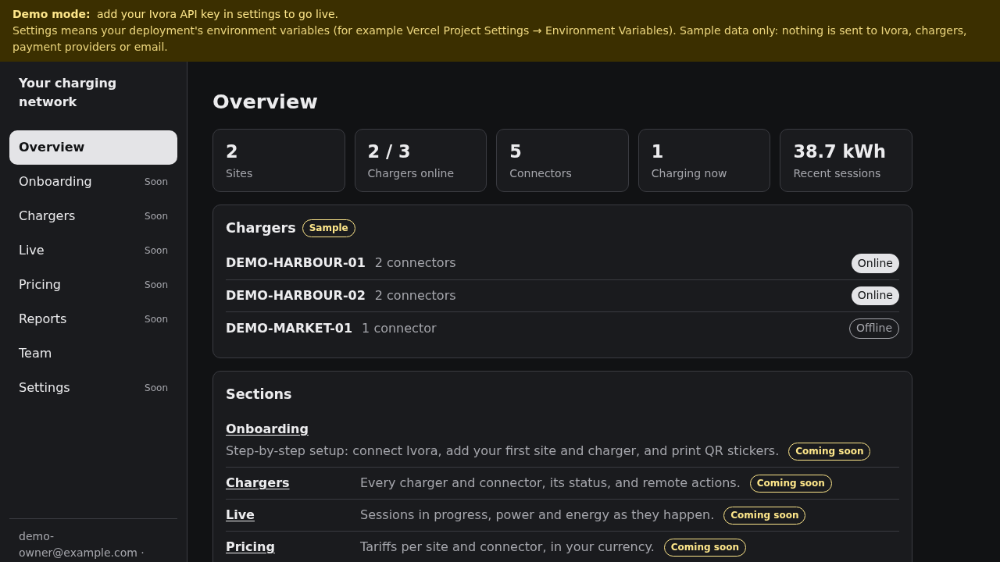
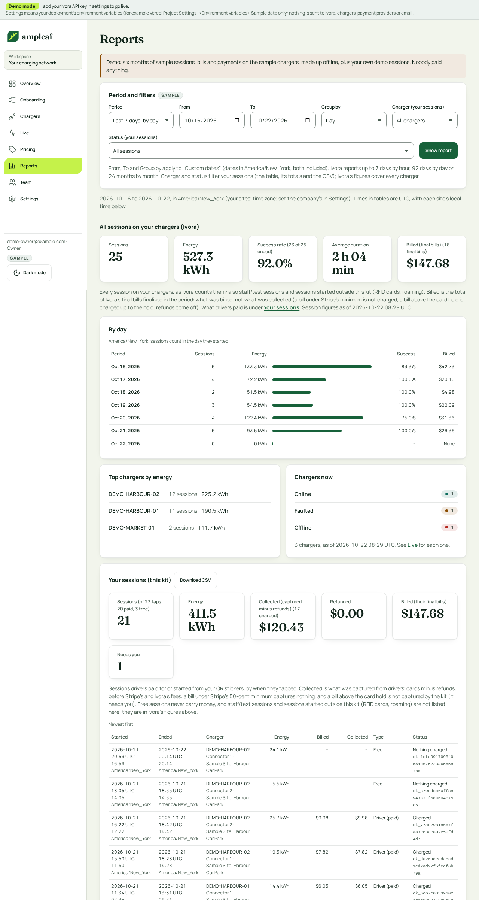

# CPO Starter Kit

> **In progress.** This is part 8 of the kit: the app shell, demo mode, the Ivora client, the team (staff sign-in and roles on Supabase), onboarding (company details, brand, Stripe status), chargers (add, test, QR stickers), the Live view (map and list, status and faults, remote start, stop, reset and unlock), pricing (tariffs with per-kWh, time-of-use, idle and session fees; free and private chargers) and driver checkout (scan a sticker, pay by card through Ivora Checkout into your own Stripe account, or start a free session; the kit stops a paid session before it uses up the card hold, then finalizes the bill and captures exactly what was used) and reports (sessions, energy, success rate and billed revenue from Ivora's statistics; your sessions with what was collected, captured minus refunds, from the kit's own records, with CSV export; and a link to your Stripe payouts). Sections marked "Coming soon" are filled in by later parts. **Live payments need the settlement sweep** (`CRON_SECRET` and a scheduler calling it every minute; see [Driver checkout](#driver-checkout)).

An operations app for small charging operators (CPOs) with no developers on staff. You fork it, put your own name on it, connect your Ivora project and go live: onboarding, chargers, live sessions, pricing, reports and your team in one place, on your own domain.



## Make it yours in 5 minutes

The kit ships as **Ampleaf**, a placeholder brand you are meant to replace. Everything about it lives in [`brand/`](brand), and components use only its tokens.

1. **Name and copy:** `brand/brand.ts` (product name, tagline, support line). A rename is the one `name` line. Your business name is `OPERATOR_NAME` (below); it shows as the workspace in the sidebar and in page titles.
2. **Colours, type scale, radius, spacing:** `brand/tokens.css`. Each colour is `light-dark(<light>, <dark>)`. If you change `--color-bg`, change `lib/theme.ts` to match (a test checks it). Run `npm test`: `tests/contrast.test.ts` fails if a text pair drops below WCAG AA (4.5:1) in either mode.
3. **Logo:** `brand/logo.svg` (standalone file) and `brand/Logo.tsx` (the same shapes inline, so it follows the theme). Keep both in step.
4. **Fonts:** put woff2 files in `brand/fonts/` and point `brand/fonts.ts` at them. Use open-licensed fonts and keep their license files next to them.
5. **Icons:** `brand/icons.tsx`, one entry per section slug from `lib/modules.ts`.

**Lime marks what is current or live** (the current page, the demo chip). `--color-accent` is a fill only, always with `--color-on-accent` text on it, and never a text colour on the page or a card: it is unreadable there. `tests/contrast.test.ts` fails if a stylesheet or component uses it as text. If you change the accent, keep that rule.

The design brief, the approved mock and the palette are `brand/BRIEF.md`, `brand/mock.html` and `docs/brief/`. Screenshots of the main screens in light and dark, desktop and phone, are in `docs/screens/`.

### Fonts and icons

- [Manrope](https://github.com/sharanda/manrope), Copyright 2019 The Manrope Project Authors, SIL Open Font License 1.1 (`brand/fonts/OFL-Manrope.txt`).
- [Fraunces](https://github.com/undercasetype/Fraunces), Copyright 2020 The Fraunces Project Authors, SIL Open Font License 1.1 (`brand/fonts/OFL-Fraunces.txt`).
- Section, menu and theme icons: [Lucide](https://lucide.dev), ISC License, Copyright (c) Lucide Contributors.
- Live map: [Leaflet](https://leafletjs.com), BSD-2-Clause, Copyright (c) 2010-2023 Volodymyr Agafonkin, (c) 2010-2011 CloudMade. Map data and tiles © [OpenStreetMap](https://www.openstreetmap.org/copyright) contributors (ODbL), credited on the map itself.
- The Ampleaf mark is original, Apache-2.0 with this template.

## What it does today

- **App shell:** phone-first and keyboard accessible (skip link, labelled navigation, visible focus, 44 px tap targets). On a phone the sections are behind a Menu button; on a wide screen they are a sidebar. Light and dark mode follow the system setting, with a toggle. Every colour, font, size, radius and spacing is a token in [`brand/tokens.css`](brand/tokens.css) (see "Make it yours in 5 minutes" below).
- **Overview:** sites, chargers online, connectors, sessions charging now and recent energy, read from Ivora (or from sample data in demo mode).
- **Team:** staff sign in with email and password or an emailed sign-in link. Owners and managers invite staff by email (a link that works once and expires in 72 hours), change roles and remove people. The last owner can't be removed or demoted.
- **Onboarding and Settings:** a three-step setup wizard (Company, Brand, Payments) and a Settings page with the same forms. See [Onboarding](#onboarding) below.
- **Chargers:** add a charger (site, station and a random connection password), run a connection test and an optional remote start and stop test, print a QR sticker per connector, edit and remove. See [Chargers](#chargers) below.
- **Live:** a map and a list of sites, chargers and connectors with live status (online, offline, faulted; each connector's status), open and recent faults, sessions charging now, and remote start, stop, reset and unlock. See [Live](#live) below.
- **Pricing:** tariffs with a per-kWh price, time-of-use periods, an idle fee after a grace period and an optional session fee, or free; previews priced by Ivora's own simulation; a new Ivora tariff for every change; a tariff per charger or connector; private chargers. See [Pricing](#pricing) below.
- **Driver checkout:** a driver scans a charger's QR sticker, sees the charger, its status and price on your own domain, and taps "Pay and charge": the kit creates an Ivora bill and a hosted payment, and the driver pays by card through Ivora Checkout into your own Stripe account. When the session ends the kit finalizes the bill and captures exactly the final amount; unused holds are released. On a free tariff the driver taps "Start free session" instead. See [Driver checkout](#driver-checkout) below.
- **Setup checklist** on the Overview, for owners and managers: company details, brand, Stripe ready, first charger and first price (a tariff assigned to a charger).
- **Reports:** Ivora's figures for every session on your chargers (sessions, energy, success rate, average duration and billed revenue per currency over a period you pick, by hour, day or month in your time zone; top chargers and charger state). Below them, your own sessions from the kit's records: what was collected (captured minus refunds), refunded and billed, a table in UTC and site time with filters, and a streamed CSV export. A link to your Stripe dashboard's payouts. See [Reports](#reports) below.

### Onboarding

Owners and managers only: technicians and viewers see a short note instead, and every server action checks the role on the server (and again in the database, in the same statement as the write).

- **Company details:** name (what drivers see), support email, an optional https support URL, an optional https website, time zone (IANA; times are stored in UTC and shown in it) and currency (ISO 4217; money stays in integer minor units). Saved in Supabase (`cpo_company_profiles`).
- **Brand:** a colour (`#rrggbb`) and an optional logo. Saving pushes the name, colour and support contacts to Ivora's driver payment pages with `PUT /branding`, then uploads the logo with `PUT /branding/logo`. The driver pages fill buttons and headings with the colour on white, so a colour below 3:1 against white (for example `#ffff00`, about 1.1:1) goes to them as the lightest darker shade of itself that reaches 3:1; the form shows that shade and its ratio as you type, and the kit keeps your own colour for its theme. The logo is checked in the browser first (type and size, so a large file gets a clear message rather than a generic upload error) and again on the server from its own bytes, with the API's limits: PNG, JPEG or WebP (never SVG), at most 512 KB, 32 to 2048 px a side, not animated. Ivora stores and serves the image; the kit keeps only its URL. If a push fails, the details stay saved, the page says so with the API's error, and **Push to Ivora again** retries. The card form itself is Stripe Checkout, whose look comes from your Stripe account's branding settings.
- **The brand colour themes the kit**, with a contrast check: it replaces the kit's primary colour (buttons, links, focus) only in the modes where links reach 4.5:1 on the page and on cards and button text reaches 4.5:1 on it (WCAG AA). Otherwise that mode keeps the kit's own colour. The form shows the ratios as you type, including the colour against white for the driver pages. The rules are in [`lib/brand-colors.ts`](lib/brand-colors.ts) and `tests/brand-colors.test.ts`.
- **Payments (Stripe via Ivora Checkout):** the kit reads `GET /payment/stripe/v1/tenants/{id}/account` and shows **Not connected** (`none` or `disconnected`), **Pending** (connected, but Stripe can't take charges yet), **Awaiting Ivora approval** (`pending_review`) or **Ready** (`active` with `charges_enabled`), plus Stripe's open requirements, the disabled reason and test or live mode. API keys can't create Stripe onboarding links (the API refuses them), so the kit links to your Ivora dashboard (`IVORA_DASHBOARD_URL`, plus `IVORA_DASHBOARD_STRIPE_PATH` if your dashboard has a deep link to the project's payment settings; without it the link opens the dashboard home) to connect Stripe there, and **Check status again** re-reads it. **The kit stores no Stripe keys.**
- **Idempotency:** a branding push uses `cpo-branding-<operator>-put-<pushes so far>-<content hash>`, and a logo upload `cpo-logo-<operator>-put-<uploads so far>-<image hash>`. A retry of the same push reuses its key; going back to an earlier brand later gets a new key, so it isn't answered with the stored reply to the first push.
- **Demo mode** keeps the demo company in your browser's cookie, never uploads the logo (it is only checked), and has a **Demo: simulate a Stripe status** switch for every state. Nothing is sent to Ivora, Stripe or Supabase.

### Chargers

Everyone on the team sees the chargers; technicians, managers and owners add, test, edit them and print stickers; only managers and owners remove a charger that is registered in Ivora. Every server action checks the role on the server, and the database checks it again in the same statement as the write.

- **List:** every station in your Ivora project, with its site, connectors and online status. Stations added elsewhere (for example with the installer kit) show too; the kit starts its own record for one the first time someone tests it, prints its stickers or edits it.
- **Add:** a connection name (the OCPP identity, 3 to 36 letters, digits, `-` or `_`), an optional display name, 1 to 8 connectors, and an existing site or a new one. The kit saves its own record first, then creates the site (if new) and the station with `external_reference` `cpo-site-<record>` and `cpo-charger-<record>`, and sets a random 24-character password with `PUT /stations/{id}/credentials`. The page then shows the OCPP connection URL, the charge point ID and the password, with copy buttons. **The password is shown once**: it is never stored, logged or shown again (you can set a new one).
- **Uncertain outcomes:** each step has an `Idempotency-Key` derived from the record (`cpo-site-<record>-create`, `cpo-charger-<record>-create`, `cpo-credentials-<record>-set-<n>`). If a step's outcome is unknown (a lost response, `503 outcome_unknown`), the charger stays "Not registered yet" and **Finish adding** repeats the same steps with the same keys; a create that already happened is found by its `external_reference`. If Ivora refuses the station outright (for example `station_name_taken`) at an existing site, nothing was created, so the record is dropped and you can send the form again. If the kit had just created a new site for it, the site stays in Ivora and its ID stays on the unfinished charger, so **Finish adding** reuses it instead of creating a second one; if the name was the problem, remove the unfinished charger and add it again at that site.
- **Connected chargers and limits:** an offline station stores the password for its next connection, and a connected OCPP 2.0.1 or 2.1 station receives it. A connected OCPP 1.6 station is refused by Ivora (`station_online`): the kit says to disconnect it first or change the password in the charger's own settings. Ivora limits how often a password can change; a long `Retry-After` is not waited out, and the kit says in how many minutes to try again. `password_unconfirmed` is never retried: set a new password before the charger connects.
- **Connection test:** reads the station and checks it is **online**, has **booted** (sent its BootNotification, so vendor or model is known) and sent a message in the last 5 minutes (**heartbeat**; Ivora asks for a 60-second heartbeat interval). It sends nothing to the charger.
- **Remote start and stop test (optional):** behind a required "I understand this starts the charger" box. It sends `start` on the chosen connector (with the operator's staff token, the same one as Live's remote start, created once if missing; an operator command that authorizes no payment), follows the session in `GET /transactions`, and `stop` ends it, with keys `cpo-charger-<record>-test-<n>-start` and `-stop`. It passes when the charger accepts both and reports the session; energy (kWh) is 0 without a vehicle. Safety rules:
  - It starts only on a connector Ivora reports as `Available`, so never next to a driver's session (a charger that only accepts a remote start with a vehicle plugged in, `Preparing`, can't run this test).
  - One test per charger at a time: the start is claimed in the same database statement that counts the attempt (`cpo_claim_charger_test`), so a double click or a second tab gets "a test is already running" and only one `start` is sent.
  - It only ever follows and stops its own session: one with the test ID tag (the API shows it as `****TEST`), on the test's connector, started no earlier than the test. A driver's session is never adopted or stopped.
  - If Ivora's answer to the start is uncertain (a timeout, `503 outcome_unknown`, `409 request_in_progress`), the test stays "Starting": **Check again** finds the session if the start did reach the charger, and **Stop the test** stops it. Only a definite refusal fails the test. With no session after 2 minutes it fails; if the charger did start anyway, stop it at the charger.
- **QR stickers:** one per connector, each with a random eight-character code (no 0, O, 1 or I) on your own domain: `<PUBLIC_BASE_URL>/c/<code>`. The code is the kit's own, never a database or Ivora ID, so you can move hosting or replace a charger without reprinting. See [QR codes](#qr-codes-on-your-own-domain). The sticker page prints black on white from the browser.
- **Edit:** the display name (the kit's own) and the site (`PATCH /stations/{id}` with `location_id`, key `cpo-charger-<record>-move-<n>`). The connection name can't change once a charger has connected; add it again under a new name instead.
- **Remove (managers and owners only):** asks for confirmation and explains what happens in Ivora. Technicians can only discard a charger the kit never registered in Ivora (an unfinished add). `DELETE /stations/{id}` deletes a station that never charged (disconnecting it first). One with charging history stays in Ivora (`409 station_has_history`), so its sessions stay in your records, and the kit hides it. A running session must be stopped first (`transaction_active`). Either way the kit keeps its record, marked removed, so the charger's stickers say "not in service" instead of pointing at something else.
- **Demo mode** simulates everything in your browser's cookies: a new charger "connects" two seconds after its password is set and "boots" a moment later, test sessions run at 7.4 kW, and the sample chargers behave like connected OCPP 1.6 chargers (their password can't be changed remotely). Demo stickers use the demo's own address and say "Demo, not for printing". Nothing is sent to Ivora or a charger.

### Live

Everyone on the team sees the Live view; technicians, managers and owners send commands. Every server action checks the role on the server, and the database checks it again in the same statement that claims the command.

- **List:** sites, then their chargers, each with its state (Online, Offline, or Faulted when it has an open fault or a Faulted connector) and every connector's status as the charger reports it (`Available`, `Preparing`, `Charging`, `Faulted`, …). Sessions charging now (energy in kWh, the token's last 4 characters as the API shows it) and open faults (from each station's `open_faults`). The list is plain server-rendered HTML: it works without the map and without scripts. Status is never colour alone: a word plus a dot, square or diamond.
- **Map:** [Leaflet](https://leafletjs.com) (BSD-2-Clause) with [OpenStreetMap](https://www.openstreetmap.org/copyright) tiles, which need no API key, attributed "© OpenStreetMap contributors" on the map. One marker per site with coordinates (the site's `latitude` and `longitude` in Ivora), showing its worst state in words (tooltip), shape and colour; clicking it scrolls to the site in the list. OpenStreetMap's tiles are for light use ([tile usage policy](https://operations.osmfoundation.org/policies/tiles/)); for heavier use set `MAP_TILE_URL` (and `MAP_TILE_ATTRIBUTION`, `MAP_TILE_ATTRIBUTION_URL`) to another provider that needs no key in the browser, or `MAP_TILE_URL=off` for markers without tiles. Sites without coordinates are in the list only.
- **A charger's page** (`/live/stations/<id>`) adds its sessions, its fault history (`GET /stations/{id}/faults`: open and cleared faults, kept 90 days by Ivora) and its recent commands, and is where commands are sent.
- **Commands (technicians and above):** remote start, stop (one session), reset (soft or hard) and unlock (one connector). Each opens a confirmation that says what it does and needs an "I understand" tick before it can be sent.
- **Remote start** goes only to an `Available` connector, never a `Preparing` one: a driver who has plugged in starts and pays through the normal flow. It uses the operator's own **staff token**, not a shared tag: on the first remote start the kit makes a random token (`STAFF` and 15 random characters, stored in `cpo_staff_tokens`) and registers it once in your Ivora token list (`POST /tokens`, type `Central`, label "Staff remote start (CPO kit)", external reference `cpo-staff-<operator ID>`, `Idempotency-Key` `cpo-staff-token-<operator ID>-create`). A token already in Ivora under that reference is adopted; a blocked one stops remote starts until you accept it again in Ivora. Sessions started with it are labelled **staff/test session** in Live, on the Overview and in the charger test, and carry the token in Ivora's sessions and reports, so they show in revenue. A start counts as done only when a session with the staff token starts on that connector, never a driver's own session.
- **A driver's session is never ended implicitly.** A stop, a reset (soft or hard) and an unlock of a connector in use end sessions, so the confirmation lists each one by session ID, connector, start time, energy and token, and each needs its own tick. The server re-reads the charger's sessions before sending and refuses if any session the command would end was not named (for example one that started after the confirmation was opened).
- **One tap, one command:** each confirmation carries a random request ID. The command is claimed in one database statement (`cpo_claim_live_command`) that checks the role, refuses while another command on the same charger is still waiting for an answer (a second tab gets "another command is still waiting"), and returns the existing command for the same request ID (a double click or a resubmitted form), so only one command is ever sent. Its `Idempotency-Key` is `cpo-command-<record>-<action>`.
- **Observed, not assumed:** the kit sends `POST /stations/{id}/commands`, then follows the operation (`GET /operations/{id}`) for a few seconds. Only a definite refusal fails a command: a `4xx` from the API, a `rejected` operation (with Ivora's code), or the charger answering anything but `Accepted` (or `Unlocked`, `Scheduled`). A timeout, `503 outcome_unknown` or `409 request_in_progress` leaves it **Waiting for answer**. **Check again** only reads its status (the operation, if Ivora returned one) and never sends anything. If Ivora never confirmed the send, **Send again** is a separate button with its own tick, offered for one minute after the first send: the server reads the charger's sessions again and sends the same command with the same key and body, which the API answers with the original operation if the first send arrived. If a session the command would end started since the confirmation (or, for a start, the connector is no longer free), or the minute has passed, the command is closed as **Outcome unknown** instead: check the charger and send a new, confirmed command. It is never resent with a new key, and a double click or resubmitted form only shows the command it already made. An operation whose outcome is `unknown` is shown as **Outcome unknown** and never resent. A command left waiting for 15 minutes is closed as unknown. Even an accepted command only says the charger accepted it; the view then shows what it sees happen: the new session, the session ended, the charger restarting and back online, the connector unlocked.
- **Updates:** Ivora webhooks (`station.connected`, `station.disconnected`, `station.booted`, `connector.status_changed`, `station.fault_opened`, `station.fault_cleared`, `charging_session.status_changed`, `operation.completed`, `meter.sampled`) arrive at `/api/webhooks/ivora`. The route verifies `Ivora-Signature` (HMAC-SHA256 of `<t>.<raw body>`, constant-time, timestamps within 5 minutes) before parsing, checks the tenant, stores the event ID once (`cpo_ivora_events`; a redelivery is acknowledged without processing it again, and IDs are purged after 7 days), acknowledges with `200` at once, and does the work after the response. The event is only a cue: an `operation.completed` re-reads its operation from the API before a command records it, a charger event settles that station's [driver checkouts](#driver-checkout) from the API, and open Live pages re-read the API. An event the kit could not store gets a `500`, so Ivora delivers it again.
- **Refresh and rate limits:** an open Live page asks the kit's own `/api/live/changes` every 5 seconds (a database read, no Ivora request) and re-reads the page when a webhook or command moved it. One page never re-reads Ivora more than once every 10 seconds. A slow full re-read covers webhook downtime: every 2 minutes with webhooks, every 30 seconds without `IVORA_WEBHOOK_SECRET`. While a command waits for its answer, the page re-reads every 10 seconds for up to 2 minutes. Hidden tabs do nothing. After a `429`, the page waits for Ivora's `Retry-After` (at least 10 seconds, a minute without one) before it reads again, and says so.
  - **Request budget** (the default is 180 requests a minute per key): a Live page re-read costs about 2 requests (sites, chargers; more pages for over 100 sites or chargers) plus at most 5 operation reads; a charger page about 3 (charger, faults, sites) plus its pending command's operation. On top, the [session tracking](#running-sessions) below makes at most 50 requests and stops after 8 seconds or at the first `429`, whichever comes first; usually far fewer: one list page per charger due for a scan (each charger at most every 30 seconds, at most 10 per load), one read per new session, and one per running session with no news for 2 minutes (at most 10 per load; a stalled one every 30 minutes). With webhooks most sessions have news, so few are re-read. Each webhook that names a session costs one read: a `charging_session.status_changed` always, a `meter.sampled` (about every minute per session) at most once every 5 minutes per session. A quiet fleet of 10 chargers with one open page costs about 25 requests a minute without webhooks (2 re-reads, each scanning all 10); several open pages share the scans (the throttle is per charger, in the database), so pages add only their own 2 to 3 requests per re-read. A cold start with many long-history chargers is spread over several loads (see below), and if Ivora answers `429` the page waits for its `Retry-After`. Keep a few Live pages open rather than many. Sending a command adds a few requests (charger, sessions, the command, up to 8 operation reads), and the first remote start 2 more (find and register the staff token).
- <a id="running-sessions"></a>**Running sessions (Live counts, the session list, "staff/test" and "free" labels, the charger page):** `GET /transactions` lists sessions **oldest first**, with no date or active filter, and its items carry no ID token or connector, so "the newest 100" would be the oldest. The kit tracks running sessions itself in a small table (`cpo_active_sessions`, service-role only) and reads each session's details with `GET /transactions/{id}`. A session enters the table from: a webhook that names it (`charging_session.status_changed`, whose transaction is `data.session.usage.transaction_id`; its `resource_id` is the session's own `ecs_` ID; and `meter.sampled` or a connector event with a `transaction_id`), the kit's own stop commands and free checkouts, and a **scan** of each station's list from a stored high-water mark (`cpo_active_marks`: the last transaction ID the scan is done with, never paged from 0 twice). The scan reads in full only items not known to have ended, so a station with 1,000 old sessions and 2 current ones costs a few list pages and 2 reads. A session that ended stays ended in the table (a late "running" report can't reopen it) and is kept for a day for the charger page. Live and the commands read **every** running session (paged, never capped, by charger where one is meant), so a busy day can't push an overnight session out of the counts or out of a reset's confirmation; the charger page lists its ended sessions 20 at a time ("Older ended sessions"). A session whose energy has not grown for 12 hours while Ivora still reports it running is shown as "no energy for 12 hours" and read every 30 minutes instead of every 2. A session Ivora answers `404` for is dropped, and the sessions and marks of chargers removed from Ivora are dropped too. A value the table can't hold (a negative energy, an unreadable time) is stored as unknown, and a row the kit can't read is skipped with a log, so one odd answer can't break the page.
  - **Without webhooks** (no `IVORA_WEBHOOK_SECRET`): nothing breaks, it is slower. A new session is found by the next scan (each station is scanned at most every 30 seconds, whichever server instance serves the page, up to 10 stations per page load, so many chargers take a few loads), and a session that ended is noticed when it has had no news for 2 minutes and is read again (up to 10 per load). With webhooks a session appears and ends at the moment of its event, and is re-read only after 2 minutes of silence. A gap in webhooks (downtime, lost deliveries) heals the same way.
  - **Cold start and long histories:** a station with no mark yet and no transaction ID above 2,000 is scanned from 0. Above that, the first scan seeds the mark with a binary search on `after=<x>&limit=1` for the newest ID (about 2 × log₂ of it, tiny requests, even for 50,000 sessions), then keeps 1,000 IDs of margin below it and scans from there. The search saves its progress after each request (`cpo_active_marks`), so a search cut short by a page load's budget (a slow Ivora) carries on where it stopped on the next load instead of starting again; if a webhook already named one of the charger's sessions, the search starts from that ID. At most 2 chargers are seeded per page load; the others follow on the next loads, and until each has been scanned once the page says the list may be incomplete. IDs are shared by all of Ivora's stations, so the margin is in IDs, not sessions. A session that has been running longer than that margin when the kit is first connected is not found by the scan; it appears with its next `meter.sampled` or `charging_session.status_changed` webhook, so register the webhook with `meter.sampled`.
  - If a read fails (a `429`, an outage) the page shows what the kit knows with a note that the list may lag; after a `429` the tracking stops at once and the page waits for its `Retry-After`. The note also shows when the budget left work that matters for later: a charger never scanned or not scanned for 5 minutes, or a session not read for 10 minutes; not for the routine rotation of a large fleet. A charger command that depends on the sessions (start, stop, reset, unlock) re-reads that charger's sessions within the same budget and refuses instead of guessing if anything was cut. When Ivora's `/transactions` gains date and active filters, the scan can be replaced by one filtered read.
- **Demo mode** simulates the commands in your browser's cookies: stopping the sample session ends it, a reset takes the charger offline for a few seconds (ending its sessions) and clears its sample fault, unlock answers `Unlocked`, and a remote start begins a simulated session. The map shows the sample sites (at made-up coordinates in the open sea) without tiles, so the demo stays offline. Demo mode accepts no webhooks. Nothing is sent to Ivora, a charger or a tile server.

#### Register the webhook

After deploying with your own domain (`APP_URL`):

```sh
npm run ivora:webhook -- register https://ops.example.com/api/webhooks/ivora
```

It reads `IVORA_API_KEY` and `IVORA_TENANT_ID` from `.env.local` (the key needs `webhooks:write` as well as the read scopes of the events: `stations:read`, `billing:read`), refuses a URL that is not public `https` on port 443 at `/api/webhooks/ivora`, and prints the signing secret **once**: add it as `IVORA_WEBHOOK_SECRET` in the deployment and redeploy. Then check the signature handling with `npm run ivora:webhook -- test <id>` and `npm run ivora:webhook -- deliveries <id>`. `list` and `disable <id>` manage endpoints. If an active endpoint for the same URL exists, it refuses (Ivora shows a secret only once): keep its secret, or disable it and register again. The registration's `Idempotency-Key` is derived from the URL, the events and the number of earlier endpoints for that URL, so a retry after a lost response can't create a second endpoint. Use one endpoint per deployment, with its own secret.

### Pricing

Owners and managers only (the section, every page and every server action check the role on the server, and the database checks it again in the same statement as the write): prices decide what drivers pay.

- **Tariff editor:** a name, paid or free, the time zone of its periods (the company's by default), the price per kWh, an optional session fee, an optional idle fee per minute with a grace period (10 minutes by default where Ivora applies grace periods, 0 where it can't yet; see below), up to 4 time-of-use periods (days, from, until, price per kWh; an end before the start runs past midnight; periods may not overlap) and optionally your own text for drivers. Amounts are kept as integer minor units, parsed from the text (no floating point). **Paid tariffs are in US dollars:** Ivora Checkout settles card payments in USD and the card hold is a dollar amount, so a paid tariff needs the company currency set to USD in Settings (free tariffs work in any currency). A tariff keeps the currency it was created in.
- **Ivora elements (OCPI 2.2.1-aligned):** each period becomes an `ENERGY` element restricted to its `start_time`, `end_time` and `day_of_week`, followed by one unrestricted element with the base `ENERGY` price, the session fee (`FLAT`) and the idle fee (`PARKING_TIME`, per hour, `step_size` 60 so it bills per started minute). Ivora prices each moment with the first element that applies, so the periods win during their hours. Ivora checks `day_of_week` against the local day of each moment, so an overnight period on chosen days is sent as two elements: "Fri 22:00–06:00" is Friday from 22:00 (`start_time` only) and Saturday until 06:00 (`end_time` only); Sunday night runs into Monday. An overnight period on every day stays one element. The tariff carries `time_zone` and `tariff_alt_text` (English): your text, or the kit's description of the prices. A free tariff is one `ENERGY` element at 0 with no card hold. A paid tariff's hold (`authorization_minor`) is 2500 US cents ($25.00), in `lib/server/pricing/tariff.ts`; a preview that costs more than the hold shows a warning.
- **Idle fee and grace period:** Ivora bills `PARKING_TIME` on real sessions for every minute a car is plugged in but not charging: after charging ends, and while charging is paused (the charger reports `SuspendedEV` or `SuspendedEVSE`). The driver text says so ("per minute plugged in but not charging"). The grace period is Ivora's own rule, `rules.idle_grace_minutes`, sent with the tariff and its simulation: Ivora leaves the first minutes of idle time free and reports them as `idle_free_seconds`. The kit never subtracts minutes itself: previews send every idle minute and show the free minutes and billed quantity Ivora returns. **The rule is newer than the published OpenAPI**, and an API that does not have it refuses the field. So before saving a grace period the kit asks Ivora's simulation, and only saves it when the answer shows the rule applied (`idle_free_seconds`); otherwise it refuses with "Ivora can't apply an idle grace period for this account yet" and asks you to set the grace to 0 minutes (or drop the idle fee). So that a first save isn't refused, the editor asks the same simulation when it opens and starts the grace field at 0 where Ivora can't apply it (or can't be asked). With 0, drivers pay from their first idle minute and the driver text says so.
- **Preview:** "Preview price" sends the draft and a session (date, from, until, kWh, idle minutes, in the tariff's time zone; by default today from 18:00 to 20:30, 30 kWh, 15 idle minutes) to `POST /tariffs/simulate`, which validates the draft as creation would and prices it with the billing function. The charging time is the real time elapsed, across a change of clocks too (01:00 to 03:00 is one hour the night clocks go forward); a time that does not happen that night is refused, and one that happens twice is the first. The page shows Ivora's lines, amounts and total exactly as returned ("A 30 kWh session on … from 18:00 to 20:30 … costs $16.50"); the browser never prices anything. Ivora's validation problems (`422 tariff_invalid`, every entry of `details.errors`) are listed under the form.
- **Versions, never edits:** the kit never changes an Ivora tariff in place. Saving creates the next version as a new Ivora tariff (`POST /tariffs`, `external_reference` `cpo-tariff-<tariff>-v<n>`, `Idempotency-Key` `cpo-tariff-<tariff>-v<n>-a<attempt>-create`), then archives the previous version (`DELETE /tariffs/{id}?replacement_tariff_id=<new>`, key `cpo-tariff-<tariff>-v<old>-archive-to-v<n>`), which moves any connectors and charger displays that used it in Ivora to the new one. Bills snapshot their tariff when they are created, so past and open bills keep their price. If Ivora refuses a version outright, it is dropped and nothing changes; its number is never used again, so a key is never sent with a second body. If the answer is uncertain (a lost response, `503 outcome_unknown`), the version stays "Not confirmed by Ivora", drivers keep the previous version and another save is refused. **Finish saving** first looks the version up by its reference (`GET /tariffs?external_reference=`) and adopts it if Ivora has it; if not, it sends the same body as a new attempt with a new key (repeating the old key would only replay the uncertain answer). If an earlier attempt lands in between and the new one is answered `409 external_reference_taken`, the kit looks the version up again and adopts it (never drops it). **Discard this draft** gives up instead: anything Ivora made for the draft is archived (nothing uses it yet) and drivers keep the current version. Discarding waits until 2 minutes after the version's latest create attempt started, so a create Ivora is still finishing can't land after the lookup and leave an unused tariff behind.
- **Two people editing at once:** every save names the revision of the tariff or charger the form was loaded at, and the database refuses it if someone saved in between ("Someone changed this tariff after you opened it. Reload the page…"). So a stale editor can't put back an old price, and a stale charger form can't make a private charger public again.
- **Your own text for drivers:** a new version with changed prices but the same text you wrote before is refused until you update the text, clear it (the kit's description is used) or tick "My text for drivers matches these prices".
- **Which tariff each connector uses:** the Pricing page lists every charger with each connector's tariff and where it comes from (the charger's, or the connector's own), plus the tariff Ivora has on the connector if any (what charger screens show). **The public API has no call to set a connector's tariff**, so assignments are the kit's own (`cpo_station_pricing`, `cpo_connector_tariffs`): the kit's [driver checkout](#driver-checkout) creates each bill with the connector's tariff (`tariff_id`), and a connector without one is not for sale. Only tariffs Ivora has confirmed can be assigned.
- **Free and private chargers:** a free tariff has zero price and no hold, so it has no card checkout (Ivora Checkout needs a hold of at least $0.50): its sticker page offers **Start free session** instead (see [Free sessions](#free-sessions)). A private charger has no public QR checkout: its sticker page says it is for staff and RFID card holders only (who start it with their card, or staff from Live). **"Private" is enforced by the kit only:** Ivora does not know about it, so Ivora-hosted payment pages, a QR code shown on the charger's own screen and roaming partners over OCPI are not blocked by it. So treat it as "no QR checkout from this kit", not as a block on public charging.
- **Demo mode** starts with two sample tariffs ("Sample: Standard" with an evening peak period, idle and session fees; "Sample: Free staff charging") on the sample chargers, DEMO-MARKET-01 private. Your tariffs and assignments stay in your browser's cookie. Previews are priced offline on the server by a demo stand-in for Ivora's simulation (`lib/server/ivora/demo-pricing.ts`, the documented rules for the elements the kit builds), labelled "Demo". Nothing is sent to Ivora.

### Driver checkout

Drivers are not staff: the sticker's page is public, and the kit checks everything itself on the server (the sticker, the charger, its connector, the price, private, Stripe) before it asks Ivora for anything. **Money goes to your own Stripe account** (the one connected in [Onboarding](#onboarding)) through Ivora's payments API. **The kit holds no Stripe keys** and never sees a card.

1. **The sticker's page** (`/c/<code>`, on your own domain) shows your name, the charger and connector, the connector's status (Available, Plugged in, In use, Offline, or what the charger reports), the tariff's text for drivers, the card hold (the Ivora tariff's `authorization_minor`, read with `GET /tariffs/{id}`), and Ivora's price for an example session (20 kWh over an hour, starting now: `POST /tariffs/{id}/quote`, which prices with the same function bills finalize with). The UI follows forecourt-checkout's driver page.
2. **"Pay and charge"** checks the connector (online, and `Available` or `Preparing`) and the Stripe account (`active` with `charges_enabled`), **claims the connector** (see below), then creates a bill with the connector's tariff (`POST /bills`) and a hosted payment for it (`POST /payment/stripe/v1/tenants/{tenant_id}/payments` with `return_surface: driver` and a `return_reference`), and sends the driver to the payment's checkout page. The payment's `next_action` must be an `https` page, or the driver is not redirected. The driver has 15 minutes to pay; tapping again within them reopens the same page.
3. **After paying, Stripe returns the driver to Ivora's payment page, which can't show this kit's session yet.** With `return_surface: driver` the API chooses where Stripe returns the driver, and that page resumes Ivora-hosted checkouts only, not bills an application created through the API. So the sticker's page tells drivers to come back to it (scan the sticker again, or keep it open) to follow their session. A decision on resuming API bills there, or returning to your own domain, is pending with Ivora; the kit will switch over when it lands. The kit does not have its own live-session page yet either.
4. **A driver who comes back** to the sticker's page sees their own session (from an HTTP-only cookie holding the random ID of their tap; no personal data): waiting for payment, plug in, charging (kWh and the cost so far), finished (what was charged and what was released), not charged, didn't start. Reading the bill there also lets Ivora start the charger once paid (the documented driver-return rule). If Ivora's automatic start was refused (for example the charger was offline), the bill stays `authorized` and the page offers **Start charging** to that driver only (`POST /bills/{id}/start`), and only while the connector is `Available`. A refused start releases the hold at once, and the page says so. A running session has **Stop charging** for that driver.

**Settlement.** Ivora never finalizes or captures a bill by itself, so the kit does, for every checkout still in progress:

- **Stops before the hold is used up:** while charging, once Ivora's estimate reaches 90% of the hold (for example $22.50 of $25.00), the kit stops the session (`POST /stations/{id}/commands`, `stop`) and records it with `POST /v1/billing/bills/{id}/alerts` (`hold_stop`). 80 kWh at $0.35 would cost $28.00; the kit stops it at about 61 kWh ($22.50 with the $1.00 session fee), so the final bill stays within the hold. The other 10% covers what is charged between two checks: with a fast DC charger, raise the tariff's hold. If the charger is still charging 5 minutes later, the kit sends the stop once more (`-hold-stop-retry`); if it still charges 5 minutes after that, Live shows the session under **Driver sessions that need you** ("Still charging after the hold stop"), so you can stop it on the charger's page or on site.
- **Settles against the bill's hold:** the hold shown on the page is the tariff's, but once the bill exists the kit records the bill's `hold_minor` (the one Ivora authorizes and caps the capture at) and settles against it, also when it differs from the tariff's (for example a hold raised in Ivora).
- **Sessions the charger never ends:** if a running session's energy hasn't changed for 12 hours while Ivora still sees it running (a charger that lost its StopTransaction, or a car left plugged in all night), the kit sends one stop (`-stall-stop`), frees the connector for other drivers, finalizes and captures what the bill says (retrying with the same keys until Ivora sees the session end), and shows it in Live ("The charger never ended a session"). If Ivora still can't finalize it 24 hours after the checkout, it goes to `attention`: settle the bill in Ivora before the card hold lapses (about 7 days). A free session that stalls is stopped the same way and goes straight to `attention` (there is nothing to settle).
- **Finalizes and captures** once the session has ended: `POST /bills/{id}/finalize` with the completed `transaction_id` (Ivora reads the energy itself and computes the immutable total), then `POST …/payments/{id}/capture`, which captures exactly the final bill (no amount is sent). A zero bill, or one below Stripe's 50-cent minimum, releases the hold instead. A bill above its hold (possible only if charging went on unchecked) is refused by Ivora with `bill_exceeds_hold` and goes to your attention (Ivora's staff capture the hold; the rest is not charged).
- **Releases unused holds** (`POST …/payments/{id}/release`): a payment page not completed within 15 minutes, a paid session not started within 30 minutes, a refused start (at once), a failed start, or a start with no car plugged in within 20 minutes. While a dispatched start could still produce a session, Ivora answers `start_reserved` and the kit tries again later with the same key.
- **When it runs:** on each driver page view, on each Ivora webhook for that station (`connector.status_changed`, `meter.sampled`, …), and on the **settlement sweep**, `GET /api/cron/settle` with `Authorization: Bearer <CRON_SECRET>`, which settles up to 50 checkouts per call, least recently checked first. It starts no new checkout after 25 seconds (one Ivora read can take 20 s with 429 waits) and the route's `maxDuration` is 60 seconds; the rest wait for the next call. It then copies a few ended sessions' details and refunds for [Reports](#reports) (reads only). **For live payments, call the sweep every minute** (Vercel Cron on a plan with per-minute schedules sends exactly that header, or any scheduler you run), and register the webhook with `meter.sampled` (re-run `npm run ivora:webhook -- register` if you registered it before this version). Without `CRON_SECRET` (at least 32 characters) the sweep refuses every call.

- **One driver per connector:** a checkout holds its connector from the tap until it ends (waiting for payment, or running). The claim is one database statement (`cpo_claim_checkout`, a unique index on the connector for open checkouts), so a second driver at the same moment is told the connector is in use **before any bill or hold**. `tests/concurrency.test.ts` races two drivers on one connector against a real Postgres.
- **Idempotency:** each checkout is the kit's own record (`cpo_checkouts`), claimed by the page's random request ID, so a double tap or a resubmitted form continues the same checkout. Every key derives from its ID: `cpo-checkout-<id>-bill`, `-payment`, `-start`, `-stop`, `-hold-stop`, `-hold-stop-retry`, `-stall-stop`, `-finalize`, `-capture` and `-release`. An uncertain answer (`503 outcome_unknown`, `409 request_in_progress`, a lost response) keeps the checkout open, and the next try repeats the same request with the same key: one bill, one payment, one capture, never a second charge. Only a definite refusal fails a checkout; the page then starts a new one.
- **Three separate values:** the record's ID (the keys; never sent to a browser), the tap's request ID (the driver's capability, in their HTTP-only cookie; never sent to Ivora or Stripe), and the payment's `return_reference` (its own random `ck_…` value, since it ends up in Ivora's and Stripe's URLs).
- **Clear errors:** an offline charger, a connector in use (or reserved, finishing, suspended, or another driver's checkout), one that is faulted or unavailable, a Stripe account that isn't ready (`409 payment_account_required` or `payment_account_not_ready` too), a price that changed meanwhile, and private or unpriced connectors each get their own message saying what to do. "Pay and charge" is off while one applies, and while this browser already has a session there. A message never says "nothing was charged" while a hold is in place. Ivora's error code and request ID are shown small for support.
- **Rate limits:** per client address 10 per 10 minutes and 2 per connector per hour (with the 15-minute payment window, one person who never pays can hold a connector for at most half an hour), and 300 per operator per hour in total; without a trusted client address, 20 per connector per hour instead (the client address as in [Security](#security)). Free sessions count too, and the limits are checked before anything is read from Ivora or written. Demo mode, which sends nothing, has none. Page views share short-lived reads (a charger's status for 5 seconds, the Stripe account for a minute, the hold and the example quote for 15 minutes), so opening the page often can't spend your Ivora rate limit.
- **Staff and test sessions** (started with the operator's staff token, see [Live](#live)) are not checkouts and are never counted as driver payments; a connector they use is "in use" to drivers.
- **Demo mode** simulates the whole flow with nothing charged: "Pay and charge" opens the demo's own checkout page (standing in for Stripe Checkout), "Pay with demo card" authorizes a simulated hold and returns to the sticker's page, the simulated charger starts (7.4 kW) and shows the cost so far, **Stop charging** ends it, and the session is finalized and "captured" offline, with a demo receipt (charged, hold released). A payment page not paid within 15 minutes is released. **Demo: simulate** on the sticker page shows the errors for an offline charger, a connector in use and a Stripe account that isn't ready. Everything stays in the visitor's cookies; nothing is sent to Ivora, Stripe or a charger.

#### Free sessions

On a connector whose tariff is free right now, the sticker's page offers **Start free session**, with no payment. The kit starts the charger with the operator's **free charging token**, registered once in Ivora like the staff token (`POST /tokens`: type `Central`, `external_reference` `cpo-free-<operator id>`, label "Free charging (CPO kit)"; an existing one is adopted). It reads the token from Ivora on every start, so **blocking it in Ivora turns free starts off** at once. The rules:

- **Free only:** the connector's tariff is read again right before the command; a tariff that turned paid while the page was open never gets a free start (it is refused and the driver sees the price). A paid tariff never uses the free token.
- **Available only**, like staff remote starts: a connector that reports `Preparing` (a car plugged in, perhaps someone else's) is refused, with how to start again.
- The same one-driver-per-connector claim and rate limits as paid checkouts; the start carries `cpo-checkout-<id>-start`. An uncertain start stays open and **stoppable** (it may have reached the charger), and the same tap within a minute repeats it with the same key. With no session after 5 minutes, the connector is free again.
- **Finding the session:** `GET /transactions` lists a station's sessions **oldest first**, with no date or active filter, and its items carry no ID token or connector. So the kit keeps a **high-water mark per station** (`cpo_transaction_marks`, the highest transaction ID it is done with) and pages on from it (`GET /transactions?station_id=…&after=<mark>`), reading each new session in full (`GET /transactions/{id}`) and matching it to the free checkout it belongs to: the free token (as the API masks it), the checkout's connector, and a start no earlier than the tap. One scan serves every free checkout at the station, and the mark moves only over sessions older than 5 minutes, so none is skipped. Older sessions are paged past by their start time without being read. A transaction ID in a webhook is read and matched the same way. The first scan of a station with a long history pages through it once (up to 20 pages of 100 per scan, carried on by the next); after that a scan is usually one read. The helper (`lib/server/live/transactions.ts`) is shared with Live's session tracking (which keeps its own mark, `cpo_active_marks`, because this scan passes over sessions that are not its concern). On a first scan of a station with a long history the mark is seeded near its newest ID (see Running sessions), so a new free session is found in a few small requests.
- Free sessions are labelled **free** in Live and counted as free on the Overview, never as staff/test or paid sessions. (Live and the Overview still label from the newest list page, whose items carry no ID token on Ivora; see [Limits](#limits-and-next-steps).)

### Reports



Everyone on the team (viewers and above) sees Reports: the page and the CSV export check the role on the server. Reports never send a charger command or move money. The page has two parts, kept apart on purpose:

1. **All sessions on your chargers (Ivora's figures, `GET /stats`).** Every session, however it started: drivers who paid through the kit, free sessions, staff/test sessions, and **sessions started outside this kit** (RFID cards, roaming partners). Ivora leaves sessions on its own test stations out of these figures.
2. **Your sessions (this kit).** Only the sessions drivers paid for or started from your QR stickers, read from the kit's own checkout records, with what was actually collected.

Sessions started outside this kit are counted in the figures but **can't be listed one by one** in this version. Ivora's transaction list (`GET /transactions`) has no date filter and lists oldest first, so the kit never scans it for a period. They will be listed once the API can filter transactions by date.

- **Period:** last 24 hours (by hour), 7, 30 or 90 days (by day), 12 months (by month), or custom dates with a bucket of your choice. Dates and buckets are in the **report's time zone**: the company's (Settings), else the one all your sites share (the location's `time_zone` in Ivora), else UTC.
  - **Within Ivora's limits:** every preset fits one statistics request (at most 168 hour, 92 day or 24 month buckets, and 50,000 sessions).
  - **Too large:** Ivora answers a custom period past those limits with `422 stats_range_too_large`. The page says so in words: the code, the limits, and "pick a shorter period, or show it by day/month". Your sessions still show.
- **Ivora's figures** (`GET /stats`, top 5 chargers):
  - Sessions (and how many are charging) and energy in kWh.
  - Success rate: ended sessions that delivered energy and did not stop on a fault, reset, power loss, timeout or deauthorization.
  - Average duration.
  - **Billed (final bills)** per currency, in integer minor units: Ivora's final bills finalized in the period. This is **what was billed, not what was collected.** A bill under Stripe's 50-cent minimum captures nothing, a bill above the card hold is not captured beyond it, and refunds come off later. Without `billing:read` it shows "Needs billing:read".
  - A series per bucket (oldest first) with a bar for energy, the top chargers by energy, and how many chargers are online, faulted and offline now.
  - Ivora caches session figures (60 seconds by hour, 5 minutes by day, 15 minutes by month), and the page says as of when.
- **Your sessions** come from the kit's checkout records (`cpo_checkouts`), by the time the driver tapped "Pay and charge" or "Start free session", through the database functions `cpo_report_checkouts` and `cpo_report_totals` (one date index, `cpo_checkouts_reports`). Filters: the period, a charger and a status. The statuses are in progress, charged, refunded, nothing charged (released, failed, free, or under Stripe's minimum) and needs you (for example a bill above its hold). Totals cover every matching session; the table shows 50 a page, newest first.
  - **Collected = captured minus refunded**, per currency, before Stripe's and Ivora's fees. It is never the bill total. A $0.30 bill released under the $0.50 minimum counts as $0 collected; a $27.40 bill above a $25 hold is not counted as collected while it needs you (it shows under Billed only). If Ivora's staff then capture the hold, the sweep reads that from the payment, and the $25.00 counts as collected (the row turns **charged**).
  - **Refunded** and **Billed (their final bills)** are shown separately.
  - **Session types** come from the kit's own record: **Driver (paid)** or **Free** (the operator's free charging token). Free sessions never carry money.
  - **Staff/test sessions** (Live remote starts and the charger test, with the staff token) are not checkouts. They are not in this table and never in driver revenue; Ivora's figures count them.
  - Each row: the start and end in UTC with the site's local time below, charger, connector and site, energy, billed, collected (and refunded), type, status and the checkout reference (`ck_…`). A checkout with no session (the driver never paid) shows when they tapped.
- **What the kit copies from Ivora (the settlement sweep):** every run of `GET /api/cron/settle` (see [Driver checkout](#driver-checkout)), after settling, reads a few records:
  - **Session details:** up to 10 ended sessions' details from `GET /transactions/{id}` (start, end, energy in Wh, connector number and stop reason), once each, for sessions settled in the last 30 days. Until then a row says "details pending" (and while a session runs, the energy so far from settlement).
  - **Payments:** up to 10 payments from `GET /payments/{id}`, each once a day for 90 days after settlement (`cpo_report_payments_due`): charged ones for their `refunded_minor`, and paid sessions that need you (for example a bill above its hold) for a `captured_minor` from Ivora's staff capturing the hold. That capture is kept capped at the hold and never replaces a capture the kit made itself. Refunds are made outside the kit (the Ivora dashboard or API); the page says how many charged sessions have not been checked yet. A refund made more than 90 days after a session is not picked up: see Stripe.
  - That is at most 20 reads a minute, far inside the default 180 requests a minute per key. A read that fails is tried again on a later run. The sweep only reads from Ivora; the database keeps an ended session's details once and never records a refund above what was captured (`cpo_record_checkout_details`, `cpo_record_checkout_payment`). The sweep starts no new read 30 seconds after the cron call began (settlement runs first; one read can take 20 seconds with 429 waits), so a run ends inside the route's 60-second limit, and the rest wait for the next run.
- **CSV export** (**Download CSV**, `GET /reports/export` with the page's period, charger and status): `text/csv`, UTF-8, comma-separated, CRLF line ends, one header line. The columns never change order (see the table below).
  - **Streamed** from the kit's database, 500 rows at a time, newest first, each page after the last row of the one before (a keyset on the full database timestamp, to the microsecond, and the record ID), so sessions that start while it downloads shift nothing and sessions in the same millisecond are never skipped. The file ends as soon as a page comes back short or empty. No Ivora request per row.
  - **Up to 10,000 rows per file.** The kit counts the matching sessions before it starts; more than that is refused with `422` and "pick a shorter period, one charger or one status".
  - **A cut-off export fails visibly.** A database error before the download is an error status (`502`). The export has 45 seconds **from the request's start**, counting the site and charger reads before it (the route's limit is 60): out of time before the first byte is `504`; once streaming, a failed read, a read that hangs, or running out of time makes the download fail. It never ends as a clean file with rows missing.
  - **Formulas are defused:** text that a spreadsheet might run as a formula gets a leading `'`. That is text starting with `=`, `+`, `-`, `@`, their full-width forms (`＝`, `＋`, `－`, `＠`), or any space, tab or line break.

  | Column                   | Meaning                                                                                                                                                                                                                      |
  | ------------------------ | ---------------------------------------------------------------------------------------------------------------------------------------------------------------------------------------------------------------------------- |
  | `session_ref`            | The kit's checkout reference (`ck_…`)                                                                                                                                                                                        |
  | `session_type`           | `paid` or `free`                                                                                                                                                                                                             |
  | `status`                 | `in_progress`, `charged`, `no_charge` or `attention` (needs you)                                                                                                                                                             |
  | `created_at_utc`         | When the driver tapped, ISO 8601 UTC: the time the period filters on                                                                                                                                                         |
  | `started_at_utc`         | The session's start as Ivora recorded it, ISO 8601 UTC; empty until its details are copied, and when there was no session                                                                                                    |
  | `ended_at_utc`           | The session's end, ISO 8601 UTC; empty likewise                                                                                                                                                                              |
  | `time_zone`              | The site's IANA time zone (the report's when the site has none)                                                                                                                                                              |
  | `started_at_local`       | Start in that zone, ISO 8601 with its offset, e.g. `2026-10-01T10:00:00-05:00`                                                                                                                                               |
  | `ended_at_local`         | End in that zone                                                                                                                                                                                                             |
  | `duration_seconds`       | Whole seconds from start to end as Ivora recorded them; empty until both are copied (never "until now")                                                                                                                      |
  | `site`                   | Site name                                                                                                                                                                                                                    |
  | `station_id`             | Ivora station ID                                                                                                                                                                                                             |
  | `station`                | The charger's OCPP connection name                                                                                                                                                                                           |
  | `connector_id`           | Connector resource ID                                                                                                                                                                                                        |
  | `connector_number`       | OCPP connector number; empty until the details are copied                                                                                                                                                                    |
  | `energy_wh`              | Energy delivered, integer Wh; empty until the details are copied                                                                                                                                                             |
  | `energy_kwh`             | The same energy as exact kWh text                                                                                                                                                                                            |
  | `stop_reason`            | The charger's stop reason, as Ivora reports it                                                                                                                                                                               |
  | `transaction_id`         | Ivora's transaction resource ID; empty when there was no session                                                                                                                                                             |
  | `bill_id`                | The Ivora bill of a paid session                                                                                                                                                                                             |
  | `currency`               | ISO 4217 currency of a paid session; empty for free sessions                                                                                                                                                                 |
  | `hold_minor`             | The card hold, integer minor units (cents)                                                                                                                                                                                   |
  | `billed_minor`           | The final bill's total; empty until final                                                                                                                                                                                    |
  | `captured_minor`         | What was captured from the card: `0` when the hold was released (for example a bill under Stripe's minimum); empty while unsettled, or while it needs you and nothing is captured (a hold Ivora's staff captured shows here) |
  | `refunded_minor`         | Refunded of the captured amount, as the payment last said                                                                                                                                                                    |
  | `net_minor`              | `captured_minor` minus `refunded_minor`: what was collected, before fees                                                                                                                                                     |
  | `refunds_checked_at_utc` | When the sweep last read the payment (refunds, and a capture of a session that needed you); empty if not yet                                                                                                                 |
  | `details`                | `recorded`, `pending` (not copied from Ivora yet) or `no_session`                                                                                                                                                            |

- **Payouts:** drivers pay through Ivora Checkout into your own Stripe account, and Stripe pays out to your bank after Stripe's and Ivora's fees. **The kit holds no Stripe keys in this version** and reads no payouts.
  - The Payouts card links to your Stripe dashboard's payouts page: `https://dashboard.stripe.com/payouts`, or `/test/payouts` for a test-mode account.
  - The link opens Stripe's sign-in if you aren't signed in. With several Stripe accounts, switch to the one connected in Onboarding. An Express account may see its payouts in its own Express dashboard instead.
  - With no Stripe account connected yet, the card points to Onboarding instead.
- **Request budget:** a Reports page costs 1 statistics read, sites and chargers (1 each per 100) and the Stripe account; the CSV export none beyond sites and chargers. The sweep adds at most 20 reads a minute.
- **Demo mode** reports six months of sample history on the sample chargers (3 to 7 sessions a day, made up offline from a hash of each day), plus the visitor's own demo sessions.
  - **Sample sessions:** paid sessions (some refunded, some never paid and released, some above the hold), free, staff/test and RFID sessions; the last two only in Ivora's figures, as for a real operator.
  - **Offline stand-ins:** the kit's records come from `lib/server/ivora/demo-history.ts`. `GET /stats` is an offline stand-in with the same rules and limits, so a period that is too long shows `stats_range_too_large` there too.
  - Nothing is sent to Ivora or Stripe.

### QR codes on your own domain

Stickers stay on a wall for years, so their QR codes point at your own domain, read from `PUBLIC_BASE_URL` (or `APP_URL` if that is not set; never the hosting provider's default URL). Live mode refuses to show printable stickers until it is a stable `https://` origin of your own, and refuses:

- Ivora domains (`ivoracharge.com`, `ivoracharge.co` and their subdomains),
- hosting providers' default domains such as `*.vercel.app`, and link shorteners,
- `http://`, `localhost`, IP addresses, and a URL with a path, query or credentials,
- any preview deployment (`VERCEL_ENV=preview`): its codes would not exist in production.

`/c/<code>` is public (drivers are not staff) and is where [driver checkout](#driver-checkout) starts, or says the charger is private or "not in service" for a removed charger. Stickers keep working whatever changes later, because only this page decides where a code goes.

### Roles

| Role       | May                                                                                                                          |
| ---------- | ---------------------------------------------------------------------------------------------------------------------------- |
| Owner      | Everything, including prices and inviting, promoting and removing owners.                                                    |
| Manager    | Company details, brand and payments; prices and tariffs; remove chargers; invite, change and remove technicians and viewers. |
| Technician | Add, test and edit chargers, print stickers, and start, stop, reset and unlock chargers in Live.                             |
| Viewer     | Read the overview, chargers, Live and reports. Cannot change anything.                                                       |

Nobody can remove themselves; ask another owner. Roles are stored in the `cpo_staff` table and checked on the server, never read from user metadata. Every page and every server action starts with `requireRole(min)` from [`lib/server/auth.ts`](lib/server/auth.ts), which later modules use too.

## Run locally

Requires Node.js 22.13 or later.

```sh
npm ci
npm run dev
```

With no credentials it starts in **demo mode**, with a persistent banner: "Demo mode: add your Ivora API key in settings to go live". _Settings_ means your deployment's environment variables (for example Vercel Project Settings → Environment Variables, or `.env.local` locally); the kit has no in-app key entry. Live mode also needs Supabase (below).

In demo mode you are signed in as a labelled demo owner (`demo-owner@example.com`), with sample sites and chargers named `Sample Site: …` and `DEMO-…` and a sample team at `@example.com`. You can invite (the email is shown instead of sent, with a link to open), accept, change roles and remove staff; the demo team is kept in your own browser's cookie and a button resets it. Demo mode never sends anything to Ivora, Supabase, chargers, payment providers, email or any other service.

## Connect real services

Copy `.env.example` to `.env.local` and fill it in. Live mode needs **both** Ivora and Supabase, so live charger data is never served without staff sign-in; if any of the required values is missing the app stays in demo mode.

| Variable                      | Purpose                                                                                                                                                                                                                |
| ----------------------------- | ---------------------------------------------------------------------------------------------------------------------------------------------------------------------------------------------------------------------- |
| `IVORA_API_KEY`               | Tenant-scoped Ivora API key. Server-side only. Required for live mode.                                                                                                                                                 |
| `IVORA_TENANT_ID`             | Numeric tenant (project) ID, part of every API path. Required for live mode.                                                                                                                                           |
| `IVORA_API_BASE_URL`          | Optional; defaults to `https://api.ivoracharge.com`. An empty value counts as unset.                                                                                                                                   |
| `OPERATOR_NAME`               | Your business name, shown in the header, page titles and emails (default "Your charging network").                                                                                                                     |
| `DEMO_MODE`                   | Set to `true` to force demo mode even when credentials are set (for example on a public demo instance).                                                                                                                |
| `IVORA_DASHBOARD_URL`         | Optional; your Ivora dashboard, where Stripe is connected. Defaults to `https://platform.ivoracharge.com`.                                                                                                             |
| `IVORA_DASHBOARD_STRIPE_PATH` | Optional; a path on that dashboard that opens the project's payment settings, if it has one, for example `/projects/{tenant_id}/settings` (`{tenant_id}` is filled in). Without it, the link opens the dashboard home. |
| `IVORA_WEBHOOK_SECRET`        | Signing secret of the deployment's Ivora webhook endpoint, printed once by `npm run ivora:webhook -- register`. Without it, the endpoint refuses deliveries and Live polls every 30 seconds.                           |
| `MAP_TILE_URL`                | Optional; Live map tiles, an https template with `{z}`, `{x}`, `{y}` needing no key. Defaults to OpenStreetMap's; `off` shows no tiles. With your own, set `MAP_TILE_ATTRIBUTION` (and `MAP_TILE_ATTRIBUTION_URL`).    |
| `PUBLIC_BASE_URL`             | Optional; the origin printed in QR stickers, e.g. `https://charge.example.com`. Defaults to `APP_URL`. Must be your own stable https domain.                                                                           |
| `SUPABASE_URL`                | Your Supabase project URL. Required for live mode.                                                                                                                                                                     |
| `SUPABASE_ANON_KEY`           | The project's anon (or publishable) key. Used on the server only, with RLS. Required for live mode.                                                                                                                    |
| `SUPABASE_SERVICE_ROLE_KEY`   | Service role key, for writes the server has already authorized. Server-only. Required for live mode.                                                                                                                   |
| `SUPABASE_DB_URL`             | Postgres connection string, used only by `npm run db:migrate`.                                                                                                                                                         |
| `CRON_SECRET`                 | Bearer secret of the settlement sweep (`GET /api/cron/settle`), which a scheduler calls every minute in live mode. At least 32 characters, or the sweep refuses every call. **Needed for live payments.**              |
| `SETUP_SECRET`                | One-time secret that unlocks the setup screen for the first owner. At least 32 characters, or setup stays off.                                                                                                         |
| `APP_URL`                     | Public origin for invite and sign-in links, e.g. `https://ops.example.com`. Defaults to the Vercel URL.                                                                                                                |
| `TRUSTED_PROXY_HEADER`        | Optional, off Vercel: the header your proxy sets to the client address. See [Security](#security).                                                                                                                     |
| `RESEND_API_KEY`              | Optional. Sends invite and sign-in emails through Resend. Without it, see [Email](#email).                                                                                                                             |
| `EMAIL_FROM`                  | Sender for those emails, for example `Team <team@example.com>`. Needed with `RESEND_API_KEY`.                                                                                                                          |

Use **one Ivora project and API key per deployment**, and a test project for previews and local development. The same goes for Supabase: one project per deployment.

### Set up Supabase

1. Create a Supabase project. In **Authentication → Sign In / Providers**, turn off **Allow new users to sign up**: the kit never signs people up publicly, and logins are only created by the setup screen and by invites.
2. In **Authentication → URL Configuration**, set the Site URL to your `APP_URL` and add `<APP_URL>/auth/callback` to the redirect URLs. Vercel preview deployments put their own URL in links (never production's), so if a preview uses Supabase sign-in links, add its URL (or a wildcard for your preview domain) too, against a separate test Supabase project.
3. Apply the migrations: `npm run db:migrate` (reads `SUPABASE_DB_URL` from `.env.local`). It runs every file in `supabase/migrations` in filename order, in one transaction, and records each in the `cpo_schema_migrations` ledger table, so running it again applies only new files. Or paste the files, in order, into the SQL editor.
4. Set `SETUP_SECRET` to at least 32 random characters (for example `openssl rand -base64 32`; setup refuses to start with a shorter one), deploy, open `/setup` and create the first owner with the secret. Setup works once: after that everyone joins by invite, and you can remove `SETUP_SECRET`.

### Email

- With `RESEND_API_KEY` and `EMAIL_FROM`, invites and sign-in links are sent by the kit through Resend, each with an idempotency key so a retry never sends twice.
- Without them, an invite shows its link once to the person who created it, to send themselves, and sign-in links are sent by Supabase's own email (configure custom SMTP in Supabase for production; that link must be opened in the same browser).
- Links carry their token in the URL fragment (`/invite#…`, `/auth/confirm#…`), which browsers never send to servers, so tokens stay out of request logs. Opening a sign-in link does not sign in by itself: you press a button, so email scanners cannot use it up.

### Security

- **Server-only:** the Ivora client, Supabase clients and configuration import `server-only`, so importing them from a client component fails the build. Keys are never sent to the browser, logged or shown in errors. The Supabase session lives in HTTP-only cookies managed by the Supabase SSR client; the browser holds no Supabase key or token.
- **Roles on the server:** every server action that changes something calls `requireRole()` and the team rules in [`lib/server/team/service.ts`](lib/server/team/service.ts) before touching data. Role changes and removals then run in one database function (`cpo_set_staff_role`, `cpo_remove_staff`) that locks the actor's and the target's rows and refuses if either role changed since the server checked it, so a manager can't demote or remove someone an owner promoted in between; the page asks to reload instead. A database trigger also refuses to remove or demote the last owner, locking the operator row so two owners cannot demote each other at the same time. Demoting or removing someone revokes the pending invites they may no longer send.
- **Database (the 10-30 rule):** RLS is on for every table, and every migration revokes all privileges from `anon` and `authenticated` (older Supabase projects grant them everything by default). Only `cpo_operators` and `cpo_staff` are read through the Data API with the staff member's own session, so only they get column-level `SELECT` for `authenticated`, matching RLS policies that show a staff member their own operator and team only. `anon` reads nothing. Invites, rate limits, the company profile (`cpo_company_profiles`), charger records and sticker codes (`cpo_chargers`, `cpo_sticker_codes`), Live commands, staff tokens and webhook event IDs (`cpo_live_commands`, `cpo_staff_tokens`, `cpo_ivora_events`), tariffs and assignments (`cpo_tariffs`, `cpo_tariff_versions`, `cpo_station_pricing`, `cpo_connector_tariffs`), driver checkouts, the free charging token and the per-station transaction marks (`cpo_checkouts`, `cpo_free_tokens`, `cpo_transaction_marks`; Reports read checkouts through the service-role functions `cpo_report_checkouts` and `cpo_report_totals`), and the tracked running sessions and their marks (`cpo_active_sessions`, `cpo_active_marks`) and the migration ledger are service-role only, and invites store a SHA-256 of their token, never the token. Every function revokes `EXECUTE` from `public`, `anon` and `authenticated`; only `cpo_my_operator_ids`, which the RLS policies call, is granted back to `authenticated`. `npm run check:migrations` (run in CI) runs the repository's shared checker, [`tools/check-migrations`](../tools/check-migrations/README.md), on `supabase/migrations`. PGlite tests in `tests/database.test.ts` run the migrations with Supabase's default privileges on tables and functions and check the policies and grants; `tests/concurrency.test.ts` runs concurrent role changes, remote test claims, Live command claims, pricing saves from stale forms and two drivers claiming one connector against a real Postgres when `TEST_DATABASE_URL` points at a local throwaway server (CI starts one).
- **Rate limits:** password sign-in (30 per source and 10 per account per 10 minutes), sign-in links (10 per source per 10 minutes, 1 per address per minute), setup (10 per source per 10 minutes), invite acceptance, and invites (20 per inviter and 3 per recipient per hour). Quotas are shared by all server instances through the database, keyed by HMAC digests, never plain addresses, and long-expired windows are purged as it goes. Per-source quotas need a client address callers can't fake: on Vercel, Vercel's own header; elsewhere, set `TRUSTED_PROXY_HEADER` to the header your proxy or CDN sets (for example `cf-connecting-ip`, or `x-forwarded-for` from a proxy that appends to it; the kit takes its last entry). Without one, per-source quotas are skipped rather than shared, so one client can't lock everyone out, and the per-account quotas still apply. Setup has no account to limit, so there it falls back to one quota shared by every caller (10 tries per 10 minutes): guessing the setup secret stays slow, and at worst setup has to wait a few minutes. A sign-in link request gets the same answer for any address, including an invitee who has no login yet (they join with their invite link).
- **Logs:** never passwords, tokens or email addresses; record IDs and error codes only.
- **Demo mode in one place:** `getIvora()` in `lib/server/ivora/index.ts`, `getTeam()` in `lib/server/team/index.ts`, `getChargers()` in `lib/server/chargers/index.ts`, `getLive()` in `lib/server/live/index.ts`, `getPricing()` in `lib/server/pricing/index.ts` and `getCheckout()` in `lib/server/checkout/index.ts` and `getReports()` in `lib/server/reports/index.ts` return demo implementations whenever demo mode is on, and the live Ivora and Supabase clients also refuse to run while demo mode is on. Tests stub `fetch` to fail and run every Ivora method and every team flow in demo mode.
- **Idempotency:** every Ivora write sends an `Idempotency-Key` derived from our own record and action (`idempotencyKey("location", id, "create")` gives `cpo-location-<id>-create`). The client refuses a write without one.
- **Retries:** `409 request_in_progress`, `503 outcome_unknown`, a lost connection and gateway errors are retried with the same key and body, with backoff. `429` waits for `Retry-After` (seconds or a date). One call takes at most 20 seconds in total, tries and waits together (each try times out within what is left), so a request stays inside a serverless time limit; a wait or try past it is not started, and the last error goes back to the caller with its `Retry-After`. The Overview's paged lists share one such budget and show what they read so far, marked as partial. Other `4xx` errors, including `401`, are never retried.
- **Duplicates:** a create that may already have happened (`external_reference_taken`, or `request_in_progress` / `outcome_unknown` after the last retry) is looked up by our `external_reference`.
- **Errors:** API errors show their code, the request ID and a link to [Errors and statuses](https://ivoracharge.com/developers/guides/reference/errors). Logs carry the code and request ID only.

## Deploy

[](https://vercel.com/new/clone?repository-url=https%3A%2F%2Fgithub.com%2FIvora-Charge%2Fivora-examples&root-directory=cpo-starter-kit&project-name=cpo-starter-kit&repository-name=cpo-starter-kit)

The button deploys the kit in demo mode. To go live, set up Supabase as above, add the variables in Vercel Project Settings → Environment Variables, redeploy, and create the first owner at `/setup`. Point your own domain at the deployment (and set `APP_URL` to it) before inviting staff or printing any QR codes.

## What it uses from the Ivora API

All paths are under `/v1/tenants/{tenant_id}` (except the Stripe account, under `/payment/stripe/v1/tenants/{tenant_id}`) and follow the [published OpenAPI](https://api.ivoracharge.com/openapi.json) and the [developer guides](https://ivoracharge.com/developers/guides).

| Module     | Use                         | Endpoint                                                                                                                                                                                                                                                                                 | Permission                                                        |
| ---------- | --------------------------- | ---------------------------------------------------------------------------------------------------------------------------------------------------------------------------------------------------------------------------------------------------------------------------------------- | ----------------------------------------------------------------- |
| Overview   | Sites (every page)          | `GET /locations`                                                                                                                                                                                                                                                                         | `stations:read`                                                   |
| Overview   | Chargers and connectors     | `GET /stations`, `GET /stations/{station_id}`                                                                                                                                                                                                                                            | `stations:read`                                                   |
| Overview   | Recent and active sessions  | `GET /transactions`                                                                                                                                                                                                                                                                      | `billing:read`                                                    |
| Chargers   | Sites                       | `GET /locations`, `POST /locations` (with `Idempotency-Key`)                                                                                                                                                                                                                             | `stations:read`, `stations:write`                                 |
| Chargers   | Register a charger          | `POST /stations`, `GET /stations?external_reference=` (with `Idempotency-Key`)                                                                                                                                                                                                           | `stations:write`                                                  |
| Chargers   | Connection password         | `PUT /stations/{station_id}/credentials`, `GET /operations/{operation_id}`                                                                                                                                                                                                               | `stations:write`                                                  |
| Chargers   | Connection test             | `GET /stations/{station_id}` (reads only)                                                                                                                                                                                                                                                | `stations:read`                                                   |
| Chargers   | Remote start and stop test  | `POST /stations/{station_id}/commands` (`start`, `stop`), `GET /transactions?station_id=`, `GET /transactions/{transaction_id}`, and the staff token below                                                                                                                               | `stations:control`, `billing:read`, `tokens:read`, `tokens:write` |
| Chargers   | Move to another site        | `PATCH /stations/{station_id}` (with `Idempotency-Key`)                                                                                                                                                                                                                                  | `stations:write`                                                  |
| Chargers   | Remove                      | `DELETE /stations/{station_id}` (with `Idempotency-Key`)                                                                                                                                                                                                                                 | `stations:write`                                                  |
| Live       | Sites, chargers, faults     | `GET /locations`, `GET /stations`, `GET /stations/{station_id}`, `GET /stations/{station_id}/faults`                                                                                                                                                                                     | `stations:read`                                                   |
| Live       | Sessions                    | `GET /transactions`, `GET /transactions?station_id=`                                                                                                                                                                                                                                     | `billing:read`                                                    |
| Live       | Start, stop, reset, unlock  | `POST /stations/{station_id}/commands` (with `Idempotency-Key`), `GET /operations/{operation_id}`                                                                                                                                                                                        | `stations:control`                                                |
| Live       | Staff token (first start)   | `GET /tokens?external_reference=`, `POST /tokens` (with `Idempotency-Key`)                                                                                                                                                                                                               | `tokens:read`, `tokens:write`                                     |
| Pricing    | Create a tariff version     | `POST /tariffs` (with `Idempotency-Key`), `GET /tariffs?external_reference=` (Finish saving looks it up first)                                                                                                                                                                           | `billing:write`, `billing:read`                                   |
| Pricing    | Retire a replaced version   | `DELETE /tariffs/{tariff_id}?replacement_tariff_id=` (with `Idempotency-Key`)                                                                                                                                                                                                            | `billing:write`                                                   |
| Pricing    | Discard an unconfirmed one  | `GET /tariffs?external_reference=`, `DELETE /tariffs/{tariff_id}` if Ivora made it (with `Idempotency-Key`)                                                                                                                                                                              | `billing:write`, `billing:read`                                   |
| Pricing    | Preview, grace check        | `POST /tariffs/simulate` (stores nothing)                                                                                                                                                                                                                                                | `billing:read`                                                    |
| Pricing    | Chargers and connectors     | `GET /stations`, `GET /stations/{station_id}`, `GET /locations`                                                                                                                                                                                                                          | `stations:read`                                                   |
| Checkout   | Status, hold, example price | `GET /stations/{station_id}`, `GET /payment/stripe/v1/tenants/{tenant_id}/account`, `GET /tariffs/{tariff_id}`, `POST /tariffs/{tariff_id}/quote` (stores nothing)                                                                                                                       | `stations:read`, `billing:read`                                   |
| Checkout   | Pay and charge              | `POST /bills`, `POST /payment/stripe/v1/tenants/{tenant_id}/payments` (`return_surface: driver`; both with `Idempotency-Key`)                                                                                                                                                            | `billing:write`                                                   |
| Checkout   | Returning driver            | `GET /bills/{bill_id}` (also lets Ivora start a paid bill), `POST /bills/{bill_id}/start` if that was refused (with `Idempotency-Key`), `POST /stations/{station_id}/commands` (`stop`)                                                                                                  | `billing:read`, `billing:write`, `stations:control`               |
| Checkout   | Settlement                  | `POST /bills/{bill_id}/finalize`, `POST …/payments/{payment_id}/capture`, `POST …/payments/{payment_id}/release`, `GET …/payments/{payment_id}`, `POST /v1/billing/bills/{bill_id}/alerts` (`hold_stop`), `POST /stations/{station_id}/commands` (`stop`); writes with `Idempotency-Key` | `billing:read`, `billing:write`, `stations:control`               |
| Checkout   | Free sessions               | `GET /tokens?external_reference=`, `POST /tokens` (the free charging token, once), `POST /stations/{station_id}/commands` (`start`, `stop`), `GET /transactions?station_id=&after=`, `GET /transactions/{transaction_id}`, `GET /operations/{operation_id}`                              | `tokens:read`, `tokens:write`, `stations:control`, `billing:read` |
| Live       | Webhook registration        | `POST /webhooks`, `GET /webhooks`, `POST /webhooks/{id}/test`, `GET /webhooks/{id}/deliveries`, `DELETE /webhooks/{id}` (script)                                                                                                                                                         | `webhooks:write`                                                  |
| Team       | None                        | Staff and roles live in Supabase                                                                                                                                                                                                                                                         | None                                                              |
| Onboarding | Driver-page branding        | `PUT /branding` (with `Idempotency-Key`)                                                                                                                                                                                                                                                 | `stations:write`                                                  |
| Onboarding | Logo                        | `PUT /branding/logo` (raw image, with `Idempotency-Key`)                                                                                                                                                                                                                                 | `stations:write`                                                  |
| Reports    | Figures                     | `GET /stats` (revenue fields need `billing:read`)                                                                                                                                                                                                                                        | `stations:read`, `billing:read`                                   |
| Reports    | Sessions table and CSV      | The kit's own checkout records; `GET /stations`, `GET /locations` for names and time zones. The settlement sweep copies `GET /transactions/{id}` (ended sessions, once) and `GET /payments/{id}` (refunds, once a day for 90 days)                                                       | `stations:read`, `billing:read`                                   |
| Reports    | Payouts link                | `GET /payment/stripe/v1/tenants/{tenant_id}/account` (test or live mode only)                                                                                                                                                                                                            | `billing:read`                                                    |
| Onboarding | Stripe account status       | `GET /payment/stripe/v1/tenants/{tenant_id}/account` (not under `/v1/…`)                                                                                                                                                                                                                 | `billing:read`                                                    |

So the kit's key needs `stations:read`, `stations:write`, `stations:control` (the remote test, Live commands, starting paid bills, free starts and stopping sessions near the hold), `tokens:read` and `tokens:write` (the staff and free charging tokens), `billing:read` and `billing:write` (tariffs, bills, payments, finalize, capture, release and hold-stop alerts; reports need only `stations:read` and `billing:read`); it never needs `billing:refund`; the key you register the webhook with also needs `webhooks:write` (it can be a separate key, used only by `npm run ivora:webhook`). Connecting or disconnecting Stripe needs a signed-in project admin in the Ivora dashboard; API keys are refused. Later parts add their endpoints and permissions to this table.

## Limits and next steps

- The Overview follows the API's `next_cursor` pagination up to 20 pages (2,000 sites and 2,000 chargers), or 20 seconds, and says so when there are more; it shows the latest 50 sessions.
- One staff login belongs to one operator. Removing someone also deletes their login. Deleting the last owner's login in Supabase is refused by the database.
- A login that exists but is not on the team (for example if deleting it failed after a removal) can still join by invite: with its password on the invite page, or by signing in (password or emailed link) and opening the invite again.
- No password reset screen yet: staff without a password use an emailed sign-in link.
- Onboarding does not read back branding that someone changed directly in Ivora: the kit pushes what it has saved, and **Push to Ivora again** overwrites the driver pages with it.
- The time zone and currency are used by pricing (a new tariff's defaults) and by reports (the time zone). A tariff keeps the currency it was created in.
- Pricing: tariffs can't be deleted from the kit yet (assign another and leave it unused). Assignments are the kit's own, because the public API can't set a connector's tariff; the tariff Ivora has on a connector (charger screens) is shown but set in the Ivora dashboard. A grace period needs an Ivora API that applies `rules.idle_grace_minutes` (see above). Time-of-use periods use time of day and days of the week; dates, power, energy and duration restrictions, charging-time (`TIME`) prices and other billing rules (discounts, caps) are not in the editor. Paid tariffs are USD only. **Tax:** prices are what drivers pay. Ivora's elements carry prices excluding tax (OCPI), and bills charge the total with no tax added, so if you owe sales tax or VAT, include it in your prices.
- Chargers: the connection test reads Ivora's view of the station; it does not ask the charger for a fresh heartbeat. The remote test needs `stations:control`; without it the rest of the module still works. Renaming a charger's connection name, EVSE and connector edits and charger configuration are not in the kit (use the Ivora dashboard). Sticker codes are created per connector Ivora reports; add codes for new connectors from the charger's page.
- **Driver checkout, return after paying:** Stripe returns drivers to Ivora's payment page, which can't show sessions the kit created through the API yet, so drivers come back to the sticker's page (on your domain) to follow and stop their session and see what was charged. Resuming API bills on Ivora's page, or returning to your own domain, is pending with Ivora; the kit has no live-session page of its own yet.
- **Settlement depends on the sweep:** without a scheduler calling `/api/cron/settle` every minute, a session nobody looks at is only stopped and settled on Ivora webhooks, which don't arrive while charging unless `meter.sampled` is registered. Checkouts that need you (a bill above its hold, one that could not be settled within 24 hours, a stalled session, a charger that ignored the hold stop) are listed in Live under **Driver sessions that need you** (attention ones for 14 days), with the bill ID to look up in Ivora and Stripe; there is no screen to resolve them in the kit yet.
- Checkout is USD only (paid tariffs are), with the hold set on the tariff ($25.00 for tariffs the kit creates). A driver's checkout record holds no personal data; the email a driver gives at checkout stays with Ivora and Stripe. Refunds are not in the kit (use the Stripe dashboard or `billing:refund` elsewhere).
- Free sessions start only from the sticker page on an Available connector; externally funded sessions are not used.
- Live, the Overview and the chargers' remote test still read `GET /transactions` as a single page. On Ivora that list runs oldest first and its items carry no ID token or connector, so on a charger with a long history they can miss a running session and its staff or free label. Driver checkout already finds sessions from a per-station high-water mark (see [Free sessions](#free-sessions)); Live and the others move to the same helper in the Live update. Times are shown in UTC. The map has one marker per site with coordinates; set them on the location in Ivora. Commands are start, stop, reset and unlock; availability, firmware and diagnostics stay in the Ivora dashboard. Demo mode does not simulate an uncertain command; the unit tests cover it.
- Reports: sessions started outside this kit (RFID cards, roaming) and staff/test sessions are in Ivora's figures but not listed one by one, because Ivora's transaction list can't be filtered by date yet. A CSV holds up to 10,000 sessions; for more, export month by month or per charger. Collected is captured minus refunds before fees; payouts are a link to your Stripe dashboard (the kit holds no Stripe keys). Refunds, and Ivora's staff capturing the hold of a session that needs you, are picked up for 90 days after a session. Sessions settled before this version have no copied details unless they settled in the last 30 days.
- Next parts: the rest of the kit's 11 parts.

## Checks

```sh
npm run format:check && npm run typecheck && npm run check:migrations && npm test && npm run build
npx playwright install chromium && npm run test:e2e   # offline demo run, desktop and mobile
```

Tests never need credentials or network access: the Ivora API, Supabase and the email provider are replaced by fakes at the HTTP or client boundary, and the migrations run in an in-process Postgres ([PGlite](https://pglite.dev)).

`npm run check:migrations` runs `node ../tools/check-migrations supabase/migrations`, the 10-30 checker shared by this repository's templates. **If you fork only this kit,** copy [`tools/check-migrations`](../tools/check-migrations) into your repository too, next to the kit folder (so `../tools/check-migrations` still resolves), or change the path in `package.json` and the workflow. It needs no install.
