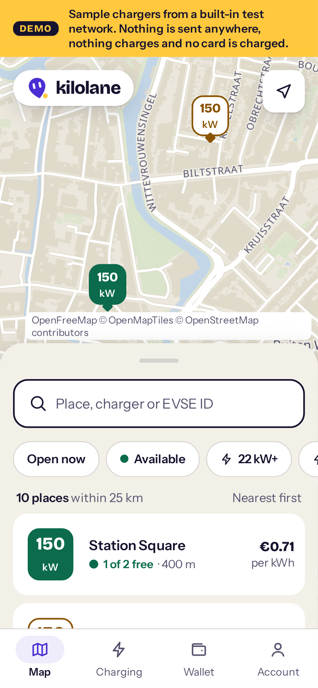
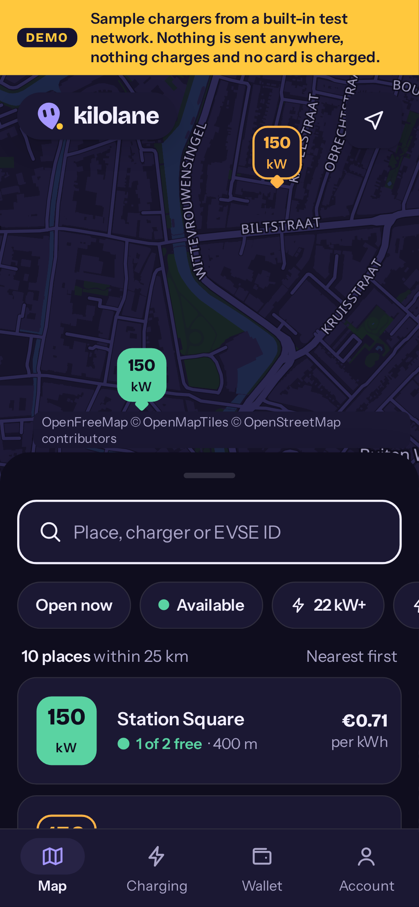
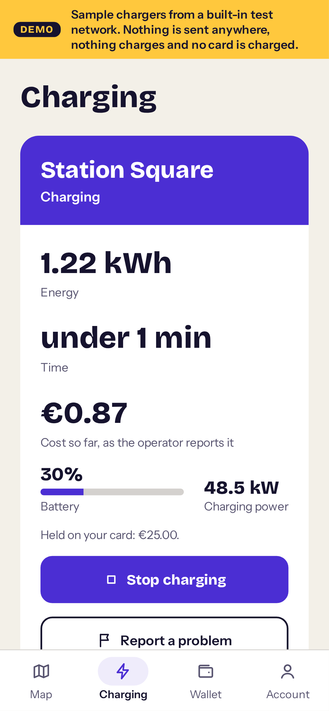
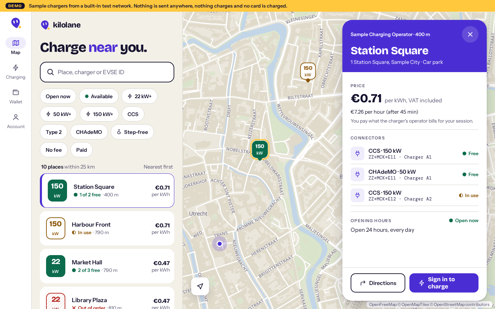
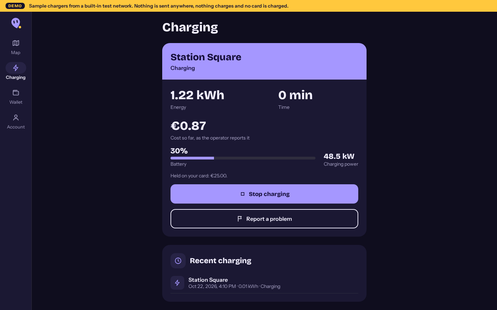
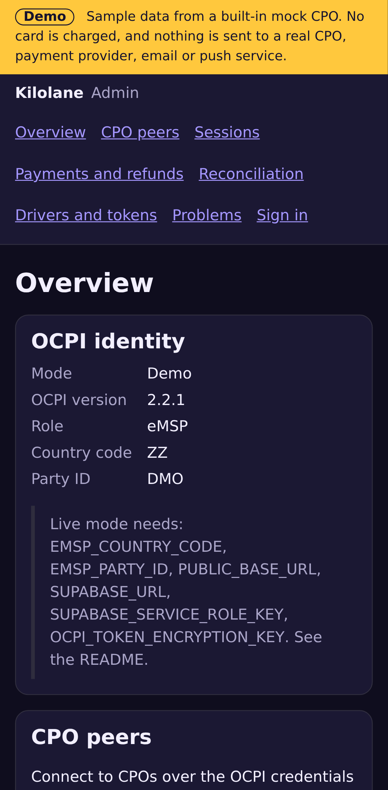

# eMSP Starter

For charging networks that want to run **their own driver app and payments**, connected over **OCPI 2.2.1** to any CPO platform. You run the eMSP (e-Mobility Service Provider) side: drivers, their tokens, sessions, CDRs and payments. Each CPO (charge point operator) you partner with is an OCPI peer. Ivora is one possible CPO peer among many; nothing here depends on it.

Fork it, brand it in five minutes, and you have:

- **A driver app** (iOS, Android and the web, from one Expo codebase): a map and list of chargers with live status and prices, passwordless sign-in, start by QR code or charger ID, a live session with stop, cards with Stripe, receipts and history, push notifications, favourites and problem reports. Accessible, in light and dark mode, with every string in a locale file.
- **An OCPI 2.2.1 eMSP server** (Next.js): any number of CPO peers in both handshake directions, locations and tariffs pulled and received, drivers' tokens pushed to every CPO with real-time authorization, START_SESSION and STOP_SESSION, sessions and CDRs received and pulled, reconciliation per peer and day.
- **Payments on your own Stripe account:** a card hold before every start, capture from the session's CDR (never above the hold), refunds with a reason, admin review, email receipts.
- **An admin web** for your team: CPO peers and each module's last pull and error, live and recent sessions, payments and refunds with an audit log, CDR reconciliation with a CSV, drivers and tokens, reported problems. Every error shows its OCPI code and a next step.
- **A demo mode** that runs all of it offline, with no keys, against a built-in mock CPO.

| Folder               | What it is                                                                                                                         |
| -------------------- | ---------------------------------------------------------------------------------------------------------------------------------- |
| [`server/`](server/) | Next.js App Router, TypeScript. The OCPI eMSP endpoints, the REST API the app uses, the admin web, and the Supabase migrations.    |
| [`app/`](app/)       | Expo / React Native with expo-router. The driver app for iOS, Android and the web, from one codebase. It talks only to the server. |

## Screenshots

All in demo mode. The driver app, **Kilolane**:

| Phone, light                                                      | Phone, dark                                                     | Charging, phone                                                        |
| ----------------------------------------------------------------- | --------------------------------------------------------------- | ---------------------------------------------------------------------- |
|  |  |  |




The admin web:

| Desktop, light                                                                         | Desktop, dark                                                                                | Phone, dark                                                                              |
| -------------------------------------------------------------------------------------- | -------------------------------------------------------------------------------------------- | ---------------------------------------------------------------------------------------- |
|  |  |  |

More in the [app README](app/README.md) and the [server README](server/README.md#admin-web).

## Why two packages

Every other template in this repository is a single Next.js app. A driver app has to ship to phones, so this template breaks that convention: the app is an Expo project next to the Next.js server. Each has its own `package.json`, lockfile, `README.md` and `.env.example`, and they share no code. One workflow, [`.github/workflows/emsp-starter.yml`](../.github/workflows/emsp-starter.yml), checks both: format, typecheck, unit tests and build (Next build for the server, `expo export` for the app's web build), the OCPI e2e suite against the mock CPO, then Playwright against the admin web and the app's web build. CI makes no native store builds.

## Run locally

Requires Node.js 22.13 or later. In two terminals:

```sh
cd server && npm ci && npm run dev    # http://localhost:3000, admin web and API
cd app && npm ci && npm run web       # the driver app in a browser
```

Both start in **demo mode** with no credentials, and say so in a "Demo" banner on every screen. The app runs offline on its own sample data until you point it at the server with `EXPO_PUBLIC_API_URL=http://localhost:3000` in `app/.env.local`; then it shows whatever mode the server is in. In the offline demo, sign in with any email and the code `000000`.

## Connect real services

Every secret lives on the server, in `server/.env.local` locally or the host's environment settings. The app holds no secret: its `EXPO_PUBLIC_` values are built into it and anyone can read them. The full tables are in the [server README](server/README.md#connect-real-services) and the [app README](app/README.md#connect-to-your-server).

| Service           | Where  | Variables                                                                                                                   | Without it                                                                                    |
| ----------------- | ------ | --------------------------------------------------------------------------------------------------------------------------- | --------------------------------------------------------------------------------------------- |
| OCPI identity     | server | `EMSP_COUNTRY_CODE`, `EMSP_PARTY_ID`, `PUBLIC_BASE_URL`, `OCPI_TOKEN_ENCRYPTION_KEY`                                        | Demo mode. Peer credentials are not variables: each CPO's are exchanged over OCPI and stored. |
| Database and auth | server | `SUPABASE_URL`, `SUPABASE_SERVICE_ROLE_KEY` (and `SUPABASE_DB_URL` for migrations)                                          | Demo mode.                                                                                    |
| Scheduled jobs    | server | `CRON_SECRET`                                                                                                               | No scheduled pulls, token push retries or payment sweep.                                      |
| Payments (Stripe) | server | `STRIPE_SECRET_KEY`, `STRIPE_PUBLISHABLE_KEY`, `STRIPE_WEBHOOK_SECRET`; optional `HOLD_AMOUNTS`, `PAYMENT_DEFAULT_CURRENCY` | Live mode refuses every app start ("Payments are not set up").                                |
| Email receipts    | server | `RESEND_API_KEY`, `RECEIPT_FROM`                                                                                            | No receipts. Sign-in emails come from Supabase Auth.                                          |
| Push              | server | `EXPO_ACCESS_TOKEN`; the app needs an EAS project ID                                                                        | No push notifications.                                                                        |
| Driver app        | app    | `EXPO_PUBLIC_API_URL`; for the web build, its origin in the server's `APP_ORIGINS`                                          | The app's offline demo.                                                                       |
| Maps              | app    | `EXPO_PUBLIC_MAP_STYLE_URL` (and `_DARK`, `EXPO_PUBLIC_MAP_ATTRIBUTION`, `EXPO_PUBLIC_MAP_ATTRIBUTION_URL`)                 | OpenFreeMap's keyless tiles: free, no uptime guarantee. See [Map](app/README.md#map).         |
| CPO live data     | server | None: a read-only key per CPO peer, set in the admin web                                                                    | No state of charge or power in the app.                                                       |

Then apply the migrations (`npm run db:migrate` in `server/`), add your first admin, connect your first CPO from **CPO peers**, and try a charge in [Stripe test mode](server/README.md#try-it-in-stripe-test-mode) before you [go live with payments](server/README.md#go-live-with-payments).

## Deploy

**Server and admin web, on Vercel:**

[](https://vercel.com/new/clone?repository-url=https%3A%2F%2Fgithub.com%2FIvora-Charge%2Fivora-examples&root-directory=emsp-starter%2Fserver&project-name=emsp-starter-server&repository-name=emsp-starter&env=EMSP_COUNTRY_CODE,EMSP_PARTY_ID,PUBLIC_BASE_URL,SUPABASE_URL,SUPABASE_SERVICE_ROLE_KEY,OCPI_TOKEN_ENCRYPTION_KEY&envDescription=Live-mode%20settings.%20Type%20demo%20in%20any%20you%20don%27t%20have%20yet%3A%20the%20server%20stays%20in%20demo%20mode%20until%20all%20of%20them%20are%20real.&envLink=https%3A%2F%2Fgithub.com%2FIvora-Charge%2Fivora-examples%2Ftree%2Fmain%2Femsp-starter%2Fserver%23deploy)

The button asks for the live-mode settings. Type `demo` in any you don't have yet (Vercel takes no empty field): the server stays in demo mode until every one is real. See the [server's Deploy section](server/README.md#deploy) for the rest (payments, scheduled jobs, the first admin).

**Driver app:**

- **Web:** the same app as a static site, on Vercel (`app/vercel.json`) or any static host. See the [app's Deploy section](app/README.md#deploy).
- **iOS and Android:** build with [Expo EAS](https://docs.expo.dev/build/introduction/) from your own Expo account (`app/eas.json` has a `preview` and a `production` profile). Submitting to the App Store and Google Play needs **your own Apple Developer Program and Google Play Console accounts**, under your network's name; the template ships with neither. CI makes no native store builds.

## OCPI 2.2.1: modules and roles

The server is an **eMSP** only, connected directly (peer to peer) to each CPO, OCPI 2.2.1 only. It is tested against a built-in mock CPO, which is never Ivora, and the [OCPI e2e suite](server/README.md#end-to-end-tests-against-a-cpo) runs against any CPO's sandbox.

| Module      | Our interface (what CPOs call)                                                   | What we call on the CPO                                       |
| ----------- | -------------------------------------------------------------------------------- | ------------------------------------------------------------- |
| Versions    | Versions list and version details                                                | Its versions and version details                              |
| Credentials | Sender and Receiver: registration in both directions, token rotation, unregister | The same                                                      |
| Locations   | Receiver: pushed locations, EVSEs and connectors                                 | Sender: full, then incremental pulls, paginated and resumable |
| Tariffs     | Receiver: pushed tariffs                                                         | Sender: pulls                                                 |
| Tokens      | Sender: our tokens (paginated) and real-time authorization                       | Receiver: every new token and change pushed, with retries     |
| Commands    | Sender: the CommandResult on our `response_url`                                  | Receiver: START_SESSION and STOP_SESSION                      |
| Sessions    | Receiver: PUT and PATCH, in any order                                            | Sender: pulls, for CPOs that only offer GET                   |
| CDRs        | Receiver: POST; CDRs are immutable                                               | Sender: pulls                                                 |

Every endpoint uses the OCPI response envelope, `Authorization: Token <base64>`, `X-Request-ID` and `X-Correlation-ID`, pagination (`Link`, `X-Total-Count`, `X-Limit`) with `date_from` and `date_to`, and the routing headers. Every incoming object is validated against the 2.2.1 schema, and unknown peers are refused. Not supported: the hub role and Hub client info, charging profiles, charging preferences, the CPO and NSP roles, other OCPI versions. Details per module are in the [server README](server/README.md#ocpi-peers).

## Demo mode

- **Server:** on whenever a live-mode variable is missing or invalid, or `DEMO_MODE=true`. The switch lives in one file, `server/lib/server/demo.ts`. Every outbound request must go through its `outboundFetch`, which refuses in demo mode, and a test fails if any other server file calls `fetch`. Demo mode never charges a card, never sends a command or request to a real CPO, and never sends email or push notifications.
- **App:** on when `EXPO_PUBLIC_API_URL` is empty or `EXPO_PUBLIC_DEMO_MODE=true`. The switch lives in `app/src/lib/config.ts`, and `app/src/lib/api.ts` is the only file that makes requests. A test stubs `fetch` to fail and checks the demo sends nothing. The only thing the app loads from outside the device is public map tiles (OpenFreeMap by default, no key); the e2e tests block them and check nothing else leaves.

## Make it yours in 5 minutes

The template ships with its own brand, **Kilolane** (see the [design brief](docs/brief/BRIEF.md)): violet, a sodium-yellow "flare", warm paper by day and indigo by night, square power tiles. It is meant to be replaced. Every colour, font and size in both packages is a token, so restyling never means editing components.

1. Edit [`server/brand/tokens.json`](server/brand/tokens.json): `name`, `shortName`, the `color` (light) and `colorDark` palettes with the same keys (including the `map*` colours of the app's map), `font` names, sizes, spacing and radii.
2. Run `npm run brand:sync` in `server/`. It copies the file to `app/brand/tokens.json`; CI fails if the two differ.
3. Set the app's display name in [`app/app.json`](app/app.json) (`expo.name`), and its `slug` and `scheme`. Replace the mark in `app/src/components/Logo.tsx` (and `docs/brief/logo.svg`).
4. For other fonts, set their names in `font` and import their files in `app/src/fonts.ts` (the app bundles them with `expo-font`); the admin web falls back to the system font unless you add `@font-face` or `next/font`.
5. Run `npm test` in `app/`: it checks every text pair for WCAG AA (4.5:1) and the focus ring for 3:1, in light and dark mode, and fails on a colour that does not pass.

## Data

Supabase Postgres, migrated with `npm run db:migrate` in `server/` (see its README). Migrations follow the **10-30 rule**: row-level security and an explicit revoke on every public table, no default grants, grants to the Data API roles only on tables with a policy, and no public function executable by those roles. The app never reads the database directly, so tables are service-only. The repository's shared checker, [`tools/check-migrations`](../tools/check-migrations/README.md), enforces the rule in CI, and every migration runs in tests on PGlite. A fork of this template alone copies `tools/check-migrations` next to it.

## Limits and next steps

**Status:** demo ready. The whole OCPI path runs in CI against the mock CPO, but live mode has not yet been run in production against a real CPO.

- **RFID cards cannot charge** yet (owner decision): they are pushed to CPOs with whitelist `NEVER`, and real-time authorization refuses them, so no session runs without a payment hold. The app is the only way to charge until RFID billing lands.
- **Web build:** no card adding (Stripe's PaymentSheet is native), no push notifications and no QR scanner; drivers start from a typed ID. The session is kept in `sessionStorage`; see [Sessions on the web](app/README.md#sessions-on-the-web) before you run it for drivers.
- **Maps:** OpenFreeMap is free and keyless but has no uptime guarantee; use a commercial provider in production. Search finds places by name, street, postcode and city; searching any address needs a geocoder, not included.
- **Prices** are display only: the CPO's tariff as it says, without your own fees.
- **Rate limits and caches** are counted per server instance.
- **Admin web:** times in UTC; payments other than flagged ones are found by ID.
- **OCPI:** see the unsupported modules above. Contract IDs carry no eMA check digit. A charger that refuses app starts can only be shown as RFID-capable (OCPI 2.2.1 has no Plug & Charge capability).
- **Live data** (state of charge, power) comes only from CPOs with an adapter; one for the Ivora API is included, others need [their own](server/README.md#write-an-adapter-for-another-cpo).
- **Store builds and submission** are yours: your Expo account, Apple and Google developer accounts, app icons, store listings and privacy labels.

Next steps, in the order a network usually needs them: RFID billing (so cards can charge), an `httpOnly` cookie session for the web build, geocoding in search, more languages (copy `app/src/i18n/en.json`), charging preferences, and your own fees on top of the CPO's tariff.

The full lists are in the [server](server/README.md#limits-and-next-steps) and [app](app/README.md#limits-and-next-steps) READMEs.

## Checks

The same as CI, in each package:

```sh
cd server && npm run format:check && npm run typecheck && npm run check:migrations && npm test && npm run build && npm run test:ocpi-e2e
cd app && npm run format:check && npm run typecheck && npm test && npm run build
npx playwright install chromium && npm run test:e2e   # in either folder: offline, desktop and phone
```

Tests never need credentials or network access.

## License

[Apache-2.0](../LICENSE)
