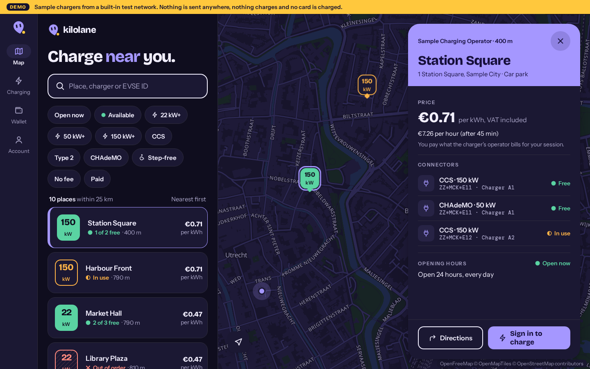

# eMSP Starter: driver app (Kilolane)

> **In progress** (part 10 of 13). See the [template README](../README.md) for what the eMSP Starter is and how the server and the app fit together.

The driver app of the eMSP Starter, built with Expo and expo-router: iOS, Android and a web build from one codebase. It talks only to your eMSP Starter server's API; it holds no keys and never reads the database. Its brand, **Kilolane**, comes from the [design brief](../docs/brief/BRIEF.md) and lives in `brand/tokens.json`.

| Phone, light                                                             | Phone, dark                                                            |
| ------------------------------------------------------------------------ | ---------------------------------------------------------------------- |
|  |  |




## What it does today

- **Shell:** four tabs (Map, Charging, Wallet, Account), at the bottom on phones and in a rail on wide screens. Charging and Wallet say what arrives in later parts.
- **Map first:** a map of chargers with clusters, and the same places in a list. On phones the list, search and filters sit in a bottom sheet in thumb reach (drag the handle, or tap it); on wide screens they sit in a panel beside the map.
- **Search:** one box for a place, a charger's reference (for example `A1`) or an EVSE ID (for example `ZZ*MCK*E11`; separators and case do not matter). **Filters:** open now, available, minimum power (22, 50, 150 kW), connector (CCS, Type 2, CHAdeMO), step-free access, and no fee or paid. "Show chargers near me" sorts by distance.
- **Charger page:** connectors with their EVSE IDs and status, the price from the CPO's tariff, rounded to the currency's minor unit (€0.71; with VAT when the CPO gives the rate, and every other component and condition), opening hours with "open now", directions in the device's maps app, and **Charge here** (sign in first; starting a charge arrives in the next part).
- **Passwordless sign-in** with the server's email code ([server README](../server/README.md#driver-accounts-and-sign-in)): the same answer for every address, so the app never tells who has an account; rate limits are the server's, and a `429` shows how long to wait. Sessions are kept in the keychain or keystore on phones and in `sessionStorage` on the web (see "Sessions on the web" below). The app refreshes the session shortly before its access token expires; being offline or a server error keeps the driver signed in and tries again later, and only a refresh token the server turns down (`400` or `401`) signs the driver out.
- **Light and dark mode**, following the device.
- **Demo strip:** on every screen while the app runs its offline demo or the server reports demo mode. It cannot be dismissed and wraps on narrow screens.

## Accessibility

- Every control has a screen-reader label and role; filter chips are checkboxes, tabs are tabs, and a charger in the list is read in the words it shows ("150 kW Station Square 1 of 2 free · 400 m €0.71 per kWh"), so voice control finds it by what the driver sees. Screens are landmarks (main, navigation, the demo strip as a region), and headings go one level at a time. `e2e/a11y.spec.ts` runs axe on the map, a charger and sign-in, light and dark.
- Status is never colour alone: free is a filled tile and dot, in use an outlined tile and half dot, out of order a hatched tile and a cross, unknown a dashed outline, and the word is always printed.
- Text follows the driver's text size: Dynamic Type and font scale on phones, rem on the web (browser font size and zoom). Status tiles grow with it. No text is under 12 px.
- Text pairs meet WCAG AA (4.5:1) in both modes, and the focus ring is at least 3:1 against everything it touches (ink in light mode, flare in dark; on the violet charger header it is `focusOnPrimary`, white in light mode and ink in dark). The selected charger's ring (`selected`) differs from the focus ring in both modes. `tests/brand.test.ts` checks every pair.
- Tap targets are 44 px or more; the search field and the primary button are 56 to 60 px. No sideways scroll at 390 px (only the chip row scrolls, inside itself).

## Languages and formats

Every string is in `src/i18n/en.json`. Numbers, prices, distances, times and weekdays are formatted for the device's locale (`Intl`), so a German phone sees `0,71 €` and `2,4 km` even before there are German strings. To add a language, copy `en.json` to `<language>.json`, translate the values and list it in `src/i18n/index.ts`; English fills any key it lacks. Plurals use `_one` / `_other` keys (and `_few`, `_many` where a language needs them).

A tariff's conditions (for example "Mon–Fri, 07:00–21:00") still come from the server in English. The CPO's own price text (OCPI `tariff_alt_text`) is shown only when the tariff has no structured prices, and then labelled as the operator's note, because it is often without VAT or in another language.

## Run locally

Requires Node.js 22.13 or later.

```sh
npm ci
npm run web       # in a browser
npm run dev       # Expo dev server; press i or a for a simulator (development build, see below)
```

With no `EXPO_PUBLIC_API_URL` the app runs its **offline demo**: the mock CPO's sample chargers (made by the server's own code; `npm run app:demo-data` in `server/` refreshes them), sign-in with the code `000000`, and no request to any server. "Near me" puts you beside the sample chargers instead of asking for your location. The map's tiles are the one thing it loads from outside the device (public map data from OpenFreeMap, below).

The map needs MapLibre Native on iOS and Android, so the native app runs as a [development build](https://docs.expo.dev/develop/development-builds/introduction/) (`npx expo run:ios`, `npx expo run:android`, or EAS Build), not in Expo Go.

## Connect to your server

Copy `.env.example` to `.env.local`.

| Variable                          | Purpose                                                                                                                                                                                    |
| --------------------------------- | ------------------------------------------------------------------------------------------------------------------------------------------------------------------------------------------ |
| `EXPO_PUBLIC_API_URL`             | Origin of your eMSP Starter server, for example `http://localhost:3000`. Empty: offline demo.                                                                                              |
| `EXPO_PUBLIC_DEMO_MODE`           | Set to `true` (or `1`, `yes`, `on`) to force the offline demo even when the URL is set.                                                                                                    |
| `EXPO_PUBLIC_MAP_STYLE_URL`       | Optional. Your map provider's style JSON URL (see "Map" below). Empty: the app's own style on OpenFreeMap.                                                                                 |
| `EXPO_PUBLIC_MAP_STYLE_URL_DARK`  | Optional. A dark style for dark mode. Default: the same style.                                                                                                                             |
| `EXPO_PUBLIC_MAP_ATTRIBUTION`     | Optional. The attribution your provider requires, shown on the map.                                                                                                                        |
| `EXPO_PUBLIC_MAP_ATTRIBUTION_URL` | Optional. The https page the attribution links to (your provider's copyright page). Default: OpenStreetMap's copyright page for the built-in style; no link for your own style without it. |

`EXPO_PUBLIC_` values are built into the app and readable by anyone who has it. Never put a secret in one; secrets stay on the server. For the web build, add its origin to the server's `APP_ORIGINS` so the browser may read sign-in answers.

## Map

MapLibre everywhere: [MapLibre GL JS](https://maplibre.org/) on the web (through `react-map-gl`) and [MapLibre Native](https://github.com/maplibre/maplibre-react-native) on iOS and Android. One style JSON works on all three, and the chargers, clusters and your position are the app's own markers.

**Demo and default: no key, no account, no cost.** The app draws its own style (`src/lib/map-style.ts`), coloured from the `map*` brand tokens in light and dark, on [OpenFreeMap](https://openfreemap.org/)'s vector tiles of OpenStreetMap data. The attribution "OpenFreeMap © OpenMapTiles © OpenStreetMap contributors" stays visible on the map, above the sheet and the tab bar. OpenFreeMap is free and asks for no key, but it is a volunteer-run service with no uptime guarantee; read its terms before you rely on it in production.

**Production.** For an SLA, use a commercial provider (for example MapTiler, Stadia Maps or Protomaps on your own hosting) and set `EXPO_PUBLIC_MAP_STYLE_URL` to its style JSON. The key then sits in the app, where anyone can read it, so restrict it at the provider:

| Platform | Key requirement                                                                                                                                                 |
| -------- | --------------------------------------------------------------------------------------------------------------------------------------------------------------- |
| Web      | A public key restricted to your site's domains (HTTP referrer / allowed origins).                                                                               |
| iOS      | A key restricted to your bundle identifier, where the provider supports it; otherwise a separate key per app you can rotate. MapLibre Native sends no referrer. |
| Android  | A key restricted to your package name and signing certificate, where the provider supports it; otherwise a separate key per app you can rotate.                 |

Usually that means one key per platform, each with its own usage limits. Keep the provider's attribution in `EXPO_PUBLIC_MAP_ATTRIBUTION` and its copyright page in `EXPO_PUBLIC_MAP_ATTRIBUTION_URL`. `EXPO_PUBLIC_MAP_STYLE_URL=none` draws no tiles at all, only the chargers on a plain background.

On the web, MapLibre runs its tile work in a Web Worker from its own file; `npm ci` (and `npm run build`) copy it to `public/maplibre-gl-worker.mjs`.

## Deploy

- **Web:** `npm run build` writes a static single-page site to `dist/`. Host it anywhere that serves static files, with a rewrite of unknown paths to `/index.html` so links such as `/account` open the app.
- **Content-Security-Policy (web):** the build puts a strict policy in `dist/index.html` as a `<meta>` tag and writes the same one to `dist/_headers` (read by hosts that support that file). Where your host lets you set headers, send it as a `Content-Security-Policy` header too, with `frame-ancestors 'none'` (a `<meta>` policy cannot set that). Scripts come only from the site (no inline script, no `eval`); styles allow inline ones, which React Native Web writes at run time; `connect-src` allows only the site, `EXPO_PUBLIC_API_URL` and the map (OpenFreeMap by default, or the origins of `EXPO_PUBLIC_MAP_STYLE_URL` and `_DARK`). If your map style loads tiles, glyphs or sprites from other hosts, list their origins in `MAP_CONNECT_SRC` (build time only, space-separated). `scripts/csp.mjs` makes the policy, `tests/csp.test.ts` checks it, and the e2e tests run the app under it.
- **iOS and Android:** build with [EAS Build](https://docs.expo.dev/build/introduction/) from your own Expo account. CI makes no native store builds.

## Sessions on the web

The web build keeps the driver's session (a Bearer access token and a refresh token, as the server's API issues them) in `sessionStorage`: it lasts while the tab is open and is gone when it closes. Page script can read `sessionStorage`, so an injected script could take the tokens. The strict Content-Security-Policy above is the main defence: no inline or third-party script runs, and requests can go only to your server and the map. Access tokens are short-lived and refreshed.

The stronger model is an `httpOnly`, `Secure`, `SameSite` cookie that page script cannot read. That needs a backend on the app's own origin (or the server on the same site) to hold the tokens and forward API calls, plus CSRF protection, so it is not part of this static build. Consider it before you run the web app for drivers in production. Phones keep the session in the keychain or keystore and are not affected.

## Limits and next steps

- Starting and stopping a charge, the Charging tab, cards and receipts arrive in parts 11 to 13.
- Search finds places by the words of their name, street, postcode and city. Searching any address (geocoding) needs a geocoder service and is not included.
- RFID cards still cannot charge (owner decision): the app is the only way to charge.

## Checks

```sh
npm run format:check && npm run typecheck && npm test && npm run build
npx playwright install chromium && npm run test:e2e        # serves dist/ offline, desktop 1440 px and phone 390 px
SCREENSHOT=1 npm run test:e2e -- screenshots              # redraws docs/*.png (needs the network for map tiles)
```

Tests never need credentials. The e2e tests block the map tiles, so they need no network either.
