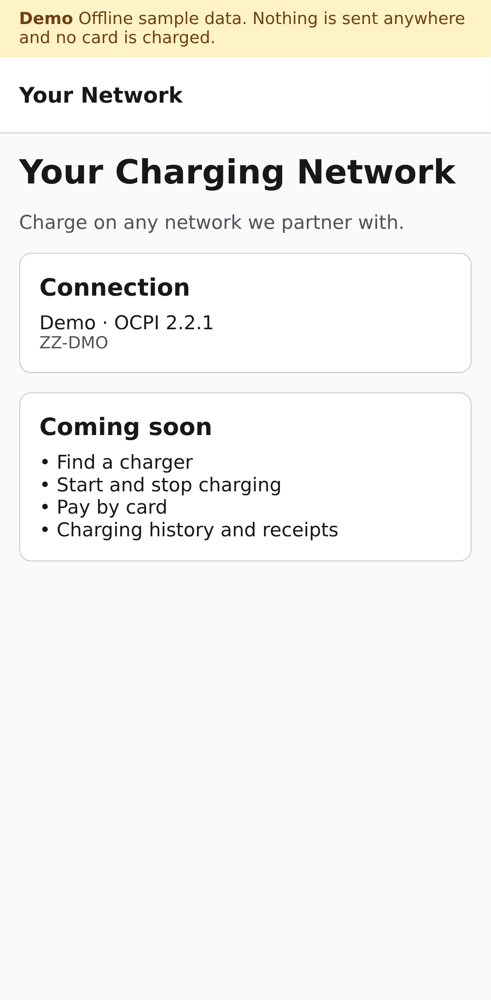

# eMSP Starter: driver app

> **In progress** (part 1 of 13). See the [template README](../README.md) for what the eMSP Starter is and how the server and the app fit together.

The driver app of the eMSP Starter, built with Expo and expo-router: iOS, Android and a web build from one codebase. It talks only to your eMSP Starter server's API; it holds no keys and never reads the database.



## What it does today

- **App shell:** a home screen with the network name, the server connection (mode and OCPI identity) and the features still to come.
- **Demo banner:** on every screen while the app runs its offline demo or the server reports demo mode.
- **Brand tokens:** every colour, font and size comes from `brand/tokens.json`, a copy of the server's file (see "Make it yours in 5 minutes" in the [template README](../README.md#make-it-yours-in-5-minutes)).

## Run locally

Requires Node.js 22.13 or later.

```sh
npm ci
npm run web       # in a browser
npm run dev       # Expo dev server; open on a phone with Expo Go, or press i / a for a simulator
```

With no `EXPO_PUBLIC_API_URL` the app runs its **offline demo**: built-in sample data and no network requests.

## Connect to your server

Copy `.env.example` to `.env.local`.

| Variable                | Purpose                                                                                       |
| ----------------------- | --------------------------------------------------------------------------------------------- |
| `EXPO_PUBLIC_API_URL`   | Origin of your eMSP Starter server, for example `http://localhost:3000`. Empty: offline demo. |
| `EXPO_PUBLIC_DEMO_MODE` | Set to `true` to force the offline demo even when the URL is set.                             |

`EXPO_PUBLIC_` values are built into the app and readable by anyone who has it. Never put a key, token or other secret in one; secrets stay on the server.

## Deploy

- **Web:** `npm run build` writes a static site to `dist/`. Host it anywhere that serves static files.
- **iOS and Android:** build with [EAS Build](https://docs.expo.dev/build/introduction/) from your own Expo account. CI makes no native store builds.

## Limits and next steps

- Only the home screen so far. Finding chargers, starting and stopping sessions, payment and history arrive in later parts.

## Checks

```sh
npm run format:check && npm run typecheck && npm test && npm run build
npx playwright install chromium && npm run test:e2e   # serves dist/ offline, desktop and mobile
```

Tests never need credentials or network access.
