# eMSP Starter: server

See the [template README](../README.md) for what the eMSP Starter is, who it is for, and how the server and the app fit together.

The Next.js server of the eMSP Starter: OCPI 2.2.1 eMSP endpoints, the REST API for the driver app, the admin web, and the Supabase migrations.

| Desktop, light                                                                                            | Desktop, dark                                                            |
| --------------------------------------------------------------------------------------------------------- | ------------------------------------------------------------------------ |
| 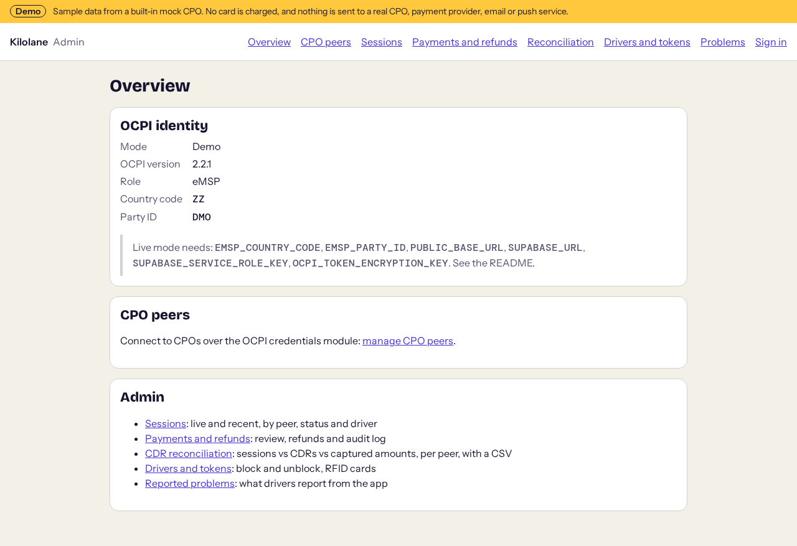 | 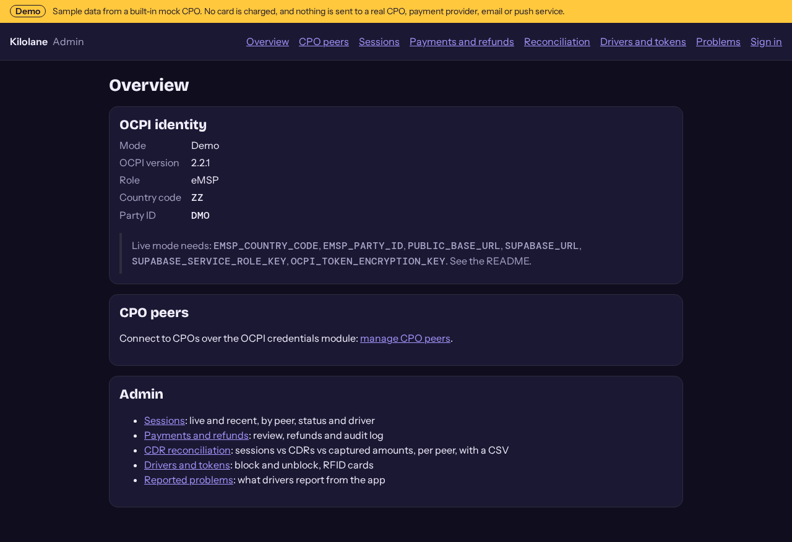 |

## What it does

- **Admin web shell:** an Overview with the eMSP's OCPI identity (version, country code, party ID) and, in demo mode, the names of the variables live mode still needs.
- **API:** `GET /api/v1/status` returns the mode, the network name and the OCPI identity. It holds no secrets, so any origin may read it. `GET /api/v1/locations` searches charging locations; see [Locations and tariffs](#locations-and-tariffs). The driver API (sign-in, cards, charges, payments) needs the driver's token; see [Driver API](#driver-api).
- **Config and demo mode:** `lib/server/config.ts` reads the environment (server-only); `lib/server/demo.ts` is the one demo-mode switch and the only gate for outbound requests.
- **Database:** an append-only audit log, the OCPI peer registry, the locations and tariffs cache, drivers' tokens and their push queue, commands, sessions and immutable CDRs, driver accounts, admin roles, payments and refunds, the migrate script, and the shared 10-30 check.
- **OCPI 2.2.1 core:** the versions and credentials modules, with any number of CPO peers, in both handshake directions. See [OCPI peers](#ocpi-peers).
- **Locations and tariffs:** pulled from every CPO peer (full, then incremental, paginated and resumable) and received as pushes, stored per peer, searchable by the app, with display prices and a price preview. See [Locations and tariffs](#locations-and-tariffs).
- **Tokens and real-time authorization:** drivers' APP_USER tokens (with an eMA contract ID from our party) and RFID cards, served to CPOs from our Tokens Sender, pushed to every CPO's Tokens Receiver at once (with retries), and authorized in real time. See [Tokens](#tokens-and-real-time-authorization).
- **Commands:** START_SESSION and STOP_SESSION for a driver, sent to the location's CPO once a payment hold succeeds, one command per app request, with the CommandResponse and the CommandResult on our response_url. See [Commands](#commands-start_session-and-stop_session).
- **Sessions and CDRs:** received on our Receiver interfaces (session PUT and PATCH, in any order; CDR POST) and pulled from each CPO's Sender interfaces, linked to the driver's start command and token, with internal events and reconciliation data per peer and day. CDRs are immutable. See [Sessions and CDRs](#sessions-and-cdrs).
- **Driver accounts:** passwordless sign-in (Supabase Auth, an email code or link) from the app and the web, an account and app token at the first sign-in, rate limited. See [Driver accounts and sign-in](#driver-accounts-and-sign-in).
- **Payments:** saved cards on the network's own Stripe account, a card hold before every app start, capture from the session's CDR, release, refunds, admin review, optional incremental authorization, email receipts and a signed webhook. See [Payments](#payments). **The owner merges changes here.**
- **Live data:** an optional, read-only live-data adapter per CPO peer for what OCPI lacks, such as state of charge. The null adapter is the default; an Ivora API adapter is included. See [Live data](#live-data-state-of-charge).
- **Admin sign-in** (`/admin/sign-in`): the same passwordless sign-in for users in the admin role table (`emsp_admins`). `ADMIN_SECRET` still works while it is set.
- **Driver app API:** the hold before a start, the charge in progress with its session and live data, history, receipts from the CDR (emailed again on request), push notifications, favourites and problem reports. See [Driver API](#driver-api). Demo mode plays the mock CPO's side of a charge ([Demo charging](#demo-charging)).
- **Admin web**, for admins only (see [Admin web](#admin-web)): CPO peers with their status and the last pull and error of each module; live and recent sessions; payments, refunds and their audit log; CDR reconciliation per peer with a CSV; drivers and tokens, with block and unblock; each peer's live-data adapter; problems drivers report from the app. Every error shows its code (the CPO's OCPI status code when it gave one) and a next step.
- **OCPI e2e suite** (`npm run test:ocpi-e2e`): the whole path from handshake to refund, run against the mock CPO in CI and against any CPO's sandbox when you configure one. See [End-to-end tests against a CPO](#end-to-end-tests-against-a-cpo).

## Run locally

Requires Node.js 22.13 or later.

```sh
npm ci
npm run dev
```

With no credentials it starts in **demo mode**, with a "Demo" banner on every page. Demo mode never charges a card, never sends a command or request to a real CPO, and never sends email or push notifications.

## Connect real services

Copy `.env.example` to `.env.local` and fill it in. All variables are server-side only; never prefix one with `NEXT_PUBLIC_`.

| Variable                    | Purpose                                                                                                                                                                                                                                                                                                                                                                                              |
| --------------------------- | ---------------------------------------------------------------------------------------------------------------------------------------------------------------------------------------------------------------------------------------------------------------------------------------------------------------------------------------------------------------------------------------------------- |
| `EMSP_COUNTRY_CODE`         | Your ISO 3166-1 alpha-2 country code, for example `NL`. Required for live mode.                                                                                                                                                                                                                                                                                                                      |
| `EMSP_PARTY_ID`             | Your 3-character OCPI party ID. Required for live mode.                                                                                                                                                                                                                                                                                                                                              |
| `PUBLIC_BASE_URL`           | The `https://` origin this server is reached at. CPO peers call the OCPI endpoints on it. Required.                                                                                                                                                                                                                                                                                                  |
| `SUPABASE_URL`              | Supabase project URL. Required for live mode.                                                                                                                                                                                                                                                                                                                                                        |
| `SUPABASE_SERVICE_ROLE_KEY` | Supabase service role key. Bypasses RLS: never logged, never sent to the app. Required for live mode.                                                                                                                                                                                                                                                                                                |
| `SUPABASE_DB_URL`           | Postgres connection string, used only by `npm run db:migrate`.                                                                                                                                                                                                                                                                                                                                       |
| `OCPI_TOKEN_ENCRYPTION_KEY` | 32 random bytes, base64 (`openssl rand -base64 32`). Encrypts the tokens CPO peers give us, and live-data API keys, at rest. Required for live mode. Losing or changing it means re-registering every peer and re-entering their keys.                                                                                                                                                               |
| `ADMIN_SECRET`              | Optional. At least 32 characters (`openssl rand -base64 32`). While set, an admin action also runs for whoever gives it, beside signed-in admins: for the first admin and for demo deployments. Unset it once your admins sign in.                                                                                                                                                                   |
| `CRON_SECRET`               | Required in live mode once you issue tokens (token expiry and push retries run only with it); otherwise optional. At least 32 characters. Enables the scheduled jobs, `GET /api/cron/ocpi-sync` with `Authorization: Bearer <CRON_SECRET>`: the pulls (locations, tariffs, sessions, CDRs), token push retries and expiry, command timeouts and the payment sweep. Without it the route answers 503. |
| `STRIPE_SECRET_KEY`         | The network's own Stripe secret key (`sk_live_…`, `sk_test_…`) or a restricted key (`rk_…`). Without it, live mode refuses every app start ("Payments are not set up"). Never logged.                                                                                                                                                                                                                |
| `STRIPE_PUBLISHABLE_KEY`    | Stripe publishable key (`pk_…`), handed to the app's PaymentSheet. Public by design. Needed to save cards.                                                                                                                                                                                                                                                                                           |
| `STRIPE_WEBHOOK_SECRET`     | Signing secret (`whsec_…`) of the webhook endpoint `PUBLIC_BASE_URL/api/webhooks/stripe`. Without it the webhook answers 503.                                                                                                                                                                                                                                                                        |
| `HOLD_AMOUNTS`              | Optional. The hold before a start, in minor units per currency, for example `EUR:2500,GBP:2000,JPY:4000`. Default `EUR:2500,USD:2500,GBP:2500`. A currency without an amount takes no app starts.                                                                                                                                                                                                    |
| `PAYMENT_DEFAULT_CURRENCY`  | Optional. The hold's currency when the charger's tariff does not say. Default `EUR`.                                                                                                                                                                                                                                                                                                                 |
| `STRIPE_INCREMENTAL_AUTH`   | Optional, **off** by default. `on` raises a long session's hold where the card allows it; see [Incremental authorization](#incremental-authorization).                                                                                                                                                                                                                                               |
| `HOLD_INCREMENT_AT_PERCENT` | Optional. With incremental authorization on: raise the hold when the running cost reaches this share of it, 50 to 95. Default 80.                                                                                                                                                                                                                                                                    |
| `RESEND_API_KEY`            | Optional. Resend API key (`re_…`) for email receipts. Without it (or `RECEIPT_FROM`) no receipts are sent.                                                                                                                                                                                                                                                                                           |
| `RECEIPT_FROM`              | Optional. The receipts' sender, for example `Your Network <receipts@example.com>`, on a domain verified at Resend.                                                                                                                                                                                                                                                                                   |
| `EXPO_ACCESS_TOKEN`         | Optional. An Expo access token for push notifications to the driver app (turn on "enhanced security for push" in Expo, so only this server can push). Without it no push is sent. Never logged.                                                                                                                                                                                                      |
| `APP_ORIGINS`               | Optional. Comma-separated `https://` origins of the app's web build allowed to read the driver API from a browser. Native apps need none. Default: none.                                                                                                                                                                                                                                             |
| `AUTH_REDIRECT_URL`         | Optional. Where the sign-in email's link points (an `https://` page of your web app or a deep link such as `yournetwork://sign-in`); add it to Supabase Auth's redirect URLs.                                                                                                                                                                                                                        |
| `TRUSTED_PROXY_HEADER`      | Optional. The header your own proxy or CDN sets to the client address, for example `cf-connecting-ip`. When set, it alone keys every rate limit. See **Rate limits without a proxy** below.                                                                                                                                                                                                          |
| `OCPI_TOKEN_A_TTL_DAYS`     | Optional. Days a Token A we issue stays valid, 1 to 90. Default 7.                                                                                                                                                                                                                                                                                                                                   |
| `OCPI_ALLOW_PRIVATE_PEERS`  | **Local development and tests only.** `1` lets peer URLs point at loopback or private addresses, for a CPO on your machine. Off by default; ignored when `NODE_ENV` is production.                                                                                                                                                                                                                   |
| `DEMO_MODE`                 | Set to `true` (or `1`, `yes`, `on`) to force demo mode even when everything above is set, for example on a public demo.                                                                                                                                                                                                                                                                              |

Live mode turns on only when all required variables are set and valid. OCPI peer credentials are not environment variables: they are exchanged with each CPO over the OCPI credentials module and stored in the database, with tokens we issue stored as hashes and peer tokens encrypted at rest.

> **Before going live:** add your first admin (see [Admin sign-in](#admin-sign-in)), then unset `ADMIN_SECRET`. While it is set, anyone who can reach the admin page may try it.
>
> **Admin lockout (`ADMIN_SECRET` only):** wrong secrets are limited to 5 per client and 50 in total per 15 minutes. The total cap is what stops guessing from many addresses, but it also means anyone who can reach the admin page can send 50 wrong secrets and lock the real admin out for 15 minutes. The per-client count uses an address callers cannot set: the header named by `TRUSTED_PROXY_HEADER` (its last entry, the one your proxy added), or on Vercel (`VERCEL=1`) Vercel's own `x-vercel-forwarded-for`. Otherwise there is no per-client count and the total cap alone applies; `X-Forwarded-For` and `X-Real-IP` are never trusted, because a caller can send any value. While `ADMIN_SECRET` is set, keep the admin page off the public internet (an IP allow-list or a private network) so the lockout cannot be triggered by strangers; restarting the server clears the counts.
>
> **Rate limits without a trusted client address:** off Vercel and without `TRUSTED_PROXY_HEADER`, the search and price-preview limits key every client as `unknown`, so one client can use up the 120 (and 30) requests per minute for everyone. Set `TRUSTED_PROXY_HEADER` to the header your proxy sets, or put your platform's firewall rate limiting in front.

## OCPI peers

This server is the eMSP side of OCPI 2.2.1. Every CPO platform is a peer, and none is special. Our endpoints:

| Endpoint                        | What it does                                                                                                        |
| ------------------------------- | ------------------------------------------------------------------------------------------------------------------- |
| `GET /ocpi/versions`            | Our versions. Needs a token we issued (a Token A too).                                                              |
| `GET /ocpi/2.2.1`               | Version details: credentials, the locations, tariffs, sessions and CDRs Receivers, the tokens and commands Senders. |
| `/ocpi/2.2.1/credentials`       | `GET` our credentials, `POST` to register (with a Token A), `PUT` to rotate, `DELETE` to unregister.                |
| `/ocpi/2.2.1/locations/…`       | Locations Receiver: `GET`, `PUT`, `PATCH` a location, EVSE or connector.                                            |
| `/ocpi/2.2.1/tariffs/…`         | Tariffs Receiver: `GET`, `PUT`, `PATCH`, `DELETE` a tariff.                                                         |
| `GET /ocpi/2.2.1/tokens`        | Tokens Sender: every token we issued, paginated, with `date_from` and `date_to`.                                    |
| `POST …/tokens/{uid}/authorize` | Real-time authorization of one of our tokens.                                                                       |
| `POST /ocpi/2.2.1/commands/…`   | Commands Sender: the response_url where a CPO POSTs the CommandResult of a command we sent.                         |
| `/ocpi/2.2.1/sessions/…`        | Sessions Receiver: `GET`, `PUT`, `PATCH` a session of one of our drivers.                                           |
| `POST /ocpi/2.2.1/cdrs`         | CDRs Receiver: a new CDR. The answer's `Location` header is where the CPO can `GET` it back.                        |

**We register at a CPO.** The CPO gives you its versions URL and a Token A. In **Connect to a CPO**, this server reads the CPO's versions and 2.2.1 details with Token A, issues our Token B, POSTs our credentials to the CPO and stores the Token C it answers with. It then reads the versions again with Token C, from the URL the CPO returned. If anything fails after the CPO accepted us, it unregisters there again.

**A CPO registers with us.** In **Let a CPO register with us**, create a Token A and send it with our versions URL (`PUBLIC_BASE_URL/ocpi/versions`) to the CPO over a secure channel. The token is shown once; only its hash is stored. It expires after `OCPI_TOKEN_A_TTL_DAYS` (default 7 days). The CPO POSTs its credentials with Token A; we read its versions with its token, revoke Token A and answer with a new Token C.

**Rotate and unregister.** Either side can rotate (credentials `PUT`) or unregister (`DELETE`). When we rotate, our old token keeps working until the CPO has answered, so its calls during the update are not refused. When we unregister, we tell the CPO first, and unregister locally anyway if it has already forgotten us (401 or 405).

When a CPO registers with us and its versions cannot be used, it gets `3001 Peer endpoint unreachable or invalid`, whatever went wrong, so the credentials module cannot be used to probe other hosts. The two exceptions name what its own valid versions answer lacks: `3002 Peer offers no OCPI 2.2.1` and `3003 Peer has no credentials endpoint`.

How it works, in `lib/ocpi/`:

- **Registry** (`store.ts`, `store-supabase.ts`): peers with their roles, endpoints per module and status (`pending`, `registered`, `unregistered`, `failed`); a peer's parties may not belong to another registered peer or to us. Tokens we issue are stored as SHA-256 hashes (`emsp_ocpi_issued_tokens`); the token a peer gave us is AES-256-GCM encrypted with `OCPI_TOKEN_ENCRYPTION_KEY`, bound to the peer's ID. In demo mode the registry is in memory.
- **Client** (`client.ts`): the envelope, `Authorization: Token <base64>`, a new `X-Request-ID` per attempt and one `X-Correlation-ID` per operation, routing headers, a pagination iterator over `Link` / `X-Total-Count` / `X-Limit` with `date_from` and `date_to`, retries with exponential backoff and jitter on timeouts, network errors and HTTP 5xx (GET only, unless a call says it is safe to repeat), and OCPI status codes mapped to error classes. It follows no redirects, and never follows a next-page link to another origin.
- **Peer addresses** (`lib/server/peer-fetch.ts`): peers choose the URLs we call, so every request to a peer goes through `peerFetch`. It refuses demo mode, needs `https://`, resolves the host once and refuses it if any address is loopback, private (RFC 1918), link-local, CGNAT, unique-local IPv6, unspecified, multicast, documentation or reserved, including cloud metadata addresses (`169.254.169.254`, `fd00:ec2::254`) and IPv4 embedded in IPv6. The socket then connects to the address it checked, so a second DNS answer cannot redirect it (DNS rebinding). When a CPO calls our credentials module, we read its versions with one 5-second try, and any failure gets the same answer, `3001 Peer endpoint unreachable or invalid`: never the remote server's status or body. The details are logged on our side, without tokens.
- **Size limits**: we read at most 1 MB of an OCPI response and 256 KB of a request; a larger `Content-Length` is refused before reading, and a stream is cut at the limit.
- **Server middleware** (`server.ts`): checks the token's hash against the tokens we issued (base64 or the unencoded 2.1.1 form), refuses unknown, unregistered or failed peers with 401, limits a Token A to the versions and credentials modules, and checks the `OCPI-from/to` routing headers on functional modules: "to" must be us and "from" a party of the token. It echoes `X-Request-ID` and `X-Correlation-ID`.
- **Schema** (`schema.ts`): every incoming credentials, versions, version details and envelope object is validated against 2.2.1 before use.

### Mock CPO

`lib/mock-cpo/` is a second, generic OCPI 2.2.1 CPO that runs in-process: versions, credentials (all four methods, both directions), paginated locations, tariffs, sessions and CDRs Sender interfaces with `date_from` and `date_to` (required for sessions, as in 2.2.1), a Tokens Receiver that validates every token we push against 2.2.1, and a Commands Receiver that validates every StartSession and StopSession, answers with the CommandResponse a test sets (`answerCommands`: any result, or no answer at all), and POSTs a CommandResult to our response_url (`sendCommandResult`, before or after the response). It runs a session for a start it accepted (`sessionForCommand`), pushes it (`putSession`, `patchSession`, or any PATCH body in any order with `sendSessionPatch`) and POSTs its CDR (`cdrFor`, `postCdr`). It pulls our Tokens Sender (`pullTokens`) and asks for real-time authorization (`authorize`) as a CPO does. It pushes changes to our Receiver interfaces (`setEvseStatus`, `putLocation`, `putTariff`, `deleteTariff`) and injects failures (HTTP errors and hangs). Its sample data (`sample-data.ts`: invented sites in an invented city) covers AC and DC, several connector standards, every EVSE state the search cares about, facilities, parking restrictions, an unpublished site and free, energy, time-of-day, idle-fee, parking and flat-fee tariffs, and three sessions: one completed with its CDR, one completed without a CDR yet, and one charging. The tests use it as a real peer, with a second instance on another platform that uses the same location and tariff IDs, over an in-process network (`tests/support/network.ts`): no request leaves the process. Demo mode shows the same sample data, and so does the driver app's offline demo: `npm run app:demo-data` writes it, through this server's own search, to `../app/src/demo/locations.json`, and a test fails when the two drift apart.

## Locations and tariffs

Every registered CPO's locations (with their EVSEs and connectors) and tariffs are cached in Supabase, per peer, keyed by country code, party ID and ID. Two CPOs that use the same IDs never overwrite each other, and a CPO can only write its own parties' objects.

**Pull** (`lib/locations/sync.ts`), from each peer's Sender interface, tariffs first and then locations:

- The first pull is full. Later ones are incremental: `date_from` is when the last completed pull started, minus 5 minutes for clock differences.
- Pages follow the `Link` header (100 objects asked per page; the CPO may send fewer). After every page the next page's URL is saved, so a pull that fails or stops resumes at that page on the next call. Each call reads at most 50 pages (20 from the cron route).
- One pull per peer and module at a time; a pull with no progress for 5 minutes counts as interrupted and the next call resumes it.
- A completed full pull removes that peer's objects it did not see, unless a push touched them meanwhile.
- Invalid objects, and objects of a party that is not the peer's, are skipped and counted, never stored. A pulled object older (by `last_updated`) than what a push already gave us does not replace it, even when the push lands while the page is being stored: the database function that stores a page (`emsp_ocpi_save_locations`, `emsp_ocpi_save_tariffs`) compares against the row it locks.

Start a pull from **Pull locations and tariffs** in `/admin/peers` (changes since the last pull, or everything), or on a schedule: set `CRON_SECRET` and call `GET /api/cron/ocpi-sync` with `Authorization: Bearer <CRON_SECRET>`, for example every 15 minutes. On Vercel, add a cron for that path in `vercel.json`; Vercel Cron sends the header itself when `CRON_SECRET` is set.

**Push** (`lib/locations/receiver.ts`): a CPO sends changes as they happen to our Receiver interfaces. `PUT` creates or replaces a location, EVSE, connector or tariff; `PATCH` changes some fields of one (it needs `last_updated`, and the result is validated as a whole); `DELETE` removes a tariff. OCPI 2.2.1 defines `PUT` and `DELETE` for tariffs; `PATCH` is accepted from CPOs that send it. Changing an EVSE or connector moves its location's `last_updated` forward. A change older than what we hold is acknowledged and ignored. Each push reads the stored location, applies its change and writes it back only if the location's `revision` is still the one it read (compare-and-swap); otherwise it reads again and re-applies the change, up to 25 times, then answers `3000` (HTTP 503) so the CPO retries later. So many pushes to different EVSEs of one location at once all land: a CPO never resends a push we acknowledged. EVSEs are never deleted: a CPO sets them to `REMOVED`, and removed EVSEs never appear in the app. Unknown locations, EVSEs and connectors get `2003`, unknown tariffs `2000` (HTTP 404; 2.2.1 has no tariff-specific code), invalid bodies `2001` naming the fields, another CPO's party, or a party in the URL other than `OCPI-from`, `403`. These endpoints need a registered peer's token and the `OCPI-from`/`OCPI-to` routing headers.

**Search API**, for the app (any origin may read it; locations are public information):

`GET /api/v1/locations`, every parameter optional:

| Parameter                      | Meaning                                                                                                                            |
| ------------------------------ | ---------------------------------------------------------------------------------------------------------------------------------- |
| `lat`, `lng`, `radius_m`       | Within `radius_m` metres (default 5,000, at most 50,000) of the point, nearest first. Without a point, results are sorted by name. |
| `q`                            | Every word appears in the name, address, postal code or city.                                                                      |
| `evse_id`                      | An EVSE ID such as `NL*ABC*E12345`. Case and separators are ignored.                                                               |
| `charger_id`                   | The reference printed on the charger (`physical_reference`), an EVSE uid or a location ID.                                         |
| `status`                       | Comma-separated EVSE statuses, for example `AVAILABLE`.                                                                            |
| `min_power_kw`, `max_power_kw` | A connector's maximum power in this range.                                                                                         |
| `connector`                    | Comma-separated OCPI connector standards, for example `IEC_62196_T2_COMBO,CHADEMO`.                                                |
| `facility`                     | Comma-separated OCPI facilities; the location has all of them.                                                                     |
| `parking`, `exclude_parking`   | OCPI parking restrictions an EVSE must have (for example `DISABLED`), or must not have (for example `CUSTOMERS`).                  |
| `price`                        | `free` or `paid`, by the connector's tariff. A connector without a known tariff is neither.                                        |
| `limit`, `offset`              | Paging: 1 to 100 (default 20), and from 0.                                                                                         |

EVSE filters (status, parking, EVSE ID, charger ID) and connector filters (power, standard, price) must hold for the same EVSE. Each result says how many EVSEs matched, how many are available and how many are in each status (`status_counts`), the highest power, the connector standards and a one-line price (`price.summary`, in English) with its main component as numbers (`price.lead`: type, unit, `priceE4`, VAT included), so an app can format it in the driver's language. Only registered peers' published locations appear (in demo mode, the mock CPO's), and a location whose EVSEs are all removed does not. The store narrows the candidates with a bounding box, the words and the ID, nearest to the search point first (the database function `emsp_ocpi_location_candidates`), and reads at most 1,000 per search (Supabase's default **Max rows** for the Data API). In a dense area the farthest candidates are the ones left out, never the nearest; `total` then counts matches among those 1,000. For a full count over more locations than that around one point, move the search into Postgres (PostGIS).

`GET /api/v1/locations/{id}` returns one location with its EVSEs, connectors and each connector's display price. `GET /api/v1/locations/{id}/price-preview?evse_uid=&connector_id=&kwh=&minutes=[&parking_minutes=][&start=]` estimates what a session there would cost.

**Rate limits:** each client may make 120 searches and location reads, and 30 price previews, per minute; past that the API answers `429` with `Retry-After`. The client is the one your proxy reports, as for the admin secret (see **Admin lockout** under [Connect real services](#connect-real-services)): the hosting platform's client-IP header, else the right-most `X-Forwarded-For` entry. Without a proxy every client looks the same (`unknown`) and shares one limit. The counts live in each server instance; for a hard cap across instances, add your platform's firewall rate limiting in front.

**Prices** (`lib/locations/pricing.ts`) are **display only**. A connector's price is its first active `REGULAR` (or untyped) tariff, else its first active one. The display price lists every energy, time, parking and flat component with its conditions in words (days, time of day, dates, duration, energy, power, current, reservation), VAT included when the CPO gives the rate, and the tariff's minimum and maximum price. The preview walks the session minute by minute in the location's time zone, applying for each dimension the first element whose restrictions match (minimum inclusive, maximum exclusive), rounding the last period of each dimension up to its step size, then the tariff's minimum and maximum price. Money is integer arithmetic throughout: tariff prices are read as ten-thousandths of the currency unit (`priceE4`, `unitPriceE4`: OCPI prices have at most 4 decimals), line amounts stay exact fractions, and the total is rounded **once**, half up, to the currency's minor units (`totalExclVatMinor`, `totalInclVatMinor`, with `minorDigits`: 2 for EUR, 0 for JPY). Line amounts (`amountExclVatMinor`) are rounded on their own for display, so they may differ from the total by a minor unit. What a driver pays is settled from the CDR in a later part, and you may add your own fees on top of the CPO's tariff.

## Tokens and real-time authorization

Every driver has one **APP_USER** token, the one the app charges with, and may have **RFID** cards. The app token comes with the driver's **contract ID** in eMA ID format: our country code, our party ID, `C` and 8 random letters and digits, without separators or the optional check digit (for example `NLABCC12AB34CD`), like the OCPI 2.2.1 examples. RFID cards join the driver's contract: same contract ID and `group_id`. The `issuer` is the brand name. Each token has its own **whitelist** setting (OCPI 2.2.1 `WhitelistType`), which tells a CPO when it may let the token charge without asking us:

| Whitelist                                                                                                                                    | Meaning in OCPI 2.2.1                                                                                                                                                                        |
| -------------------------------------------------------------------------------------------------------------------------------------------- | -------------------------------------------------------------------------------------------------------------------------------------------------------------------------------------------- |
| `ALLOWED_OFFLINE` (default)                                                                                                                  | The CPO must ask us in real time; it may let the token charge from its cached copy only when it cannot reach us. Blocks, expiries and `NO_CREDIT` are always checked while we are reachable. |
| `NEVER`                                                                                                                                      | The CPO must ask us in real time; without an answer, no charging.                                                                                                                            |
| `ALLOWED`                                                                                                                                    | The CPO may ask us, or let the token charge from its cached copy, even while it can reach us. A block or expiry reaches it only through a push.                                              |
| `ALWAYS`                                                                                                                                     | The CPO never asks; it charges from its cached copy. A block or expiry reaches it only through a push.                                                                                       |
| A token is `active`, `blocked` (until unblocked) or `expired` (an RFID card past its expiry date); OCPI's `valid` is true only while active. |

**RFID cards cannot charge yet.** Until RFID billing lands (a later part), no energy may be free, and a card has no payment hold behind it. So every RFID card is pushed and served with whitelist `NEVER` (a card made before this rule is still sent as `NEVER`; `/admin/tokens` refuses any other value for a card), and real-time authorization answers `NOT_ALLOWED` for every RFID card, whatever the account. A CPO must ask us before it lets a card charge, and we say no. The app's APP_USER flow (a hold before START_SESSION) is unchanged. **How it will be lifted:** the RFID-billing part places a hold (or another payment guarantee) when a CPO asks to authorize a card, captures from that session's CDR as the app flow does, and then switches `RFID_CHARGING` in `lib/tokens/authorize.ts` and `RFID_WHITELIST` in `lib/tokens/manage.ts`. If you made RFID cards before this version, set each one's whitelist to `NEVER` on `/admin/tokens` once, so the change is pushed to every CPO.

A driver's app token is made at their first sign-in (`ensureAccount`, `lib/accounts/sign-in.ts`), with the account ID (the Supabase Auth user ID) as the **driver reference**. `/admin/tokens` can still create one for any driver reference of up to 64 characters; a reference without an account has no standing to check, so real-time authorization rests on the token alone, and the app cannot start with it (no account, no hold).

**Tokens Sender.** `GET /ocpi/2.2.1/tokens` serves every token, oldest `last_updated` first, at most 100 per page (`X-Limit`), with `X-Total-Count`, a `Link` to the next page on `PUBLIC_BASE_URL`, `offset`, `limit`, `date_from` (inclusive) and `date_to` (exclusive). A CPO that pulls with `date_from` gets every change, pushed or missed.

**Pushes** (`lib/tokens/push.ts`). A new token is `PUT`, and a change (block, unblock, expiry, whitelist) `PATCH`ed with the fields that changed and `last_updated`, to `{receiver}/{country_code}/{party_id}/{uid}?type=` of every registered peer that lists a tokens Receiver, all at once, with routing headers to the peer's CPO party. `last_updated` moves forward by at least a second on every change, so a CPO that keeps the newest version never mistakes two quick changes for one. Every change is also written to an **outbox** (`emsp_token_pushes`, filled by a trigger in the same transaction as the change): each peer is owed the new version until a push of it lands. A push that fails (after one retry), or never went out because the server stopped, stays owed; the cron route and **Retry missed pushes** send the token's current version with a `PUT`, after 1, 2, 4 ... minutes, at most 6 hours apart, until it lands. Pushes of one token can overlap and land out of order (an unblock still retrying while a block goes out), so after every push that lands the token is read again and, if it changed meanwhile, its current version is sent too: the last push to land carries the newest version. A queued push for a peer that unregistered is dropped. Demo mode pushes nothing.

**Real-time authorization** (`lib/tokens/authorize.ts`). `POST /ocpi/2.2.1/tokens/{token_uid}/authorize?type=` (type defaults to `RFID`), with an optional `LocationReferences` body, answers an `AuthorizationInfo`:

| `allowed`     | When                                                                                                                                                                |
| ------------- | ------------------------------------------------------------------------------------------------------------------------------------------------------------------- |
| `ALLOWED`     | The token is active. Comes with a new `authorization_reference` and the location and EVSEs asked about.                                                             |
| `BLOCKED`     | The token is blocked. Takes effect at once, before any push lands.                                                                                                  |
| `EXPIRED`     | The token is expired, or past its expiry date even if the expiry sweep has not run yet.                                                                             |
| `NO_CREDIT`   | The driver's account has no default card (`driverStanding`).                                                                                                        |
| `NOT_ALLOWED` | The driver's account is restricted; or the token is an RFID card (see above); or the account could not be read (it fails closed: never `ALLOWED` on a store error). |

The token's own status comes first, then the driver's standing. Unknown tokens, and types we do not issue (`AD_HOC_USER`, `OTHER`), get `2004 Unknown Token` (HTTP 404); an invalid body or `type` gets `2001`. The answer carries the token as the CPO should cache it, and every answer goes to the audit log with its `authorization_reference`. Both endpoints need a registered peer's token and the `OCPI-from`/`OCPI-to` routing headers, with `OCPI-to` this eMSP and `OCPI-from` one of the peer's **CPO** parties.

**Blocking a token** from the admin takes effect for real-time authorization immediately and is pushed to every CPO at once. A CPO that charges a token without asking (`ALWAYS` or `ALLOWED`, or `ALLOWED_OFFLINE` while it cannot reach us) only stops once its push lands; set `NEVER` on tokens that must never charge unchecked.

**Expiry and retries need `CRON_SECRET`.** The cron route marks active tokens past their expiry as `expired` and pushes `valid: false` (at most 100 per call), and resends missed pushes. It runs only when `CRON_SECRET` is set, so live mode with tokens **requires** `CRON_SECRET`: without it, expiries are never pushed to CPOs and a missed push is resent only from **Retry missed pushes** on `/admin/tokens`.

## Commands: START_SESSION and STOP_SESSION

`lib/commands/` sends OCPI 2.2.1 commands to the CPO a driver charges with, and takes the results back. These are **charger commands**: the owner merges changes here.

**Start** (`startSession`): the driver, the app's request ID, the app's location ID, and optionally the EVSE `uid` and connector `id` (the connector needs its EVSE; an EVSE with `START_SESSION_CONNECTOR_ID_REQUIRED` needs a connector). The location must be a published location of a registered peer, the EVSE not `REMOVED`, and the driver's app token active. Then, in order:

1. **Claim.** The request is recorded in the database in one step (`emsp_command_claim`, under a lock per driver). The same request ID again returns that command and sends nothing, looked up before any other check, so a retry gets its command back even if the location, the EVSE or the token changed since; the same ID for another start is refused (409). While the driver has a start open, a new request ID returns that one as `busy`: one tap, one command.
2. **Payment hold.** `lib/commands/pre-auth.ts` holds the payment (`paymentsPreAuth`, see [Payments](#payments)); the start goes out only if it succeeds. Every start that ends without charging releases its hold at once, except one whose outcome we never learnt (see **Release** under Payments).
3. **Send**, once, never retried: `POST {receiver}/START_SESSION` with `response_url` (`PUBLIC_BASE_URL/ocpi/2.2.1/commands/START_SESSION/{command id}`), the driver's `token`, `location_id`, `evse_uid`, `connector_id` and a new `authorization_reference`, with routing headers to the location's own CPO party.

**Stop** (`stopSession`): the driver, a request ID, and the CPO's session (peer and `session_id`). It must be one of the driver's own sessions: a session the Sessions module linked (`linkSession`, by the `authorization_reference` the CPO puts on the session, of the start's own CPO party) to one of the driver's starts. A start links to one session only: of two links racing, the first wins. With `sessionOwner(sessionStore())` (`lib/sessions/owner.ts`) as the commands' `sessionOwner`, a session the driver started otherwise (an RFID card) is theirs too, by its token. Any other session is refused like an unknown one, and nothing is sent. One stop per session is open at a time. `POST {receiver}/STOP_SESSION` with `response_url` and `session_id`.

**Answers.** The CPO's CommandResponse comes at once; its CommandResult later, on our response_url (`POST /ocpi/2.2.1/commands/{command}/{id}`, from the command's own peer and the CPO party it went to, in `OCPI-from`; anything else is `2000 Unknown command`, HTTP 404, so on a platform with several CPO parties behind one token one party cannot answer another's command).

| What the CPO says                                                                                                      | The command                                                                                                                                                            |
| ---------------------------------------------------------------------------------------------------------------------- | ---------------------------------------------------------------------------------------------------------------------------------------------------------------------- |
| CommandResponse `ACCEPTED`                                                                                             | `accepted`: waits for the CommandResult until the CPO's `timeout` (at most 600 s) plus 60 s.                                                                           |
| Start: CommandResponse `REJECTED` or `NOT_SUPPORTED`; CommandResult `NOT_SUPPORTED`                                    | `not_supported`: "This charger doesn't accept app starts", with `alternatives: ["RFID"]` where the EVSE has an `RFID_READER`. The hold is released at once.            |
| No Commands Receiver in the CPO's version details                                                                      | `not_supported`, with no hold and nothing sent.                                                                                                                        |
| CommandResponse `UNKNOWN_SESSION` (and `REJECTED` for a stop)                                                          | `failed`.                                                                                                                                                              |
| CommandResult `ACCEPTED`                                                                                               | `succeeded`.                                                                                                                                                           |
| CommandResult `EVSE_OCCUPIED`, `EVSE_INOPERATIVE`, `FAILED`, `REJECTED`, `CANCELED_RESERVATION`, `UNKNOWN_RESERVATION` | `failed`, with a message for the driver for each.                                                                                                                      |
| CommandResult `TIMEOUT`                                                                                                | `timed_out`.                                                                                                                                                           |
| An OCPI 2xxx error or HTTP 401/403 to our request                                                                      | `failed`: the CPO refused it, so it never reached a charger.                                                                                                           |
| A peer address we refuse to call (see **Peer addresses**)                                                              | `failed` at once: nothing was sent.                                                                                                                                    |
| A timeout, a network error, an HTTP 5xx, an OCPI 3xxx or 4xxx, or no valid CommandResponse                             | Unknown outcome: stays `sending` and is **never sent again**, under any request ID. A CommandResult settles it; otherwise it ends `timed_out` 3 minutes after sending. |

A command past its deadline ends when the app reads it (`getCommand`), when the driver taps again, or on the cron route, which also ends claims whose server stopped before sending. A start that times out, without any CommandResult or with the CPO's CommandResult `TIMEOUT`, releases its hold marked `uncertain`, because a session may still appear for its `authorization_reference`; a CommandResult that arrives after our own timeout is kept as `late_result`, and the Sessions module shows whether a session runs. Every step goes to the audit log, which names the command, never the driver or the token. Demo mode sends nothing: a start for the demo CPO is accepted at once, labelled "Demo mode: nothing was sent to a charger."

The app reaches these through the driver API (`POST /api/v1/charges`, `GET /api/v1/charges/{id}`, `POST /api/v1/charges/{id}/stop`; see [Driver API](#driver-api)), which takes the signed-in driver's ID, never one the app sends.

## Sessions and CDRs

`lib/sessions/` stores our drivers' sessions and CDRs as CPOs send them, per peer, keyed by the CPO party's country code and party ID and its session or CDR ID: two CPOs that use the same IDs never meet.

**Receive** (`receiver.ts`), on our Receiver interfaces, from a registered peer's CPO party: the party in the URL (or the CDR) and in the body must be the `OCPI-from` party, one of the peer's CPO parties, so on a platform with several CPO parties behind one token one party cannot write another's sessions or CDRs, nor read back its CDRs (`403`; a CDR URL of another party is `404`). The Locations and Tariffs Receivers check the same:

| Request                                                     | What it does                                                                                                                                                                                                                                                        |
| ----------------------------------------------------------- | ------------------------------------------------------------------------------------------------------------------------------------------------------------------------------------------------------------------------------------------------------------------- |
| `PUT /ocpi/2.2.1/sessions/{country_code}/{party_id}/{id}`   | A whole session: creates it, or changes ours.                                                                                                                                                                                                                       |
| `PATCH /ocpi/2.2.1/sessions/{country_code}/{party_id}/{id}` | Some fields and `last_updated`: live kWh, cost, status, charging periods. An unknown session is `2000 Unknown session` (HTTP 404; 2.2.1 has no status for it).                                                                                                      |
| `GET /ocpi/2.2.1/sessions/{country_code}/{party_id}/{id}`   | The session as we hold it.                                                                                                                                                                                                                                          |
| `POST /ocpi/2.2.1/cdrs`                                     | A CDR. Answered with `Location: PUBLIC_BASE_URL/ocpi/2.2.1/cdrs/{our id}`. The same CDR again (a retry, even with another `last_updated`) is acknowledged; another CDR with its ID is refused with `2001`: CDRs never change, a CPO corrects one with a credit CDR. |
| `GET /ocpi/2.2.1/cdrs/{our id}`                             | The CDR, for the peer that sent it only.                                                                                                                                                                                                                            |

Every body is validated against 2.2.1 (`lib/ocpi/session-objects.ts`): invalid ones get `2001` naming the fields, another CPO's party `403`.

**Out of order.** Pushes and pulls may arrive in any order, and a CPO never resends one we acknowledged, so a session is merged field by field (`record.ts`). Each field keeps the CPO's `last_updated` of the change that last set it; a change sets the fields it carries (a whole session also removes the optional fields it lacks) unless the field was set by a newer change. So a late PATCH of the kWh still lands after a newer PATCH that completed the session, and a late `ACTIVE` never reopens it. Charging periods are merged by `start_date_time`, whether a CPO sends only the new ones or all of them, so none goes missing; each period keeps the time of the change that set it, like a field, so a late PUT never rolls a period back. `last_updated` is the newest seen. Every write is a compare-and-swap on the session's `revision`, retried up to 25 times, so pushes at once all land (then `3000`, HTTP 503).

**Pull** (`pull.ts`), from each registered peer's Sessions and CDRs Sender interfaces, for CPOs that only offer `GET` and for pushes that never arrived. It is the locations pull (paginated, resumable, one at a time per peer and module; see [Locations and tariffs](#locations-and-tariffs)), with its state in the same table. The first pull asks for everything since the peer was added, minus 5 minutes (2.2.1 needs a `date_from` for sessions, and there are no sessions of our tokens before that); later pulls ask for changes since the last one. Nothing is ever removed. A pulled object goes through the same merge as a push, so pulling what was pushed changes nothing. An object we cannot store (its merge is invalid, or the session stays busy) is skipped, logged by ID and counted as invalid, and the pull goes on, so one bad object never holds the pull at its page. The cron route pulls sessions and CDRs after locations and tariffs; set `CRON_SECRET` (see [Connect real services](#connect-real-services)).

**Links to the driver's charge request.** A session or CDR is linked to the START_SESSION command whose `authorization_reference` it carries (of the same peer and CPO party), which also links the command to the session so the driver can stop it. A start is linked to one session only, so a CDR is linked to it only when it names that session (or claims it, when no session is linked yet); a CDR of another session with the same reference is linked to the driver by token, never to the start and the payment hold behind it. Without one (an RFID card, say), the driver is the one whose token it names (`cdr_token`, when we issued it). Sessions and CDRs of tokens we did not issue are stored, linked to nobody.

**CDRs are immutable.** A CDR is stored once, exactly as it arrived; the database refuses any update or delete (`emsp_cdrs_immutable`) and grants the server only `select` and `insert`. A CDR for a session we hold ends that session for us, even before the CPO says `COMPLETED`, and a session stored while its CDR arrives is ended too.

**Events** (`events.ts`), for later parts (payments capture on a CDR, the app shows a running session): `session.started` (the first time we hold a session), `session.updated` (a change we applied), `session.completed` (once, when it is `COMPLETED` or `INVALID`, or its CDR arrives) and `cdr.received` (once per CDR). Subscribe with `onSessionEvent`. Each event comes from the one write that made it true, so a push repeated, or pulled after it was pushed, emits nothing again. Listeners run in this process after the write; one that throws is logged and never fails the CPO's request. Events are not queued: a listener that must not miss one also checks the stored sessions and CDRs on a schedule. Started, completed and received go to the audit log, naming the session or CDR and the command, never the driver or the token.

**Reconciliation** (`reconcile.ts`): `reconcile({ from, to, peerId? }, { sessions })` for UTC days `from` to `to` (at most 92), per peer, day (of the start) and currency: counts of sessions (open, completed, invalid) and CDRs (and credit CDRs), `COMPLETED` sessions without a CDR, CDRs that name no session we hold, CDRs of a token we did not issue (no driver of ours to bill) and CDRs in another currency than their session (up to 100 IDs each), and totals (kWh as the sessions say; energy and cost as the CDRs say, net of credit CDRs, the amount including VAT only when every CDR gives one), with totals per peer and currency over the range. Amounts are E4 (ten-thousandths of a kWh or of the currency unit) and add up exactly. The database computes it (`emsp_reconciliation`); the memory store gives the same figures, and a test holds the two together. A session that ended minutes ago has no CDR yet: look at days that are over. The admin web shows it, with the payment side, on `/admin/reconciliation`.

Demo mode holds the mock CPO's three sample sessions and one CDR in memory, and pulls nothing.

## Admin web

Admin pages read and change data only through server actions behind the admin gate (`lib/server/admin-action.ts`): a signed-in user with the `admin` role in `emsp_admins` (a `viewer` is refused), or, while `ADMIN_SECRET` is set, whoever gives it. A page itself shows no data until an admin asks.

| Page                                             | What it does                                                                                                                                                                                                                                                                                                                                                                                                                                                                        |
| ------------------------------------------------ | ----------------------------------------------------------------------------------------------------------------------------------------------------------------------------------------------------------------------------------------------------------------------------------------------------------------------------------------------------------------------------------------------------------------------------------------------------------------------------------- |
| **CPO peers** (`/admin/peers`)                   | Every peer with its status, parties, modules, and the last pull of its locations, tariffs, sessions and CDRs: when, how many stored and invalid, the last full pull, and a failed pull's error with its code and next step. Connect to a CPO, create a Token A, rotate tokens, unregister, pull locations and tariffs.                                                                                                                                                              |
| **Sessions** (`/admin/sessions`)                 | Live (active, pending, reserved) and recent sessions, newest start first, 100 at a time; filter by status, peer ID, driver reference and "started before" (a UTC day or timestamp). The form keeps the filters of the last list, and **Show older sessions** pages back by start time (a page may repeat the last session of the one before, never skip one). Each shows the CPO's session ID, kWh, the CPO's cost, location, driver and charge (command) ID.                       |
| **Payments and refunds** (`/admin/payments`)     | Payments to review, look up a payment, **refund** part of a payment or everything left, always **with a reason**, capped at what was captured and idempotent by the form's request ID (kept while the outcome is unknown, so sending the form again retries the same refund, with the same amount even for "everything left"; a new one once it is known); the **audit log** of a payment (every hold, capture and refund, who did it and why); decide a held payment under review. |
| **CDR reconciliation** (`/admin/reconciliation`) | Per peer and UTC day (at most 92 days): sessions vs CDRs vs captured amounts. Totals per peer, then each mismatch with its IDs (completed sessions without a CDR, CDRs without a session, of a token we did not issue or in another currency, CDRs of our drivers with no payment, payments whose capture is not the CDR total), the payments flagged for review, and a **CSV export** (one row per peer, day and currency).                                                        |
| **Drivers and tokens** (`/admin/tokens`)         | **Block or unblock a driver** (their account: real-time authorization answers `NOT_ALLOWED` and the app refuses to start), look up a driver's tokens, create an app token, add an RFID card, block or unblock a token, change its whitelist, retry missed pushes.                                                                                                                                                                                                                   |
| **Reported problems** (`/admin/problems`)        | Problems drivers report from the app (category, words, charger, optional photo), open or resolved, newest first; look one up with its photo; **mark it resolved** (who did it goes to the report and the audit log, never the driver's words).                                                                                                                                                                                                                                      |
| **Live data** (`/admin/live-data`)               | Set, list and remove a peer's live-data adapter (see [Live data](#live-data-state-of-charge)).                                                                                                                                                                                                                                                                                                                                                                                      |

Demo-mode screenshots. The admin web follows the device's light or dark mode, with the brand's `color` and `colorDark` tokens (see [Make it yours](../README.md#make-it-yours-in-5-minutes)), and works on a phone.

| Page                   | Desktop, light                                                                     | Desktop, dark                                                                    | Phone, light                                                                   | Phone, dark                                                                  |
| ---------------------- | ---------------------------------------------------------------------------------- | -------------------------------------------------------------------------------- | ------------------------------------------------------------------------------ | ---------------------------------------------------------------------------- |
| **CPO peers**          | 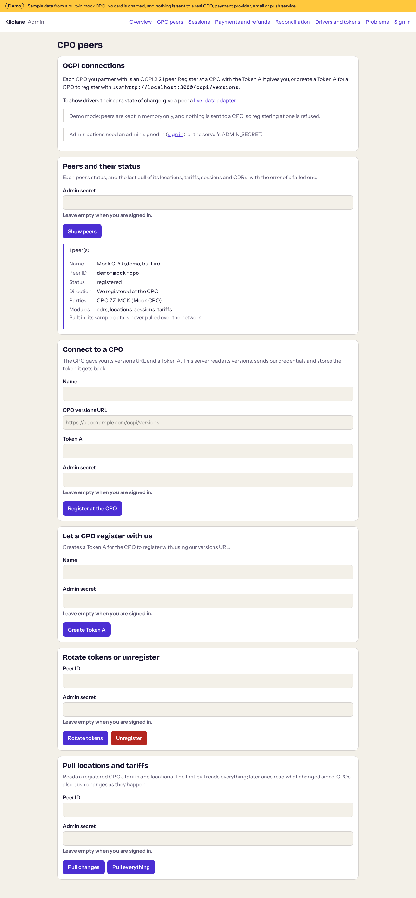           | 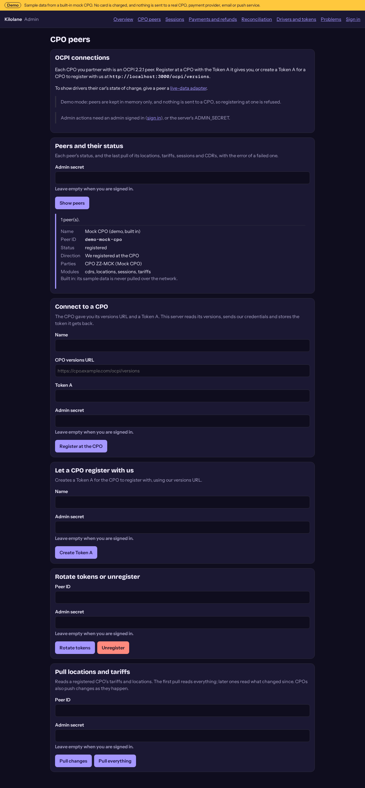           | 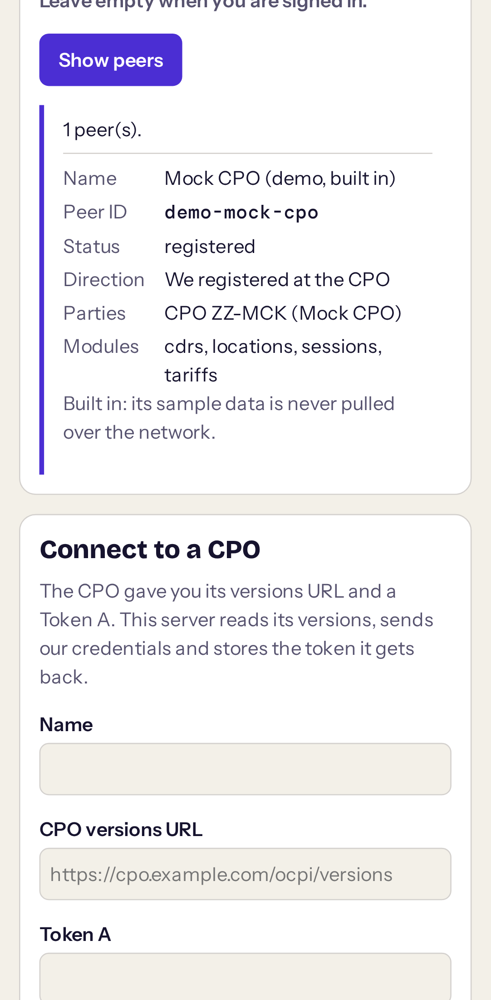               | 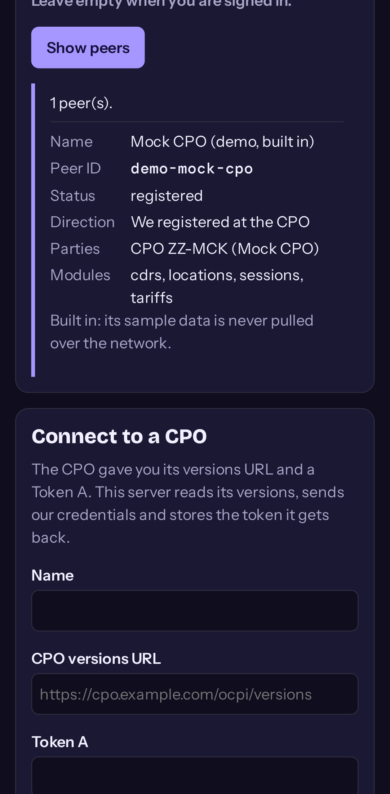               |
| **Sessions**           | 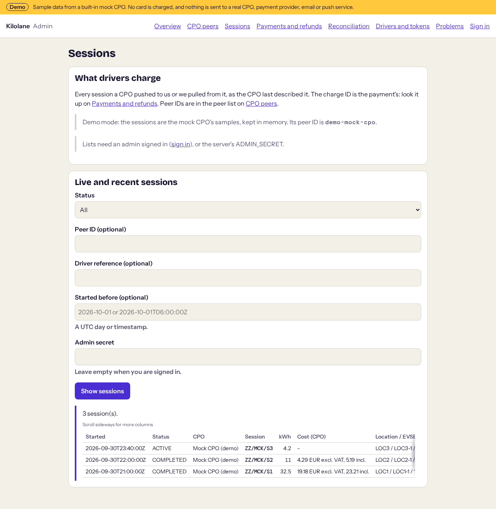          | 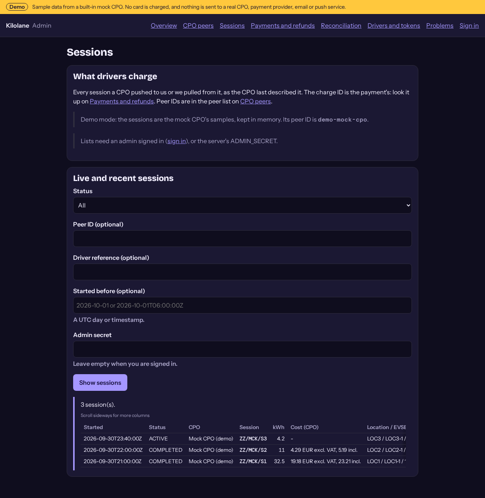          | 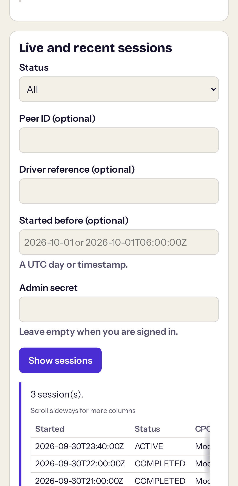             | 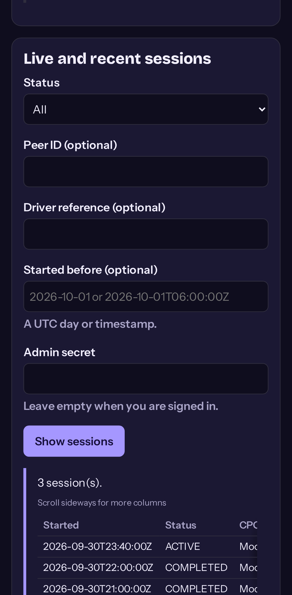             |
| **CDR reconciliation** | 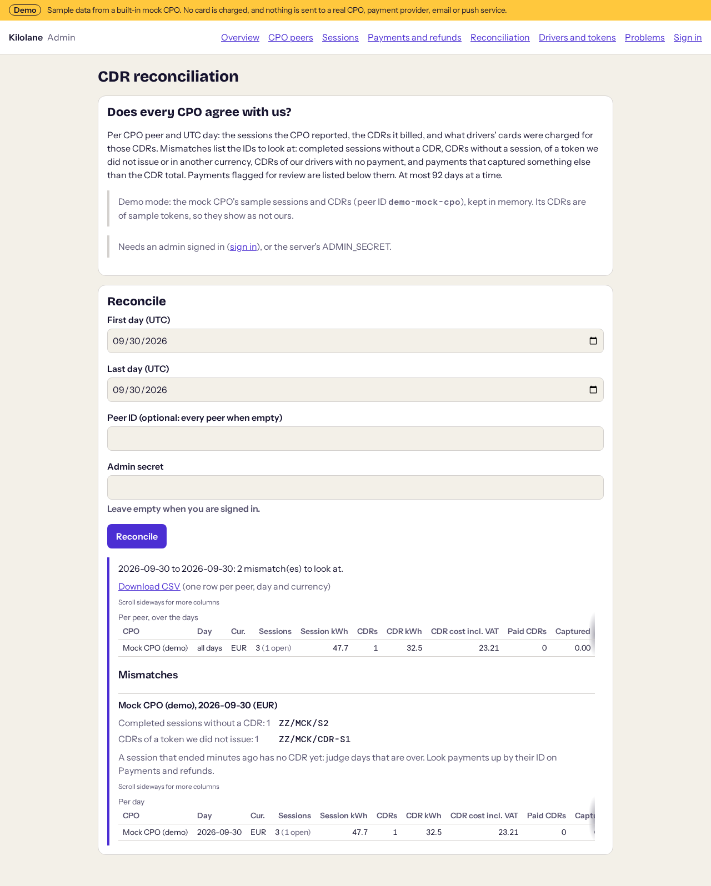 | 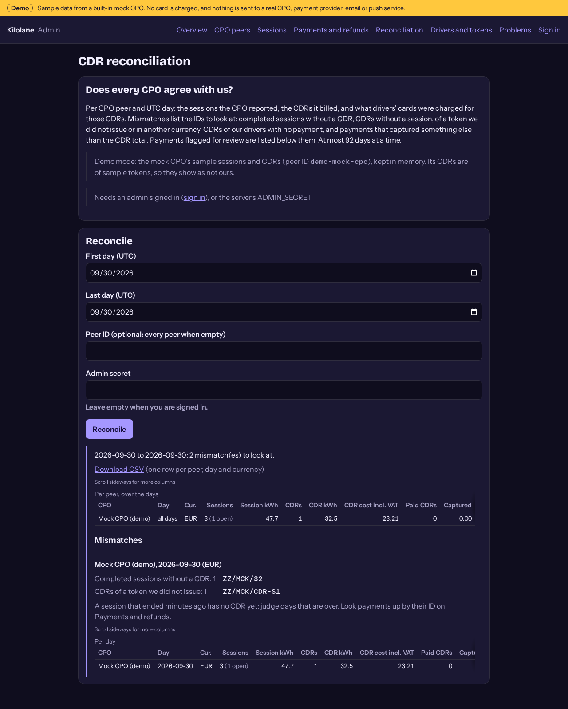 | 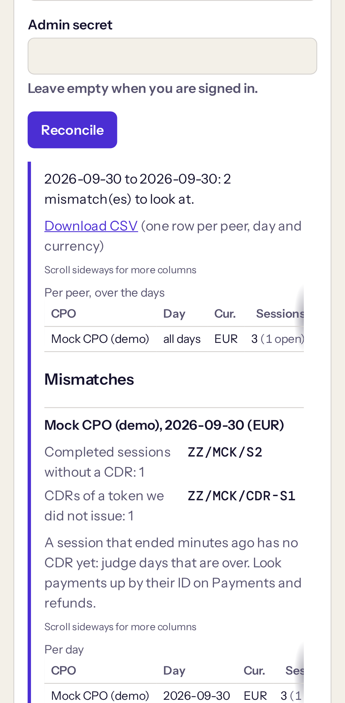 | 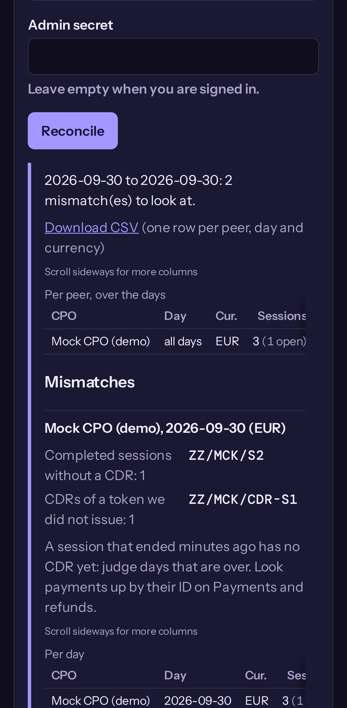 |

**Errors.** Every failed admin action shows its message, a **code** and a **next step** (`lib/admin/errors.ts`). The code is the CPO's OCPI status code when it answered with one (`OCPI 2001`: invalid or missing parameters; `OCPI 3003`: no matching endpoints, and so on), else the HTTP status it answered with (`HTTP 401`: it refused our token), else our own (`demo_mode`, `invalid_input`, `not_found`, `no_ocpi_response`, `wrong_secret`, `stripe_no_answer`, `above_captured`, ...). A failed pull keeps its OCPI status code with its result, so the peer list shows it later too.

**Audit log.** Refunds record the admin who made them (`admin:<user ID>`, or `admin:secret` for `ADMIN_SECRET`) and their reason, in the refund row and in the audit log, as do blocks and unblocks of drivers. Card data, Stripe IDs and emails never go to the audit log.

**Reconciliation, the payment side** (`emsp_payment_reconciliation`, beside `emsp_reconciliation`): for CDRs (not credit CDRs) per peer, day and the CDR's currency, the CDRs a payment was settled from, the CDRs of our drivers that none was, the CDR totals those payments saw, and what they captured and refunded (minor units; a payment in another currency is not summed, it counts as a mismatch). The memory store gives the same figures, and a PGlite test holds them together. CSV cells a spreadsheet would run as a formula are escaped.

## Driver accounts and sign-in

`lib/accounts/`. Drivers sign in without a password, from the app and the web, with **Supabase Auth**'s email one-time code (and a link, if your email template has one):

1. `POST /api/v1/auth/code { email }`: Supabase emails the code. The answer is always `202` for a valid address, whether it has an account or not.
2. `POST /api/v1/auth/verify { email, code }` (or `{ tokenHash }` from the link): the session (`accessToken`, `refreshToken`, `expiresAt`) and the account. The first sign-in makes the account (`emsp_drivers`, keyed by the Supabase Auth user ID, which is also the driver reference of their tokens, commands and payments) and the driver's app token, pushed to every CPO.
3. The app sends `Authorization: Bearer <accessToken>` on every driver call, refreshes with `POST /api/v1/auth/refresh { refreshToken }` and signs out with `POST /api/v1/auth/sign-out`. The server checks a token with Supabase Auth and trusts the answer for 30 seconds.

**Rate limits**, per server instance: 5 codes per email and 20 per client address per hour (500 in total); 10 code attempts per email and 30 per client per 15 minutes (1,000 in total). Past a limit the API answers `429` with `Retry-After`. Supabase Auth adds its own limits on emails. The per-client count needs a trusted client address (`TRUSTED_PROXY_HEADER`, or Vercel); without one only the per-email and total limits apply. Ten wrong codes for an address hold up that address's sign-in for 15 minutes, its owner's too.

**Supabase setup** (dashboard, once): Authentication → Providers → Email on, "Confirm email" on. In the **Magic Link** email template, put the code in: `{{ .Token }}`; for a link as well, point it at your app with the token hash, for example `{{ .RedirectTo }}?token_hash={{ .TokenHash }}`, set `AUTH_REDIRECT_URL` and add it under URL Configuration → Redirect URLs. Set your own SMTP server for real volumes. Sign-up is open: any email can make a driver account, which can charge only once it saves a card.

**CORS.** The driver API sends no cookies, so another site cannot ride on a driver's session; browsers may read its answers only from `APP_ORIGINS`.

### Admin sign-in

`/admin/sign-in` uses the same email code. Only users in the **admin role table** `emsp_admins` get in: `admin` (every action) or `viewer` (read only). The access token is kept in an httpOnly, `SameSite=Strict` cookie and lasts as long as the Supabase session's access token (an hour by default); then sign in again. The server only reads `emsp_admins`. Add the first admin in the SQL editor, after they have asked for a code once (which makes their Auth user):

```sql
insert into public.emsp_admins (user_id, role)
select id, 'admin' from auth.users where email = 'you@example.com';
```

Demo mode has no admin accounts: admin actions there take `ADMIN_SECRET`.

### Driver API

All need the driver's Bearer token; answers are JSON, `no-store`.

| Endpoint                                                                  | What it does                                                                                                                                                                                      |
| ------------------------------------------------------------------------- | ------------------------------------------------------------------------------------------------------------------------------------------------------------------------------------------------- |
| `GET /api/v1/me`                                                          | The account: ID, email, status, whether a default card is saved, the mode.                                                                                                                        |
| `GET /api/v1/cards`                                                       | The saved cards, as Stripe holds them: brand, last 4 digits, expiry, which is the default.                                                                                                        |
| `POST /api/v1/cards/setup`                                                | `{ requestId, stripeVersion }`: the Customer, a SetupIntent's client secret, an ephemeral key and the publishable key, for PaymentSheet.                                                          |
| `PUT /api/v1/cards/default`                                               | `{ paymentMethodId }`: one of the driver's own cards becomes the one they pay with.                                                                                                               |
| `DELETE /api/v1/cards/{id}`                                               | Removes one of the driver's cards from Stripe.                                                                                                                                                    |
| `POST /api/v1/charges`                                                    | `{ requestId, locationId, evseUid?, connectorId? }`: the hold, then START_SESSION. `201` for a new start, `200` for a retry or `busy`.                                                            |
| `GET /api/v1/charges/{id}`                                                | Poll a start or stop, with its payment.                                                                                                                                                           |
| `POST /api/v1/charges/{id}/stop`                                          | `{ requestId }`: STOP_SESSION for the start's session (`409` until the session is known).                                                                                                         |
| `GET /api/v1/payments`                                                    | The driver's payments, newest first, with the stop reason when we stopped a session.                                                                                                              |
| `GET /api/v1/charges/quote`                                               | `?locationId&evseUid&connectorId`: the hold a start there would place (currency, amount), before the driver confirms.                                                                             |
| `GET /api/v1/charges/active`                                              | The charge in progress (a start still open, or one whose session runs), or `null`.                                                                                                                |
| `GET /api/v1/charges/{id}/session`                                        | The start's session: status, kWh, start and end, the CPO's running cost (minor units), live data, the payment.                                                                                    |
| `GET /api/v1/charges/{id}/receipt`                                        | The receipt from the start's CDR and the payment's own figures (held, charged, refunded, why we stopped it). `409` until the CDR came.                                                            |
| `POST /api/v1/charges/{id}/receipt/email`                                 | Emails the receipt again (3 per driver per hour). `503` without email receipts.                                                                                                                   |
| `GET /api/v1/history`                                                     | The driver's charges with a payment, newest first: place, session, payment, whether a receipt is ready, the stop code.                                                                            |
| `PUT`, `DELETE /api/v1/push-token`                                        | `{ token, platform, locale }`: this device's Expo push token (at most 10 per driver), or forget it.                                                                                               |
| `GET /api/v1/favourites`, `PUT`, `DELETE /api/v1/favourites/{locationId}` | The driver's favourite locations (at most 100).                                                                                                                                                   |
| `POST /api/v1/problems`                                                   | `{ locationId, evseUid?, category, message, photo? }`: a problem at a charger, for the admin web. The photo is a JPEG or PNG (checked by its bytes), 1 MB at most; 10 reports per driver per day. |

Amounts are minor units of their currency. Why we stopped a session comes as `stopCode` too (`hold_increment_declined`, `other` or `null`), so the app says it in its own words: a declined higher hold is never told as a charger fault.

### Push notifications

`lib/push/`. The server pushes to the driver's devices from its own events: **charging finished** (`session.completed` of one of our drivers' sessions), a **start that failed**, was refused or timed out, a **stop that failed** or timed out (`command.finished`, `lib/commands/events.ts`), and a **declined higher hold** (`hold_increment_declined`: "Your card didn't approve more charging; session stopped at €25.00", with the amount the card covers in the device's locale and currency; that session's "charging finished" is not sent as well). A refused payment hold is not pushed: the app is waiting for that answer and shows it. Each device gets the words of its own language (`lib/push/messages.ts`; English fills the rest). Expo's push service is the example (`ExpoPushSender`, `EXPO_ACCESS_TOKEN`, through `outboundFetch`); implement `PushSender` for another provider. A token Expo reports as `DeviceNotRegistered` is forgotten. **Demo mode never sends**: notifications go to an in-memory outbox. The web app has no push.

**Pushes never hold up a CPO.** The OCPI Sessions, CDRs and Commands receivers emit the events, but each notification runs after the response has been sent (Next's `after()`, `later` in `lib/push/notify.ts`), so a slow or hanging push provider never delays a CPO's request or changes its answer. A failed send is logged by its error name and not retried.

**Which account a device belongs to.** A device's token belongs to the driver who saved it last: saving a token another account holds moves it (a shared phone, or one driver signing out and another in). The save needs the new driver's access token, and the app saves only the token Expo gave this device; there is no further proof that the device is the caller's. The trade-off: a signed-in driver who somehow learned another device's Expo push token could move it to their own account. That device would then stop getting its owner's notifications and get the caller's instead, which carry nothing of the owner's. Saves are limited to 20 per driver per hour, and the owner's device takes its token back the next time its app saves it (at its next start of a charge, or from Account). If you need more, verify the device first (for example, push a one-time code to it and have the app send it back) before moving a token.

### Demo charging

In demo mode the server plays the mock CPO's side of a charge (`lib/driver-app/demo-charging.ts`), through the Sessions module's own code, so payments, receipts and notifications run as they do live: a START_SESSION that succeeded gets a session (linked by its `authorization_reference`), its energy and cost rise while the app reads it (0.2 kWh per second, at the connector's tariff; the app's offline demo uses the same pace, and a test keeps the two equal), and a STOP_SESSION completes it and posts its CDR, which settles the demo payment and makes the receipt (in the demo outbox). The second demo card, Mastercard •••• 0341, declines a higher hold: once the cost reaches a tenth of the hold the payments module stops the session exactly as it does live (`declineIncrement`). Nothing is sent anywhere and no card is charged.

## Payments

`lib/payments/`. **Money: the owner merges changes here.** Payments run on the network's **own Stripe account** (`STRIPE_SECRET_KEY`), over Stripe's REST API through `outboundFetch` (no SDK), so demo mode can never reach Stripe.

**Saved cards.** Stripe holds the cards; we never see or store card data. Each driver gets one Stripe Customer (made at their first card setup, with the idempotency key `emsp:driver:<id>:customer`), the app saves cards with Stripe's **PaymentSheet** from a SetupIntent (`usage: off_session`), and the driver chooses the default card in the app (`PUT /api/v1/cards/default`, checked to be their own). We keep the Customer and default card IDs only. The `setup_intent.succeeded` webhook makes a new card the default when the driver has none.

**Charging**, one payment per START_SESSION command (`emsp_payments`):

1. **Hold** (`hold.ts`), before START_SESSION is sent: the account must be active with a default card. The currency is the charger's tariff currency (`PAYMENT_DEFAULT_CURRENCY` when no tariff says, or connectors disagree), the amount `HOLD_AMOUNTS` for it. A manual-capture PaymentIntent is confirmed **off-session** on the saved card. Only if the card network authorises it does the start go out. A refused card ends the start as `hold_failed` with words for the driver (declined, insufficient funds, expired, or a bank that wants the driver to confirm the card, which an off-session hold cannot do).
2. **Capture** (`settle.ts`), on the session's CDR (the `cdr.received` event, and the cron sweep for any the event missed): the CDR's `total_cost.incl_vat`, rounded **once**, half up, to minor units (12.345 EUR is 1235), **never more than the hold**. A payment captures only from a CDR the Sessions module linked to **its own START_SESSION** (through the start's own session; a CDR of another session with the same `authorization_reference` is the driver's by token only, and charges nothing here).
3. **CDR above the hold:** the whole hold is captured and the payment goes to **admin review** (`cdr_above_hold`) with the difference (`shortfall_amount`). Nothing more is ever charged automatically.
4. **Release:** a start that ends without charging (refused, not supported, failed) cancels its hold at once. A start whose outcome we never learnt (no answer, or the CPO's `TIMEOUT`) keeps its hold for 30 minutes in case a session appears; the cron sweep then releases it if none did, or leaves it for the session's CDR. A **zero-cost** CDR releases the hold.
5. **Refunds**, from `/admin/payments`: partial or whole, each with a reason (required), never more than was captured in total (reserved in the database under a lock on the payment), one per admin request ID. A refund keeps Stripe's own status: `succeeded`, `failed` (or Stripe's `canceled`), or still open, `pending` or `requires_action`, which keeps its amount reserved until the refund webhook settles it. A refund Stripe has (one with a Stripe refund ID) is never sent again; one whose answer was lost is retried with the same key, or settled by its webhook. Stripe can fail a refund that had succeeded; its amount is then free to refund again.

**Edge cases**, all to admin review and never charged automatically:

| Case                                         | What happens                                                                                                                                                                                                                                                                                            |
| -------------------------------------------- | ------------------------------------------------------------------------------------------------------------------------------------------------------------------------------------------------------------------------------------------------------------------------------------------------------- |
| A late CDR, after the hold expired           | Card holds last about 7 days for most online card payments (Stripe gives the deadline, `capture_before`; some cards less). A CDR after that, or after the card network dropped the hold, captures nothing: `hold_expired`, with the CDR's amount as the shortfall. Charge it yourself if you decide to. |
| The CDR's currency is not the hold's         | Nothing is captured and the hold is kept: `currency_mismatch`. An admin captures an amount (at most the hold) or releases it.                                                                                                                                                                           |
| The CDR gives no amount incl. VAT            | The amount excl. VAT is captured (never more than the CPO billed) and flagged `vat_unknown`.                                                                                                                                                                                                            |
| A credit CDR for the start                   | `credit_cdr`: refund the driver if it is owed.                                                                                                                                                                                                                                                          |
| Stripe never answered the hold               | The start is refused and the payment flagged `hold_unknown`; when Stripe's webhook reports a hold for it, it is cancelled (`cancel-orphan`).                                                                                                                                                            |
| A dispute, or a refund made in the Dashboard | `dispute`, `refund_outside`, from the webhook.                                                                                                                                                                                                                                                          |
| Another CDR for a start already settled      | Nothing more is charged or refunded: `second_cdr` (a correction, say 24.00 after 12.00 was captured). The audit log has the new CDR's amount; refund or charge the difference yourself.                                                                                                                 |
| A capture whose answer was lost              | Stripe's `payment_intent.succeeded` settles it from the start's CDR, exactly as the capture would have (amount, `cdr_above_hold` and its shortfall, receipt), whether it comes before or after the sweep. Only a capture with no CDR (made in the Dashboard) is recorded as `refund_outside`.           |

**Idempotency.** Every Stripe write carries an `Idempotency-Key` derived from the charge request (the START_SESSION command ID) and the action: `emsp:<command>:hold`, `:capture`, `:cancel`, `:increment:<n>`, `:refund:<request ID>`; card setup uses the driver's ID. A write with no answer is retried once with the same key and otherwise left for the sweep, which retries with the same key: one hold, one capture, whatever happens. Stripe keeps keys for at least 24 hours.

**Webhook** (`POST /api/webhooks/stripe`): every request is checked against `STRIPE_WEBHOOK_SECRET` (the `Stripe-Signature` HMAC, at most 5 minutes old), and each event is handled once by its ID (`emsp_stripe_events`). Subscribe to `payment_intent.amount_capturable_updated`, `payment_intent.canceled`, `payment_intent.succeeded`, `payment_intent.payment_failed`, `charge.refunded`, `charge.expired`, `charge.dispute.created`, `refund.created`, `refund.updated`, `refund.failed` and `setup_intent.succeeded`. On an older API version without the `refund.*` events, `charge.refund.updated` does the same.

**Events** (`events.ts`), for the app: `payment.captured`, `payment.released`, `payment.review` and `hold_increment_declined`.

### Incremental authorization

**Off by default** (`STRIPE_INCREMENTAL_AUTH`). When on, the hold asks for incremental authorization (`payment_method_options[card][request_incremental_authorization]=if_available`), and Stripe says per payment whether the card allows it (`incremental_authorization.status` on the charge). For such a payment, when a running session's cost (the CPO's `total_cost` on the session) reaches `HOLD_INCREMENT_AT_PERCENT` of the hold, the hold is raised by another `HOLD_AMOUNTS` step (`increment_authorization`, key `emsp:<command>:increment:<n>`). If a raise is **declined**, or Stripe's limit of 10 attempts per PaymentIntent is reached, we send STOP_SESSION, store the reason on the session and the payment (shown in the history and the receipt), flag the payment (`increment_declined`) and emit `hold_increment_declined` with the amount still authorised. Nothing is ever charged beyond what was authorised.

Where it works, per [Stripe's documentation](https://docs.stripe.com/payments/incremental-authorization) (check it before you switch this on):

- **Account:** Stripe offers it on **IC+ pricing**; on standard pricing, ask Stripe support.
- **Card brands:** Visa and Mastercard (all merchant countries; Mastercard excludes Mexican accounts and JPY payments of Japanese accounts), American Express (some issuers do not support it; Stripe then answers `unavailable`), and Discover in listed merchant categories, which include electric vehicle charging. UnionPay, Diners Club and JCB only in some countries and categories.
- **Not** extending the hold's life: raises do not extend the capture deadline (about 7 days).
- **SCA** (EEA, UK): raises are merchant-initiated; tell drivers before they start that the hold is an estimate that may be raised.

The CPO must send the running cost on the session; without it there is nothing to compare, and the hold is not raised.

### Receipts

`lib/receipts/`. When a payment settles from its CDR, the driver gets one email receipt: where and when, the energy, the CPO's total, what was charged, and why the session stopped if we stopped it. One provider interface (`Mailer`); **Resend** is the example (`RESEND_API_KEY`, `RECEIPT_FROM`), with the idempotency key `receipt:<payment id>`. Use another provider by implementing `Mailer` and returning it from `mailer()`. A failed send is logged and not retried. **Demo mode never sends**: receipts go to an in-memory outbox.

### Try it in Stripe test mode

Everything above runs against Stripe's test mode first, with no real money. Use a Stripe account of your own (a new one is fine) and its **test** keys.

1. In the Dashboard, switch to test mode and copy the test keys into `.env.local`: `STRIPE_SECRET_KEY=sk_test_...` and `STRIPE_PUBLISHABLE_KEY=pk_test_...`. Set `HOLD_AMOUNTS` (for example `EUR:2500`) and leave `DEMO_MODE` unset.
2. Forward webhooks to your local server with the [Stripe CLI](https://docs.stripe.com/stripe-cli): `stripe listen --forward-to localhost:3000/api/webhooks/stripe`. It prints a `whsec_...` signing secret for this session: set it as `STRIPE_WEBHOOK_SECRET` and restart the server.
3. Sign in from the app (or the web build), save a card in the PaymentSheet with one of [Stripe's test cards](https://docs.stripe.com/testing): `4242 4242 4242 4242` authorises; `4000 0000 0000 9995` is declined (insufficient funds), to see a refused hold; `4000 0027 6000 3184` needs 3-D Secure, which an off-session hold cannot do. Any future expiry date and any CVC.
4. Start a session at a charger of a CPO you are connected to in test (the mock CPO in the tests does the same in process). The hold appears in the Dashboard as **Uncaptured**; the CDR captures it; `/admin/payments` refunds it.
5. To try webhooks without a session, `stripe trigger payment_intent.succeeded` sends a test event (it belongs to no payment here, so it is acknowledged and changes nothing).

Test-mode keys only ever reach test-mode data. Switch to live keys only after you have followed the whole flow once.

### Go live with payments

1. In the Stripe Dashboard of the network's account, create the webhook endpoint above with those events, and copy its signing secret.
2. Set `STRIPE_SECRET_KEY`, `STRIPE_PUBLISHABLE_KEY`, `STRIPE_WEBHOOK_SECRET`, and `HOLD_AMOUNTS` for your currencies.
3. Apply the migration `202610220007_accounts_payments.sql`.
4. Set `CRON_SECRET` and a cron for `/api/cron/ocpi-sync`, so missed CDRs settle and uncertain holds are released.
5. For receipts, verify your sending domain at Resend and set `RESEND_API_KEY` and `RECEIPT_FROM`.
6. For the driver app, apply `202610220009_driver_app.sql`, and for push notifications set `EXPO_ACCESS_TOKEN` (see [Push notifications](#push-notifications)).

## Live data (state of charge)

OCPI 2.2.1 has no state of charge (SoC) and no current power. `lib/live-data/` adds them where a CPO can: each CPO peer may have one **live-data adapter**, a read-only source that answers `getLive(session) → { socPercent?, socMeasuredAt?, powerKw?, powerMeasuredAt? }`. Every field is optional, but each value needs the time the charger measured it. The app shows what it gets (`app/src/components/LiveReadout.tsx`) and hides the rest, so a CPO without an adapter looks exactly as before.

**Stale readings are dropped.** A charger that is suspended (`SuspendedEV`) or offline stops sending meter values while its OCPI session stays `ACTIVE`, so an old reading would show a car charging that is not. `cleanLive` (`adapter.ts`) keeps a power only when it was measured in the last 3 minutes and a SoC only when it was measured in the last 15, each by its own time, so a fresh SoC never keeps an old power on screen. A value without a time, or with one more than a minute in the future, is dropped. The app checks again with the same limits, since a screen may show an answer for a while, and labels a SoC older than 2 minutes "last seen … min ago".

- **Default: the null adapter.** A peer without an adapter returns `{}`: OCPI data only.
- **Ivora API adapter** (`ivora.ts`), for a CPO peer that runs on Ivora. Configured per peer with that CPO's API URL, its tenant ID and a **read-only key** (scope `billing:read` only), which the CPO creates for you in its Ivora developer tools. **Tell the CPO what that key reads:** `billing:read` on Ivora has no per-partner scope, so it reads every transaction, bill and payment of the CPO's tenant, not only your drivers' sessions. This server only ever asks for the sessions of its own drivers, but a CPO may prefer to issue the key from a dedicated tenant or a key it can revoke on its own. It uses public, documented, read-only endpoints only: `GET /v1/tenants/{tenant}/transactions/{id}` and `GET …/transactions/{id}/meter-values` ([OpenAPI](https://api.ivoracharge.com/openapi.json)). On Ivora an OCPI session's ID is the charging transaction's ID. The adapter uses the transaction only when public fields agree with the session: not a test transaction, started within 10 minutes of the session's `start_date_time`, and, when Ivora shows the masked ID token, ending in the same characters as the session's token. Otherwise it returns nothing, because a guess could show another driver's car. From the meter values it takes the newest `SoC` and the newest total `Power.Active.Import` (W or kW), each with its sample's time. A charger that reports no SoC gives none, and a finished transaction gives no power. It reads at most 10 pages of 500 values per call and keeps its place after every page, so a long session catches up over a few calls, even when a read is cut off by the timeout. Answers are cached for 15 seconds, so an app polling every few seconds costs one call per session. **Failures back off:** a `429` pauses every call for that peer until its `Retry-After` has passed (a minute when it gives none, at most 15 minutes); a `401` or `403` (a revoked key) pauses it for 10 minutes; any other failure is remembered per session for 30 seconds. An API URL that resolves to a private address (loopback, `10.x`, cloud metadata and so on) is refused by `peerFetch`, logged as an SSRF refusal and paused for 10 minutes. Saving the peer's settings again starts afresh. Every request is a GET through `peerFetch`: https only, public addresses only, refused in demo mode, with a 5-second timeout and a 1 MB limit. It never sends a charger command and never writes anything.
- **Demo mode** uses a demo adapter for the mock CPO (`demo.ts`): its charging session shows an invented, rising SoC. Nothing is sent anywhere, and saved adapters are never called.

**Settings** are kept per peer in `emsp_live_data_adapters`. The API key is AES-256-GCM encrypted with `OCPI_TOKEN_ENCRYPTION_KEY`, like peer tokens, and bound to the peer, so a ciphertext copied to another row does not decrypt. It is never logged, returned or shown again. Set, replace, list and remove them in **Admin, live data** (`/admin/live-data`), behind `ADMIN_SECRET` like the other admin actions. Every change goes to the audit log with the adapter kind and API host, never the key.

**For the app:** `sessionLive(id, driverRef, { sessions, adapterFor })` (`live.ts`) gives one of a driver's sessions with its live data. It returns null for a session that is not that driver's. Only a running session asks its adapter. A failing adapter (CPO API down, key revoked) is logged by error code and the session shows without extras. Values out of range (SoC outside 0 to 100, negative power) or too old are dropped. The app's endpoint for it arrives with driver sign-in, like the commands' endpoints: it takes the signed-in driver's reference, never one the app sends.

### Write an adapter for another CPO

1. Create `lib/live-data/<cpo>.ts` exporting a function that returns a `LiveDataAdapter` (`adapter.ts`): a `kind` and `getLive(ref, signal)`. `ref` has the OCPI fields of the session (peer, party, session ID, status, start time, location, EVSE, connector, token UID), never the driver.
2. Find the CPO's own record of the session **from public fields only**, and check it is the same session before using it. Return `{}` when unsure.
3. Send requests with `peerFetch` (`lib/server/peer-fetch.ts`) only, so demo mode and private addresses are refused. Use GET only, a timeout (pass `signal` on), a size limit (`readLimitedText`) and a short cache. Put the key in a header only. Throw `LiveDataError(code, message)` on failures, never with the key, URL or body in the message. Back off when the CPO says so (`429` and `Retry-After`, a rejected key) instead of asking again on every poll, and cache failures briefly.
4. Return each value with the time the charger measured it (`socMeasuredAt`, `powerMeasuredAt`), never the time you read it: `cleanLive` uses these times to drop stale readings, and drops a value without one.
5. Register it in `ADAPTER_KINDS` (`registry.ts`) with a label, what the account ID means at that CPO, and patterns for the account ID and key. Then add a card for it in `app/admin/live-data/live-data-admin.tsx` (a hidden `kind` field and the same inputs).
6. Test it with HTTP mocks, as `tests/live-data.test.ts` does for Ivora: the mapping, what a mismatch returns, stale readings, errors and back-off, and that every request is a GET. Never call the real API in tests or CI.

## Database

Migrations live in `supabase/migrations/`, named `<YYYYMMDDNNNN>_<name>.sql`, and are additive.

```sh
npm run check:migrations   # the 10-30 check, also run in CI
npm run db:migrate         # applies pending migrations using SUPABASE_DB_URL from .env.local
```

| Migration                                 | What it adds                                                                                                                                                                                                                                                                                                                                                                                                                                                                                         |
| ----------------------------------------- | ---------------------------------------------------------------------------------------------------------------------------------------------------------------------------------------------------------------------------------------------------------------------------------------------------------------------------------------------------------------------------------------------------------------------------------------------------------------------------------------------------- |
| `202610210001_baseline.sql`               | The append-only audit log.                                                                                                                                                                                                                                                                                                                                                                                                                                                                           |
| `202610210002_ocpi_peers.sql`             | The OCPI peer registry and the hashes of the tokens we issue.                                                                                                                                                                                                                                                                                                                                                                                                                                        |
| `202610210003_ocpi_locations_tariffs.sql` | The locations and tariffs cache (`emsp_ocpi_locations`, `emsp_ocpi_tariffs`, each row with a `revision` for compare-and-swap), the state of each peer's pull (`emsp_ocpi_sync_state`), and the functions that store a pulled page and find search candidates. Service-only: executable by `service_role` alone.                                                                                                                                                                                      |
| `202610210004_tokens.sql`                 | Our drivers' tokens (`emsp_tokens`: one APP_USER and one contract per driver, unique uid per type, compare-and-swap `revision`; never deleted) and the push outbox (`emsp_token_pushes`, filled by the `emsp_tokens_owe_push` trigger in the same transaction as every token change, cleared when a push lands), with `emsp_tokens_count` for `X-Total-Count` and `emsp_token_push_failed` for the backoff. Service-only.                                                                            |
| `202610210005_commands.sql`               | The commands we send (`emsp_commands`: one per driver, type and app request ID; one open start per driver and one open stop per session, by partial unique indexes; status changes are compare-and-swap; never deleted) and `emsp_command_claim`, which claims a request in one step under a lock. Service-only.                                                                                                                                                                                     |
| `202610220001_live_data_adapters.sql`     | Each CPO peer's optional live-data adapter (`emsp_live_data_adapters`: kind, https API URL, account ID and the read-only API key, encrypted only). An admin may replace or remove one. Service-only.                                                                                                                                                                                                                                                                                                 |
| `202610220007_accounts_payments.sql`      | Driver accounts (`emsp_drivers`: Stripe Customer and default card IDs only), the admin role table (`emsp_admins`, read-only to the server), payments (`emsp_payments`: one per START_SESSION, status by compare-and-swap, never deleted), refunds (`emsp_payment_refunds`, reserved by `emsp_payment_reserve_refund` under a lock and settled by `emsp_payment_settle_refund`), handled Stripe events (`emsp_stripe_events`), and `emsp_sessions.stop_reason`. Amounts in minor units. Service-only. |
| `202610220008_admin_web.sql`              | For the admin web: indexes for the session list (by status, by peer) and for one subject's audit log, an index on `emsp_payments.cdr_id`, and `emsp_payment_reconciliation`, the payment side of reconciliation. Additive: no new tables. Service-only.                                                                                                                                                                                                                                              |
| `202610220009_driver_app.sql`             | For the driver app: devices' Expo push tokens (`emsp_push_tokens`, one row per token, with the device's language), favourite locations (`emsp_favourites`) and problem reports (`emsp_problem_reports`, with an optional JPEG or PNG of at most 1 MB; never deleted, an admin marks them resolved). Additive. Service-only.                                                                                                                                                                          |
| `202610210006_sessions_cdrs.sql`          | Our drivers' sessions (`emsp_sessions`: per peer and CPO party, with each field's update time, the links to the driver and the start command, a compare-and-swap `revision`; never deleted) and CDRs (`emsp_cdrs`: immutable, refused any update or delete by a trigger), the sessions and CDRs pull state beside the locations one, and `emsp_reconciliation`. Amounts in E4 whole numbers. Service-only.                                                                                           |

`db:migrate` runs every pending file in one transaction under an advisory lock and records it in `public.emsp_schema_migrations`. Without `SUPABASE_DB_URL`, run the files in filename order in the Supabase SQL editor.

The **10-30 rule**, checked by the repository's shared checker, [`tools/check-migrations`](../../tools/check-migrations/README.md) (`npm run check:migrations` runs `node ../../tools/check-migrations supabase/migrations`):

- Every table created in `public` enables row-level security and runs `revoke all on <table> from public, anon, authenticated` in the same migration. The revoke keeps older Supabase projects, whose default privileges still grant new tables to the Data API roles, as closed as new ones. No migration may `disable row level security`.
- No default grants (`alter default privileges ... grant`) and no schema-wide grants (`grant ... on all tables in schema` or `all functions`).
- A table grant to `anon`, `authenticated` or `public` needs a policy on that table. The app talks to this server only, so expect no such grants: tables are service-only.
- Every function or procedure created in `public` runs `revoke execute (or all) on function <name> from public` in the same migration, because Postgres grants `EXECUTE` to `PUBLIC` by default. No migration grants `EXECUTE` to `anon`, `authenticated` or `public`.
- Every `security definer` function sets `search_path` (for example `set search_path = ''`).

**If you fork only this template,** copy `tools/check-migrations` into your repository too, keeping the same layout (`emsp-starter/` and `tools/` side by side, so `../../tools/check-migrations` still resolves), or change the path in `package.json` and the workflow. It needs no install.

`tests/migrations.test.ts` applies every migration to an in-memory Postgres ([PGlite](https://pglite.dev)) with Supabase's roles, and checks RLS, table and function grants, `search_path` on `security definer` functions and table behaviour. It runs them twice: on a database like a new Supabase project, and on one with the legacy default grants of older projects. Use `tests/support/pglite.ts` for the tests of new migrations.

## End-to-end tests against a CPO

`tests/e2e/` is one suite that runs this eMSP against one CPO over OCPI 2.2.1, end to end. CI runs it against the [mock CPO](#mock-cpo), so it is never tied to one platform. You can run the same suite against **any** CPO's OCPI 2.2.1 sandbox. Each step uses the server's own code: the OCPI client and endpoints, the driver API the app calls, and the payment flows.

| Step                    | What it checks                                                                                                                                                                                                                                                       |
| ----------------------- | -------------------------------------------------------------------------------------------------------------------------------------------------------------------------------------------------------------------------------------------------------------------- |
| Reachability            | Our versions endpoint answers, without a token, from where the CPO calls it.                                                                                                                                                                                         |
| Handshake               | We register at the CPO with its versions URL and Token A. It offers 2.2.1 with a CPO role, a locations Sender, a tokens Receiver and a commands Receiver.                                                                                                            |
| Locations and tariffs   | A full pull (paginated) of both, then the app's search and location detail. With no location given, the suite picks the first `AVAILABLE` EVSE that takes remote starts.                                                                                             |
| Tokens                  | A driver signs in. Their app token and an RFID card are pushed, and nothing is left owed. The CPO's Tokens Receiver (`GET`) holds both, and the card has `whitelist: NEVER`.                                                                                         |
| Card                    | A Stripe Customer, with Stripe's test card saved as the default.                                                                                                                                                                                                     |
| START_SESSION           | `POST /api/v1/charges`. **Accepted:** the hold, the CommandResult and the session linked to the start. **Rejected:** the start ends as "This charger doesn't accept app starts" and the hold is released.                                                            |
| Session updates         | The session carries the start's `authorization_reference` and the driver's token. It keeps running for `OCPI_E2E_CHARGE_SECONDS` while the CPO pushes (or we pull) its changes.                                                                                      |
| STOP_SESSION            | `POST /api/v1/charges/{id}/stop`, its CommandResult, and the session completed, with at least one update after the start.                                                                                                                                            |
| CDR                     | The CDR, pushed or pulled, linked to the start, the session and the driver.                                                                                                                                                                                          |
| Capture and refund      | The payment is captured from the CDR, never above the hold, and Stripe agrees. A refund of up to 0.50 then goes back to the card. A CDR that costs nothing releases the hold instead.                                                                                |
| Real-time authorization | The app token gets `ALLOWED` and an RFID card gets `NOT_ALLOWED`. A real CPO asks only when it wants to (at a start, say), so the suite checks our answers about this run's app token and RFID card, and skips the step, saying why, if the CPO asked about neither. |
| Unregister              | Credentials `DELETE` at the CPO (unless `OCPI_E2E_KEEP_REGISTRATION=1`).                                                                                                                                                                                             |

**Some CPOs disable remote start.** Set `OCPI_E2E_EXPECT_START` to say what the sandbox does:

- `rejected` (the default): START_SESSION must be refused, and the driver API must show the "remote start not available" state. The steps that need a session (session updates, STOP_SESSION, CDR, capture, refund) are then skipped, and each says why. The handshake, the pulls, the token pushes and real-time authorization still run.
- `accepted`: the full path.

A run that gets the other answer fails, and the message names the setting to change. The mock lane runs both. The eMSP does not send `UNLOCK_CONNECTOR` yet, so that step is listed as skipped.

**Run it against the mock CPO** (offline; CI does this):

```sh
npm run test:ocpi-e2e
```

**Run it against a CPO's sandbox.** You need:

1. **The CPO's OCPI 2.2.1 versions URL and a Token A** for your eMSP. These come from the CPO's onboarding, and some sandboxes also need your country code and party ID listed beforehand.
2. **A public `https://` origin** that reaches this machine. The CPO calls our endpoints (versions, CommandResults, sessions, CDRs, authorization). The suite serves them on `127.0.0.1:OCPI_E2E_LISTEN_PORT` (default 3318), so put a tunnel or reverse proxy in front of that port and set its origin as `OCPI_E2E_PUBLIC_URL`.
3. **A Stripe test-mode key** (`sk_test_…` or `rk_test_…`). A live key is refused.

Copy [`.env.e2e.example`](.env.e2e.example) to `.env.e2e.local` (git ignores it), fill it in, and run:

```sh
npm run test:ocpi-e2e   # loads .env.e2e.local; prints the lane, never a value
```

- The run needs no database. Every store is in memory for the run, sign-in uses the built-in demo sign-in (no email is sent), receipts are off, and the peer's token is encrypted with a new key each run.
- With `accepted`, a real charger starts and stops: pick the EVSE with `OCPI_E2E_LOCATION_ID`, `OCPI_E2E_EVSE_UID` and `OCPI_E2E_CONNECTOR_ID`.
- **No charger is left charging.** Before it unregisters, every run checks whether the CPO took a START_SESSION, also one it was expected to refuse, or one whose session never linked in time. It then waits up to `OCPI_E2E_TIMEOUT_SECONDS` for the session link, sends STOP_SESSION, and waits as long again for the result. If it still cannot stop the session, it prints "Stop it on the CPO side" with the start's `authorization_reference`, location and EVSE: stop it there by hand.
- For CPOs that only offer `GET`, sessions and CDRs are also pulled while the suite waits. Each wait lasts at most `OCPI_E2E_TIMEOUT_SECONDS` (default 300).
- A CPO on a private network (a lab) also needs `OCPI_ALLOW_PRIVATE_PEERS=1`. It is never honoured in production.
- **Never in public CI.** The real lane refuses to run when `CI` or `GITHUB_ACTIONS` is set, unless `OCPI_E2E_ALLOW_CI=1`; use that only in a private pipeline that holds the credentials. Never commit a versions URL, a token or a key.
- Each run registers the eMSP afresh and unregisters at the end. Test tokens, the test Customer and the test payment stay in the CPO's sandbox and in Stripe test mode.

## Deploy

The server and the admin web deploy together as one Vercel project:

[](https://vercel.com/new/clone?repository-url=https%3A%2F%2Fgithub.com%2FIvora-Charge%2Fivora-examples&root-directory=emsp-starter%2Fserver&project-name=emsp-starter-server&repository-name=emsp-starter&env=EMSP_COUNTRY_CODE,EMSP_PARTY_ID,PUBLIC_BASE_URL,SUPABASE_URL,SUPABASE_SERVICE_ROLE_KEY,OCPI_TOKEN_ENCRYPTION_KEY&envDescription=Live-mode%20settings.%20Type%20demo%20in%20any%20you%20don%27t%20have%20yet%3A%20the%20server%20stays%20in%20demo%20mode%20until%20all%20of%20them%20are%20real.&envLink=https%3A%2F%2Fgithub.com%2FIvora-Charge%2Fivora-examples%2Ftree%2Fmain%2Femsp-starter%2Fserver%23deploy)

1. The button copies this folder into a new repository of yours and asks for the live-mode settings: `EMSP_COUNTRY_CODE`, `EMSP_PARTY_ID`, `PUBLIC_BASE_URL`, `SUPABASE_URL`, `SUPABASE_SERVICE_ROLE_KEY` and `OCPI_TOKEN_ENCRYPTION_KEY` (see [Connect real services](#connect-real-services)). Vercel takes no empty field, so type `demo` in any you don't have yet: `demo` counts as unset, and the server stays in demo mode until every one is real. `PUBLIC_BASE_URL` is the deployment's own `https://` address, so it is often `demo` the first time.
2. To go live, apply the migrations (`npm run db:migrate` from your machine, see [Database](#database)), replace each `demo` in the project's environment settings, and redeploy. Add your first admin (see [Admin sign-in](#admin-sign-in)).
3. For the scheduled pulls, token push retries and the payment sweep, set `CRON_SECRET` and add a cron for `/api/cron/ocpi-sync` in a `vercel.json` (Vercel Cron sends the header itself). The template ships none, because Vercel's free plan runs crons at most once a day.
4. For payments, add the Stripe variables and the webhook; see [Go live with payments](#go-live-with-payments). For receipts and push, add `RESEND_API_KEY`, `RECEIPT_FROM` and `EXPO_ACCESS_TOKEN`. For the app's web build, add its origin to `APP_ORIGINS`.
5. Give your CPOs the versions URL from **CPO peers**, or connect to theirs.

For a public demo, set `DEMO_MODE=true` and nothing else. The driver app deploys separately: see the [app README](../app/README.md#deploy).

## What it uses

OCPI 2.2.1 as the eMSP role, with any CPO; Supabase (Postgres and Auth); Stripe on the network's own account; Resend for receipts (replaceable).

Optionally, for CPO peers that run on Ivora, the [live-data adapter](#live-data-state-of-charge) reads state of charge and power from the public Ivora API, with that CPO's read-only key:

| Endpoint                                                     | Permission     |
| ------------------------------------------------------------ | -------------- |
| `GET /v1/tenants/{tenant_id}/transactions/{id}`              | `billing:read` |
| `GET /v1/tenants/{tenant_id}/transactions/{id}/meter-values` | `billing:read` |

Ask the CPO for a key with `billing:read` and no other scope. The adapter sends GET requests only.

## Limits and next steps

- `ADMIN_SECRET`, while set, still opens admin actions beside admin sign-in. Wrong secrets are limited to 5 per client and 50 in total per 15 minutes, counted per server instance. Admin sessions are not refreshed: sign in again when the access token expires.
- Sign-in rate limits are counted per server instance.
- **RFID cards cannot charge** until RFID billing lands: they are `NEVER` on every CPO and real-time authorization answers `NOT_ALLOWED`, so no session runs without a payment hold. See [Tokens](#tokens-and-real-time-authorization) for how it will be lifted.
- A receipt that fails to send is not retried. Payment events and the incremental-authorization check run in the server process on session events; the cron sweep settles CDRs the events missed.
- The admin web lists sessions and flagged payments, but finds other payments by ID. Admin forms reset after each action (React form actions): fill the filters again for the next search.
- The admin web shows times in UTC.
- The OCPI version details list credentials, locations, tariffs, tokens, commands, sessions and CDRs. Charging preferences (an eMSP's `PUT` to a CPO's Sessions Sender) are not sent.
- Demo mode keeps peers in memory and refuses to contact a CPO; its locations and tariffs are the mock CPO's sample data, loaded in-process, never pulled.
- Locations with `publish: false` never appear, including those published only to certain tokens (`publish_allowed_to`).
- Tokens are pushed to each peer's first CPO party. A platform that hosts several CPO parties behind one connection gets one push per token, addressed to that party.
- Contract IDs carry no eMA check digit.
- The search reads at most 1,000 candidates per query from the store, nearest first; see [Locations and tariffs](#locations-and-tariffs).
- The public API's rate limits are counted per server instance.
- Prices are display only: the CPO's tariff as it says, without your own fees.
- Rotating `OCPI_TOKEN_ENCRYPTION_KEY` needs every peer to be registered again. An expired Token A leaves its peer pending; unregister it to close it.
- A stop from the app needs the session linked to the driver's start, which the Sessions module does on the first push or pull of the session.
- Session events run in the server process and are not queued; the payment sweep catches CDRs they missed.
- Reconciliation lists at most 100 IDs per mismatch and day: narrow the days for the rest. Flagged payments are listed for every peer (a payment names its charge, not its peer).
- Live data reaches the app through `GET /api/v1/charges/{id}/session`. Only an Ivora adapter is included; other CPOs need their own (see [Write an adapter for another CPO](#write-an-adapter-for-another-cpo)). The adapter's cache is per server instance.
- OCPI 2.2.1 has no capability for Plug & Charge, so a charger that refuses app starts can only be shown as RFID-capable.
- Receipt copies, push saves and problem reports are rate limited per server instance (reports per driver per day in the database). A failed push is not retried.
- Problem photos are kept in the database (base64, 1 MB at most). For many photos, move them to object storage.

## Checks

```sh
npm run format:check && npm run typecheck && npm run check:migrations && npm test && npm run build
npm run test:ocpi-e2e                                 # the OCPI e2e suite, against the mock CPO
npx playwright install chromium && npm run test:e2e   # offline demo run, desktop and mobile
SCREENSHOT=1 npm run test:e2e -- screenshots          # redraws docs/admin-*.png (after npm run build)
```

Tests never need credentials or network access. The OCPI e2e suite talks to a real CPO only when you configure one; see [End-to-end tests against a CPO](#end-to-end-tests-against-a-cpo).
