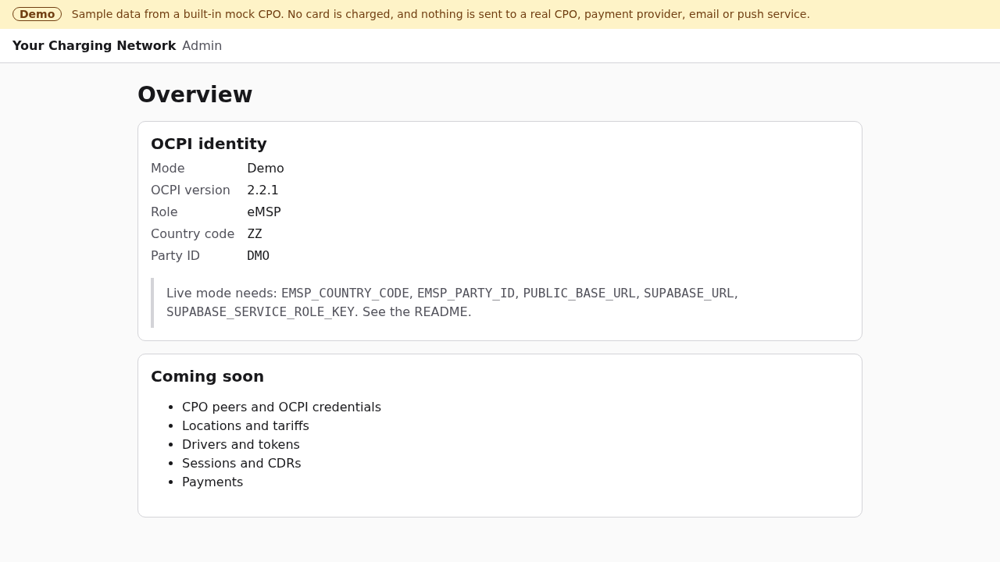

# eMSP Starter: server

> **In progress** (part 4 of 13). See the [template README](../README.md) for what the eMSP Starter is and how the server and the app fit together.

The Next.js server of the eMSP Starter: OCPI 2.2.1 eMSP endpoints, the REST API for the driver app, the admin web, and the Supabase migrations.



## What it does today

- **Admin web shell:** an Overview with the eMSP's OCPI identity (version, country code, party ID) and, in demo mode, the names of the variables live mode still needs.
- **API:** `GET /api/v1/status` returns the mode, the network name and the OCPI identity. It holds no secrets, so any origin may read it. `GET /api/v1/locations` searches charging locations; see [Locations and tariffs](#locations-and-tariffs).
- **Config and demo mode:** `lib/server/config.ts` reads the environment (server-only); `lib/server/demo.ts` is the one demo-mode switch and the only gate for outbound requests.
- **Database:** an append-only audit log, the OCPI peer registry, the locations and tariffs cache, drivers' tokens and their push queue, the migrate script, and the shared 10-30 check.
- **OCPI 2.2.1 core:** the versions and credentials modules, with any number of CPO peers, in both handshake directions. See [OCPI peers](#ocpi-peers).
- **Locations and tariffs:** pulled from every CPO peer (full, then incremental, paginated and resumable) and received as pushes, stored per peer, searchable by the app, with display prices and a price preview. See [Locations and tariffs](#locations-and-tariffs).
- **Tokens and real-time authorization:** drivers' APP_USER tokens (with an eMA contract ID from our party) and RFID cards, served to CPOs from our Tokens Sender, pushed to every CPO's Tokens Receiver at once (with retries), and authorized in real time. See [Tokens](#tokens-and-real-time-authorization).
- **Admin, CPO peers** (`/admin/peers`): connect to a CPO, create a Token A for a CPO to register with us, rotate tokens, unregister, list peers, pull a peer's locations and tariffs. Temporarily gated by `ADMIN_SECRET`.
- **Admin, driver tokens** (`/admin/tokens`): look up a driver's tokens, create an app token, add an RFID card, block, unblock, change the whitelist, retry missed pushes. Temporarily gated by `ADMIN_SECRET`.

## Run locally

Requires Node.js 22.13 or later.

```sh
npm ci
npm run dev
```

With no credentials it starts in **demo mode**, with a "Demo" banner on every page. Demo mode never charges a card, never sends a command or request to a real CPO, and never sends email or push notifications.

## Connect real services

Copy `.env.example` to `.env.local` and fill it in. All variables are server-side only; never prefix one with `NEXT_PUBLIC_`.

| Variable                    | Purpose                                                                                                                                                                                                                                                                                                                |
| --------------------------- | ---------------------------------------------------------------------------------------------------------------------------------------------------------------------------------------------------------------------------------------------------------------------------------------------------------------------- |
| `EMSP_COUNTRY_CODE`         | Your ISO 3166-1 alpha-2 country code, for example `NL`. Required for live mode.                                                                                                                                                                                                                                        |
| `EMSP_PARTY_ID`             | Your 3-character OCPI party ID. Required for live mode.                                                                                                                                                                                                                                                                |
| `PUBLIC_BASE_URL`           | The `https://` origin this server is reached at. CPO peers call the OCPI endpoints on it. Required.                                                                                                                                                                                                                    |
| `SUPABASE_URL`              | Supabase project URL. Required for live mode.                                                                                                                                                                                                                                                                          |
| `SUPABASE_SERVICE_ROLE_KEY` | Supabase service role key. Bypasses RLS: never logged, never sent to the app. Required for live mode.                                                                                                                                                                                                                  |
| `SUPABASE_DB_URL`           | Postgres connection string, used only by `npm run db:migrate`.                                                                                                                                                                                                                                                         |
| `OCPI_TOKEN_ENCRYPTION_KEY` | 32 random bytes, base64 (`openssl rand -base64 32`). Encrypts the tokens CPO peers give us, at rest. Required for live mode. Losing or changing it means re-registering every peer.                                                                                                                                    |
| `ADMIN_SECRET`              | **Temporary**, until admin sign-in (part 7). At least 32 characters (`openssl rand -base64 32`). Every admin action asks for it; without it the admin actions are disabled.                                                                                                                                            |
| `CRON_SECRET`               | Required in live mode once you issue tokens (token expiry and push retries run only with it); otherwise optional. At least 32 characters. Enables the scheduled jobs, `GET /api/cron/ocpi-sync` with `Authorization: Bearer <CRON_SECRET>`: the pull, token push retries and expiry. Without it the route answers 503. |
| `TRUSTED_PROXY_HEADER`      | Optional. The header your own proxy or CDN sets to the client address, for example `cf-connecting-ip`. When set, it alone keys every rate limit. See **Rate limits without a proxy** below.                                                                                                                            |
| `OCPI_TOKEN_A_TTL_DAYS`     | Optional. Days a Token A we issue stays valid, 1 to 90. Default 7.                                                                                                                                                                                                                                                     |
| `OCPI_ALLOW_PRIVATE_PEERS`  | **Local development and tests only.** `1` lets peer URLs point at loopback or private addresses, for a CPO on your machine. Off by default; ignored when `NODE_ENV` is production.                                                                                                                                     |
| `DEMO_MODE`                 | Set to `true` (or `1`, `yes`, `on`) to force demo mode even when everything above is set, for example on a public demo.                                                                                                                                                                                                |

Live mode turns on only when all required variables are set and valid. OCPI peer credentials are not environment variables: they are exchanged with each CPO over the OCPI credentials module and stored in the database, with tokens we issue stored as hashes and peer tokens encrypted at rest.

> **Before going live:** this part has no admin sign-in, only the temporary `ADMIN_SECRET` on admin actions, rate limited per server instance. Run live mode only on a private deployment until the admin part lands.
>
> **Admin lockout:** wrong secrets are limited to 5 per client and 50 in total per 15 minutes. The total cap is what stops guessing from many addresses, but it also means anyone who can reach the admin page can send 50 wrong secrets and lock the real admin out for 15 minutes, from as many forged addresses as they like. The client key is taken from the hosting platform's own client-IP header where there is one (`x-vercel-forwarded-for`, `x-real-ip`), else from the right-most `X-Forwarded-For` entry, the one your proxy added; entries to its left are whatever the client sent. Without a proxy in front of the server every one of these headers can be forged. When `TRUSTED_PROXY_HEADER` is set, that header alone is read (its last entry, the one your proxy added) and nothing else. Until admin sign-in lands, keep the admin page off the public internet (an IP allow-list or a private network) so the lockout cannot be triggered by strangers; restarting the server clears the counts.
>
> **Rate limits without a proxy:** when no client-IP header reaches the server (no proxy, or a proxy that sets another header), the search and price-preview limits key every client as `unknown`, so one client can use up the 120 (and 30) requests per minute for everyone. Set `TRUSTED_PROXY_HEADER` to the header your proxy sets, or put your platform's firewall rate limiting in front.

## OCPI peers

This server is the eMSP side of OCPI 2.2.1. Every CPO platform is a peer, and none is special. Our endpoints:

| Endpoint                        | What it does                                                                                         |
| ------------------------------- | ---------------------------------------------------------------------------------------------------- |
| `GET /ocpi/versions`            | Our versions. Needs a token we issued (a Token A too).                                               |
| `GET /ocpi/2.2.1`               | Version details: credentials, the locations and tariffs Receivers and the tokens Sender.             |
| `/ocpi/2.2.1/credentials`       | `GET` our credentials, `POST` to register (with a Token A), `PUT` to rotate, `DELETE` to unregister. |
| `/ocpi/2.2.1/locations/…`       | Locations Receiver: `GET`, `PUT`, `PATCH` a location, EVSE or connector.                             |
| `/ocpi/2.2.1/tariffs/…`         | Tariffs Receiver: `GET`, `PUT`, `PATCH`, `DELETE` a tariff.                                          |
| `GET /ocpi/2.2.1/tokens`        | Tokens Sender: every token we issued, paginated, with `date_from` and `date_to`.                     |
| `POST …/tokens/{uid}/authorize` | Real-time authorization of one of our tokens.                                                        |

**We register at a CPO.** The CPO gives you its versions URL and a Token A. In **Connect to a CPO**, this server reads the CPO's versions and 2.2.1 details with Token A, issues our Token B, POSTs our credentials to the CPO and stores the Token C it answers with. It then reads the versions again with Token C, from the URL the CPO returned. If anything fails after the CPO accepted us, it unregisters there again.

**A CPO registers with us.** In **Let a CPO register with us**, create a Token A and send it with our versions URL (`PUBLIC_BASE_URL/ocpi/versions`) to the CPO over a secure channel. The token is shown once; only its hash is stored. It expires after `OCPI_TOKEN_A_TTL_DAYS` (default 7 days). The CPO POSTs its credentials with Token A; we read its versions with its token, revoke Token A and answer with a new Token C.

**Rotate and unregister.** Either side can rotate (credentials `PUT`) or unregister (`DELETE`). When we rotate, our old token keeps working until the CPO has answered, so its calls during the update are not refused. When we unregister, we tell the CPO first, and unregister locally anyway if it has already forgotten us (401 or 405).

When a CPO registers with us and its versions cannot be used, it gets `3001 Peer endpoint unreachable or invalid`, whatever went wrong, so the credentials module cannot be used to probe other hosts. The two exceptions name what its own valid versions answer lacks: `3002 Peer offers no OCPI 2.2.1` and `3003 Peer has no credentials endpoint`.

How it works, in `lib/ocpi/`:

- **Registry** (`store.ts`, `store-supabase.ts`): peers with their roles, endpoints per module and status (`pending`, `registered`, `unregistered`, `failed`); a peer's parties may not belong to another registered peer or to us. Tokens we issue are stored as SHA-256 hashes (`emsp_ocpi_issued_tokens`); the token a peer gave us is AES-256-GCM encrypted with `OCPI_TOKEN_ENCRYPTION_KEY`, bound to the peer's ID. In demo mode the registry is in memory.
- **Client** (`client.ts`): the envelope, `Authorization: Token <base64>`, a new `X-Request-ID` per attempt and one `X-Correlation-ID` per operation, routing headers, a pagination iterator over `Link` / `X-Total-Count` / `X-Limit` with `date_from` and `date_to`, retries with exponential backoff and jitter on timeouts, network errors and HTTP 5xx (GET only, unless a call says it is safe to repeat), and OCPI status codes mapped to error classes. It follows no redirects, and never follows a next-page link to another origin.
- **Peer addresses** (`lib/server/peer-fetch.ts`): peers choose the URLs we call, so every request to a peer goes through `peerFetch`. It refuses demo mode, needs `https://`, resolves the host once and refuses it if any address is loopback, private (RFC 1918), link-local, CGNAT, unique-local IPv6, unspecified, multicast, documentation or reserved, including cloud metadata addresses (`169.254.169.254`, `fd00:ec2::254`) and IPv4 embedded in IPv6. The socket then connects to the address it checked, so a second DNS answer cannot redirect it (DNS rebinding). When a CPO calls our credentials module, we read its versions with one 5-second try, and any failure gets the same answer, `3001 Peer endpoint unreachable or invalid`: never the remote server's status or body. The details are logged on our side, without tokens.
- **Size limits**: we read at most 1 MB of an OCPI response and 256 KB of a request; a larger `Content-Length` is refused before reading, and a stream is cut at the limit.
- **Server middleware** (`server.ts`): checks the token's hash against the tokens we issued (base64 or the unencoded 2.1.1 form), refuses unknown, unregistered or failed peers with 401, limits a Token A to the versions and credentials modules, and checks the `OCPI-from/to` routing headers on functional modules: "to" must be us and "from" a party of the token. It echoes `X-Request-ID` and `X-Correlation-ID`.
- **Schema** (`schema.ts`): every incoming credentials, versions, version details and envelope object is validated against 2.2.1 before use.

### Mock CPO

`lib/mock-cpo/` is a second, generic OCPI 2.2.1 CPO that runs in-process: versions, credentials (all four methods, both directions), paginated locations and tariffs Sender interfaces with `date_from` and `date_to`, and a Tokens Receiver that validates every token we push against 2.2.1. It pulls our Tokens Sender (`pullTokens`) and asks for real-time authorization (`authorize`) as a CPO does. It pushes changes to our Receiver interfaces (`setEvseStatus`, `putLocation`, `putTariff`, `deleteTariff`) and injects failures (HTTP errors and hangs). Its sample data (`sample-data.ts`: invented sites in an invented city) covers AC and DC, several connector standards, every EVSE state the search cares about, facilities, parking restrictions, an unpublished site and free, energy, time-of-day, idle-fee, parking and flat-fee tariffs. The tests use it as a real peer, with a second instance on another platform that uses the same location and tariff IDs, over an in-process network (`tests/support/network.ts`): no request leaves the process. Demo mode shows the same sample data.

## Locations and tariffs

Every registered CPO's locations (with their EVSEs and connectors) and tariffs are cached in Supabase, per peer, keyed by country code, party ID and ID. Two CPOs that use the same IDs never overwrite each other, and a CPO can only write its own parties' objects.

**Pull** (`lib/locations/sync.ts`), from each peer's Sender interface, tariffs first and then locations:

- The first pull is full. Later ones are incremental: `date_from` is when the last completed pull started, minus 5 minutes for clock differences.
- Pages follow the `Link` header (100 objects asked per page; the CPO may send fewer). After every page the next page's URL is saved, so a pull that fails or stops resumes at that page on the next call. Each call reads at most 50 pages (20 from the cron route).
- One pull per peer and module at a time; a pull with no progress for 5 minutes counts as interrupted and the next call resumes it.
- A completed full pull removes that peer's objects it did not see, unless a push touched them meanwhile.
- Invalid objects, and objects of a party that is not the peer's, are skipped and counted, never stored. A pulled object older (by `last_updated`) than what a push already gave us does not replace it, even when the push lands while the page is being stored: the database function that stores a page (`emsp_ocpi_save_locations`, `emsp_ocpi_save_tariffs`) compares against the row it locks.

Start a pull from **Pull locations and tariffs** in `/admin/peers` (changes since the last pull, or everything), or on a schedule: set `CRON_SECRET` and call `GET /api/cron/ocpi-sync` with `Authorization: Bearer <CRON_SECRET>`, for example every 15 minutes. On Vercel, add a cron for that path in `vercel.json`; Vercel Cron sends the header itself when `CRON_SECRET` is set.

**Push** (`lib/locations/receiver.ts`): a CPO sends changes as they happen to our Receiver interfaces. `PUT` creates or replaces a location, EVSE, connector or tariff; `PATCH` changes some fields of one (it needs `last_updated`, and the result is validated as a whole); `DELETE` removes a tariff. OCPI 2.2.1 defines `PUT` and `DELETE` for tariffs; `PATCH` is accepted from CPOs that send it. Changing an EVSE or connector moves its location's `last_updated` forward. A change older than what we hold is acknowledged and ignored. Each push reads the stored location, applies its change and writes it back only if the location's `revision` is still the one it read (compare-and-swap); otherwise it reads again and re-applies the change, up to 25 times, then answers `3000` (HTTP 503) so the CPO retries later. So many pushes to different EVSEs of one location at once all land: a CPO never resends a push we acknowledged. EVSEs are never deleted: a CPO sets them to `REMOVED`, and removed EVSEs never appear in the app. Unknown locations, EVSEs and connectors get `2003`, unknown tariffs `2000` (HTTP 404; 2.2.1 has no tariff-specific code), invalid bodies `2001` naming the fields, another CPO's party `403`. These endpoints need a registered peer's token and the `OCPI-from`/`OCPI-to` routing headers.

**Search API**, for the app (any origin may read it; locations are public information):

`GET /api/v1/locations`, every parameter optional:

| Parameter                      | Meaning                                                                                                                            |
| ------------------------------ | ---------------------------------------------------------------------------------------------------------------------------------- |
| `lat`, `lng`, `radius_m`       | Within `radius_m` metres (default 5,000, at most 50,000) of the point, nearest first. Without a point, results are sorted by name. |
| `q`                            | Every word appears in the name, address, postal code or city.                                                                      |
| `evse_id`                      | An EVSE ID such as `NL*ABC*E12345`. Case and separators are ignored.                                                               |
| `charger_id`                   | The reference printed on the charger (`physical_reference`), an EVSE uid or a location ID.                                         |
| `status`                       | Comma-separated EVSE statuses, for example `AVAILABLE`.                                                                            |
| `min_power_kw`, `max_power_kw` | A connector's maximum power in this range.                                                                                         |
| `connector`                    | Comma-separated OCPI connector standards, for example `IEC_62196_T2_COMBO,CHADEMO`.                                                |
| `facility`                     | Comma-separated OCPI facilities; the location has all of them.                                                                     |
| `parking`, `exclude_parking`   | OCPI parking restrictions an EVSE must have (for example `DISABLED`), or must not have (for example `CUSTOMERS`).                  |
| `price`                        | `free` or `paid`, by the connector's tariff. A connector without a known tariff is neither.                                        |
| `limit`, `offset`              | Paging: 1 to 100 (default 20), and from 0.                                                                                         |

EVSE filters (status, parking, EVSE ID, charger ID) and connector filters (power, standard, price) must hold for the same EVSE. Each result says how many EVSEs matched, how many are available, the highest power, the connector standards and a one-line price. Only registered peers' published locations appear (in demo mode, the mock CPO's), and a location whose EVSEs are all removed does not. The store narrows the candidates with a bounding box, the words and the ID, nearest to the search point first (the database function `emsp_ocpi_location_candidates`), and reads at most 1,000 per search (Supabase's default **Max rows** for the Data API). In a dense area the farthest candidates are the ones left out, never the nearest; `total` then counts matches among those 1,000. For a full count over more locations than that around one point, move the search into Postgres (PostGIS).

`GET /api/v1/locations/{id}` returns one location with its EVSEs, connectors and each connector's display price. `GET /api/v1/locations/{id}/price-preview?evse_uid=&connector_id=&kwh=&minutes=[&parking_minutes=][&start=]` estimates what a session there would cost.

**Rate limits:** each client may make 120 searches and location reads, and 30 price previews, per minute; past that the API answers `429` with `Retry-After`. The client is the one your proxy reports, as for the admin secret (see **Admin lockout** under [Connect real services](#connect-real-services)): the hosting platform's client-IP header, else the right-most `X-Forwarded-For` entry. Without a proxy every client looks the same (`unknown`) and shares one limit. The counts live in each server instance; for a hard cap across instances, add your platform's firewall rate limiting in front.

**Prices** (`lib/locations/pricing.ts`) are **display only**. A connector's price is its first active `REGULAR` (or untyped) tariff, else its first active one. The display price lists every energy, time, parking and flat component with its conditions in words (days, time of day, dates, duration, energy, power, current, reservation), VAT included when the CPO gives the rate, and the tariff's minimum and maximum price. The preview walks the session minute by minute in the location's time zone, applying for each dimension the first element whose restrictions match (minimum inclusive, maximum exclusive), rounding the last period of each dimension up to its step size, then the tariff's minimum and maximum price. Money is integer arithmetic throughout: tariff prices are read as ten-thousandths of the currency unit (`priceE4`, `unitPriceE4`: OCPI prices have at most 4 decimals), line amounts stay exact fractions, and the total is rounded **once**, half up, to the currency's minor units (`totalExclVatMinor`, `totalInclVatMinor`, with `minorDigits`: 2 for EUR, 0 for JPY). Line amounts (`amountExclVatMinor`) are rounded on their own for display, so they may differ from the total by a minor unit. What a driver pays is settled from the CDR in a later part, and you may add your own fees on top of the CPO's tariff.

## Tokens and real-time authorization

Every driver has one **APP_USER** token, the one the app charges with, and may have **RFID** cards. The app token comes with the driver's **contract ID** in eMA ID format: our country code, our party ID, `C` and 8 random letters and digits, without separators or the optional check digit (for example `NLABCC12AB34CD`), like the OCPI 2.2.1 examples. RFID cards join the driver's contract: same contract ID and `group_id`. The `issuer` is the brand name. Each token has its own **whitelist** setting (OCPI 2.2.1 `WhitelistType`), which tells a CPO when it may let the token charge without asking us:

| Whitelist                                                                                                                                    | Meaning in OCPI 2.2.1                                                                                                                                                                                 |
| -------------------------------------------------------------------------------------------------------------------------------------------- | ----------------------------------------------------------------------------------------------------------------------------------------------------------------------------------------------------- |
| `ALLOWED_OFFLINE` (default)                                                                                                                  | The CPO must ask us in real time; it may let the token charge from its cached copy only when it cannot reach us. Blocks, expiries and (part 7) `NO_CREDIT` are always checked while we are reachable. |
| `NEVER`                                                                                                                                      | The CPO must ask us in real time; without an answer, no charging.                                                                                                                                     |
| `ALLOWED`                                                                                                                                    | The CPO may ask us, or let the token charge from its cached copy, even while it can reach us. A block or expiry reaches it only through a push.                                                       |
| `ALWAYS`                                                                                                                                     | The CPO never asks; it charges from its cached copy. A block or expiry reaches it only through a push.                                                                                                |
| A token is `active`, `blocked` (until unblocked) or `expired` (an RFID card past its expiry date); OCPI's `valid` is true only while active. |

Until driver sign-in lands (part 7), app tokens are created from `/admin/tokens` for a **driver reference**, any ID of up to 64 characters that will become the account ID; part 7 creates them at sign-up with `createAppToken` (`lib/tokens/manage.ts`).

**Tokens Sender.** `GET /ocpi/2.2.1/tokens` serves every token, oldest `last_updated` first, at most 100 per page (`X-Limit`), with `X-Total-Count`, a `Link` to the next page on `PUBLIC_BASE_URL`, `offset`, `limit`, `date_from` (inclusive) and `date_to` (exclusive). A CPO that pulls with `date_from` gets every change, pushed or missed.

**Pushes** (`lib/tokens/push.ts`). A new token is `PUT`, and a change (block, unblock, expiry, whitelist) `PATCH`ed with the fields that changed and `last_updated`, to `{receiver}/{country_code}/{party_id}/{uid}?type=` of every registered peer that lists a tokens Receiver, all at once, with routing headers to the peer's CPO party. `last_updated` moves forward by at least a second on every change, so a CPO that keeps the newest version never mistakes two quick changes for one. Every change is also written to an **outbox** (`emsp_token_pushes`, filled by a trigger in the same transaction as the change): each peer is owed the new version until a push of it lands. A push that fails (after one retry), or never went out because the server stopped, stays owed; the cron route and **Retry missed pushes** send the token's current version with a `PUT`, after 1, 2, 4 ... minutes, at most 6 hours apart, until it lands. Pushes of one token can overlap and land out of order (an unblock still retrying while a block goes out), so after every push that lands the token is read again and, if it changed meanwhile, its current version is sent too: the last push to land carries the newest version. A queued push for a peer that unregistered is dropped. Demo mode pushes nothing.

**Real-time authorization** (`lib/tokens/authorize.ts`). `POST /ocpi/2.2.1/tokens/{token_uid}/authorize?type=` (type defaults to `RFID`), with an optional `LocationReferences` body, answers an `AuthorizationInfo`:

| `allowed`     | When                                                                                                    |
| ------------- | ------------------------------------------------------------------------------------------------------- |
| `ALLOWED`     | The token is active. Comes with a new `authorization_reference` and the location and EVSEs asked about. |
| `BLOCKED`     | The token is blocked. Takes effect at once, before any push lands.                                      |
| `EXPIRED`     | The token is expired, or past its expiry date even if the expiry sweep has not run yet.                 |
| `NO_CREDIT`   | The driver has no usable saved card. From part 7 (`driverStanding`); until then never.                  |
| `NOT_ALLOWED` | The driver may not charge (an account restriction). From part 7; until then never.                      |

The token's own status comes first, then the driver's standing. Unknown tokens, and types we do not issue (`AD_HOC_USER`, `OTHER`), get `2004 Unknown Token` (HTTP 404); an invalid body or `type` gets `2001`. The answer carries the token as the CPO should cache it, and every answer goes to the audit log with its `authorization_reference`. Both endpoints need a registered peer's token and the `OCPI-from`/`OCPI-to` routing headers, with `OCPI-to` this eMSP and `OCPI-from` one of the peer's **CPO** parties.

**Blocking a token** from the admin takes effect for real-time authorization immediately and is pushed to every CPO at once. A CPO that charges a token without asking (`ALWAYS` or `ALLOWED`, or `ALLOWED_OFFLINE` while it cannot reach us) only stops once its push lands; set `NEVER` on tokens that must never charge unchecked.

**Expiry and retries need `CRON_SECRET`.** The cron route marks active tokens past their expiry as `expired` and pushes `valid: false` (at most 100 per call), and resends missed pushes. It runs only when `CRON_SECRET` is set, so live mode with tokens **requires** `CRON_SECRET`: without it, expiries are never pushed to CPOs and a missed push is resent only from **Retry missed pushes** on `/admin/tokens`.

## Database

Migrations live in `supabase/migrations/`, named `<YYYYMMDDNNNN>_<name>.sql`, and are additive.

```sh
npm run check:migrations   # the 10-30 check, also run in CI
npm run db:migrate         # applies pending migrations using SUPABASE_DB_URL from .env.local
```

| Migration                                 | What it adds                                                                                                                                                                                                                                                                                                                                                                                                              |
| ----------------------------------------- | ------------------------------------------------------------------------------------------------------------------------------------------------------------------------------------------------------------------------------------------------------------------------------------------------------------------------------------------------------------------------------------------------------------------------- |
| `202610210001_baseline.sql`               | The append-only audit log.                                                                                                                                                                                                                                                                                                                                                                                                |
| `202610210002_ocpi_peers.sql`             | The OCPI peer registry and the hashes of the tokens we issue.                                                                                                                                                                                                                                                                                                                                                             |
| `202610210003_ocpi_locations_tariffs.sql` | The locations and tariffs cache (`emsp_ocpi_locations`, `emsp_ocpi_tariffs`, each row with a `revision` for compare-and-swap), the state of each peer's pull (`emsp_ocpi_sync_state`), and the functions that store a pulled page and find search candidates. Service-only: executable by `service_role` alone.                                                                                                           |
| `202610210004_tokens.sql`                 | Our drivers' tokens (`emsp_tokens`: one APP_USER and one contract per driver, unique uid per type, compare-and-swap `revision`; never deleted) and the push outbox (`emsp_token_pushes`, filled by the `emsp_tokens_owe_push` trigger in the same transaction as every token change, cleared when a push lands), with `emsp_tokens_count` for `X-Total-Count` and `emsp_token_push_failed` for the backoff. Service-only. |

`db:migrate` runs every pending file in one transaction under an advisory lock and records it in `public.emsp_schema_migrations`. Without `SUPABASE_DB_URL`, run the files in filename order in the Supabase SQL editor.

The **10-30 rule**, checked by the repository's shared checker, [`tools/check-migrations`](../../tools/check-migrations/README.md) (`npm run check:migrations` runs `node ../../tools/check-migrations supabase/migrations`):

- Every table created in `public` enables row-level security and runs `revoke all on <table> from public, anon, authenticated` in the same migration. The revoke keeps older Supabase projects, whose default privileges still grant new tables to the Data API roles, as closed as new ones. No migration may `disable row level security`.
- No default grants (`alter default privileges ... grant`) and no schema-wide grants (`grant ... on all tables in schema` or `all functions`).
- A table grant to `anon`, `authenticated` or `public` needs a policy on that table. The app talks to this server only, so expect no such grants: tables are service-only.
- Every function or procedure created in `public` runs `revoke execute (or all) on function <name> from public` in the same migration, because Postgres grants `EXECUTE` to `PUBLIC` by default. No migration grants `EXECUTE` to `anon`, `authenticated` or `public`.
- Every `security definer` function sets `search_path` (for example `set search_path = ''`).

**If you fork only this template,** copy `tools/check-migrations` into your repository too, keeping the same layout (`emsp-starter/` and `tools/` side by side, so `../../tools/check-migrations` still resolves), or change the path in `package.json` and the workflow. It needs no install.

`tests/migrations.test.ts` applies every migration to an in-memory Postgres ([PGlite](https://pglite.dev)) with Supabase's roles, and checks RLS, table and function grants, `search_path` on `security definer` functions and table behaviour. It runs them twice: on a database like a new Supabase project, and on one with the legacy default grants of older projects. Use `tests/support/pglite.ts` for the tests of new migrations.

## Deploy

[](https://vercel.com/new/clone?repository-url=https%3A%2F%2Fgithub.com%2FIvora-Charge%2Fivora-examples&root-directory=emsp-starter%2Fserver&project-name=emsp-starter-server&repository-name=emsp-starter)

The button deploys the server in demo mode. To go live, apply the migrations, add the variables above in the project's environment settings and redeploy. For the scheduled pull, set `CRON_SECRET` and add a cron for `/api/cron/ocpi-sync`.

## What it uses

OCPI 2.2.1 as the eMSP role, with any CPO. Nothing from the Ivora API yet; an optional Ivora live-data adapter arrives in a later part.

## Limits and next steps

- No admin sign-in yet: `ADMIN_SECRET` is a stopgap with no session. Wrong secrets are limited to 5 per client and 50 in total per 15 minutes, counted per server instance.
- The OCPI version details list credentials, locations, tariffs and tokens; later parts add sessions, CDRs and commands.
- Demo mode keeps peers in memory and refuses to contact a CPO; its locations and tariffs are the mock CPO's sample data, loaded in-process, never pulled.
- Locations with `publish: false` never appear, including those published only to certain tokens (`publish_allowed_to`); showing them to the right drivers needs driver sign-in (part 7).
- App tokens are created by an admin until driver sign-in (part 7) creates them at sign-up; real-time authorization rests on the token's status until part 7 adds the driver's standing and saved card (`NO_CREDIT`, `NOT_ALLOWED`).
- Tokens are pushed to each peer's first CPO party. A platform that hosts several CPO parties behind one connection gets one push per token, addressed to that party.
- Contract IDs carry no eMA check digit.
- The search reads at most 1,000 candidates per query from the store, nearest first; see [Locations and tariffs](#locations-and-tariffs).
- The public API's rate limits are counted per server instance.
- Prices are display only: the CPO's tariff as it says, without your own fees.
- Rotating `OCPI_TOKEN_ENCRYPTION_KEY` needs every peer to be registered again. An expired Token A leaves its peer pending; unregister it to close it.
- Next parts: sessions and commands, CDRs, payments, driver sign-in and the admin web.

## Checks

```sh
npm run format:check && npm run typecheck && npm run check:migrations && npm test && npm run build
npx playwright install chromium && npm run test:e2e   # offline demo run, desktop and mobile
```

Tests never need credentials or network access.
