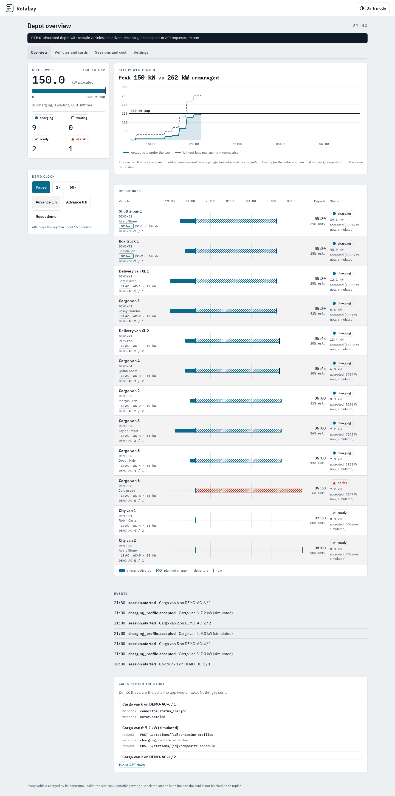
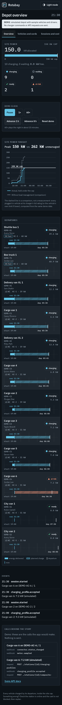
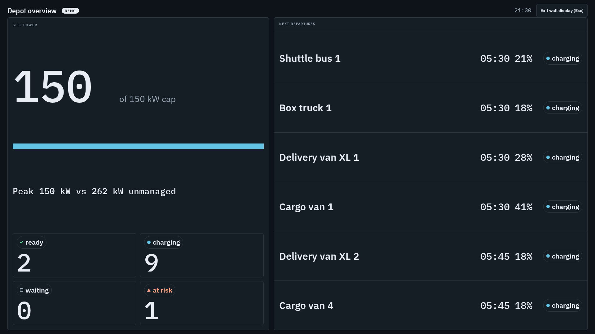

# Fleet depot

Depot charging for fleets (vans, buses, company cars) on the Ivora API. It is for operators who want every vehicle ready by its departure time, the site's power limit respected, and a monthly energy and cost figure per vehicle and per driver.



The UI ships as **Rotabay**, a calm operations console with tabular numbers and status shown by shape as well as colour. Screens in light and dark, desktop and phone, are in [`docs/screens/`](docs/screens).

## Make it yours in 5 minutes

The whole brand lives in [`brand/`](brand); components use only its tokens.

1. **Name and copy:** `brand/brand.ts` (product name, tagline, support line). A rename is the one `name` line.
2. **Colours, type scale, radius, spacing:** `brand/tokens.css`. Each colour is `light-dark(<light>, <dark>)`. Run `npm test`: `tests/contrast.test.ts` fails if a text pair drops below WCAG AA (4.5:1) in either mode.
3. **Logo:** `brand/logo.svg` (standalone file) and `brand/Logo.tsx` (the same shapes inline, so it follows `currentColor` and `--accent`). Keep both in step.
4. **Fonts:** put woff2 files in `brand/fonts/` and point `brand/fonts.ts` at them. Use open-licensed fonts and keep their license files next to them.

Light and dark follow the system setting; the header button switches and remembers the choice in the browser. The design brief and the approved mock are `brand/BRIEF.md` and `brand/mock.html`.

### Fonts and icons

- [IBM Plex Sans, IBM Plex Sans Condensed and IBM Plex Mono](https://github.com/IBM/plex), Copyright 2017 IBM Corp., SIL Open Font License 1.1 (`brand/fonts/OFL-IBMPlex.txt`).
- The Rotabay mark, the status shapes and the theme icon are original, Apache-2.0 with this template.

## Features

- **Vehicles and drivers** live in the template's own database: SQLite by default (`SQLITE_PATH`, using Node's built-in `node:sqlite`), Postgres when `DATABASE_URL` is set, and in memory in demo mode. The single `docs` table is created on first use.
- **RFID cards** use the Ivora tokens API:
  - Add a driver with a card.
  - Import a CSV of `idTag,driverName[,email]` (header optional, `,` or `;`). It is sent to `POST …/tokens/import` with only the card value and our `external_reference`; names and emails stay in your database.
  - Block a card when a driver leaves (`PATCH …/tokens/{token_id}`, with the token ID looked up by our reference).
- **Departure-time charging**: each vehicle has a departure time and the energy it needs, either in kWh or as a target battery percent.
  - The app picks the slowest constant power that finishes by departure, limited by the vehicle, the connector rating and the site allowance.
  - It sends that plan as a `session` charging profile in W for the running transaction, then asks the station for its composite schedule.
  - The board shows the station's answer from the `charging_profile.accepted` and `charging_profile.rejected` webhooks.
- **Site power cap** (`SITE_CAP_KW`): split across active sessions in whole watts (rounded down), earliest departure first. It is recomputed when a vehicle plugs in or leaves, when a departure changes, when a station answers, and every `REPLAN_INTERVAL_SECONDS` (default 60). This is app-side logic. Server-side site load balancing is planned in the Ivora API, and when it ships this split can move there. How the app keeps the stations under the cap:
  - **No expiry.** A profile has no duration, so the station keeps its last period until the session ends. Every period is at most the session's share, and from departure on the limit is that share, so a vehicle that stays plugged in past its departure is still capped.
  - **Lower limits first.** A replan sends every decrease before any increase. Increases wait until each decrease is accepted by its charger (by answer, webhook or a status read). If a decrease fails, is refused, or its outcome is unknown, the increases wait for the next replan.
  - **Counted until gone.** A profile counts at its limit until the charger rejects, replaces or clears it. On OCPP 2.x the app alternates between stack levels 1 and 2 and clears the old profile only after the new one is accepted, so a session is never left without a limit.
  - **Only what is free.** A vehicle that just plugged in gets at most the cap minus what the other sessions may still draw; it is raised once the others have made room.
  - **Optional baseline** (`BASELINE_PROFILE=1`, live mode only, off by default): see [the plug-in gap](#the-plug-in-gap).
- **Reports**: energy and cost per vehicle and per driver per month. They use Wh meter registers and the transaction's `energy_wh`, with the site tariff in integer cents (`TARIFF_CENTS_PER_KWH`). The CSV export is at `/api/reports?by=driver&format=csv&month=YYYY-MM` and guards against spreadsheet formula injection.
- **Live board**: which vehicle is on which connector, the state of charge (the charger's `soc_percent` when it reports one, otherwise an estimate labelled "est."), ready-by status, and profile status with the composite schedule.
- **Webhooks** arrive at `/api/webhooks`, verified with `Ivora-Signature` (see below).

## Screens

The landing page is at `/`, with a short "How it works on Ivora" panel (smart charging profiles, RFID cards through the token list, webhooks, and a link to the [API docs](https://ivoracharge.com/developers)). The console is at `/depot` with four tabs (Overview, Vehicles and cards, Sessions and cost, Settings) and a wall-display mode (Settings, or Esc to leave).

- **Overview:** the demo clock, a site power chart for the night, the departure timeline (one row per vehicle, labelled with its charger: L2 AC or DC fast), the event log and a "Calls behind the story" panel. The chart shows the actual kW held under the cap against a dashed line "without load management", with both peaks as numbers. The dashed line is a comparison, computed from the same demo data: every plugged-in vehicle at its charger's full rating (or the vehicle's own limit if lower). On phones each timeline row carries its own mini timeline labelled start, now and departure. Charts have text alternatives.
- **Sessions and cost:** energy and cost per vehicle or per driver for this month or last month, with a CSV download.
- **Wall display:** dark, big numbers for a TV: site kW against the cap with a slim bar, vehicles Ready, Charging, Waiting and At risk, and the next departures with their state. It fits 1920×1080 and 1280×720 without scrolling.

Regenerate the screenshots in `docs/screens/` (light and dark, desktop 1440 px and phone 390 px, plus the wall display at 1920×1080 dark) with `npm run build && npm run screenshots`.

| Overview (dark, phone)                    | Wall display (1920×1080, dark)                    |
| ----------------------------------------- | ------------------------------------------------- |
|  |  |

## Run locally

Requires Node.js 22.13 or later.

```sh
npm ci
npm run dev
```

With no credentials it starts in **demo mode**, with a persistent "Demo" banner. Demo mode never calls the Ivora API or any other service: the client refuses to send in demo mode, and a test checks this. Names, plates and card values are made up.

### The demo depot

- **12 vehicles** (electric vans of 52 to 135 kWh, a shuttle bus and a box truck of 400 kWh) on **8 chargers**: six Level 2 AC (11 and 19 kW, some with two outlets) and two DC fast (60 kW). The demo site cap is **150 kW**; live mode keeps `SITE_CAP_KW`.
- Vehicles arrive between 16:30 and 21:30 with a low state of charge and must leave between 05:30 and 08:00 with a target charge. Ten drivers have RFID cards (two vans are shared). About six weeks of earlier sessions are seeded, so reports and costs have data for this month and last month.
- **Demo clock:** Pause, 1× and 60× (the night plays in about 15 minutes at 60×), plus "Advance 1 h" and "Advance 8 h". The clock runs on the server and catches up whenever the state is read, so a wall display on another screen follows it. **Reset demo** starts the night again.
- **The story.** At 21:30 the last van (Cargo van 6) plugs in with 6% charge and must leave at 06:30. The depot is at the cap, the split serves earlier departures first, and the board flags the van as at risk. At 23:00 a scripted change moves the box truck's departure to 07:15, which puts the van ahead of it in the departure order. The van turns charging and every vehicle leaves Ready. The story comes only from the demo data and the clock; the power split and profile logic are the live ones.
- The "Calls behind the story" panel is labelled "Demo: these are the calls the app would make". It lists the real calls and webhooks behind each step (`POST …/stations/{id}/charging-profiles`, `POST …/stations/{id}/composite-schedule`, `meter.sampled`, `connector.status_changed`, `charging_profile.accepted`). Nothing is sent.

## Connect real services

| Variable                                  | Purpose                                                                                                                     |
| ----------------------------------------- | --------------------------------------------------------------------------------------------------------------------------- |
| `IVORA_API_KEY`                           | Tenant-scoped API key. Server-side only. Setting it and the tenant ID turns demo mode off.                                  |
| `IVORA_TENANT_ID`                         | Numeric tenant ID (part of every API path). Server-side only.                                                               |
| `IVORA_API_BASE_URL`                      | Optional; defaults to `https://api.ivoracharge.com`. An empty value counts as unset.                                        |
| `IVORA_WEBHOOK_SECRET`                    | The signing secret returned once when you register the webhook endpoint                                                     |
| `OPERATOR_PASSWORD`                       | **Required in live mode.** Protects the dashboard and every API route except webhooks. Without it live mode refuses to run. |
| `DATABASE_URL` / `SQLITE_PATH`            | Postgres connection string, or SQLite file (default `./data/depot.db`)                                                      |
| `SITE_CAP_KW`                             | Depot limit in kW (default 60; demo mode uses 150)                                                                          |
| `BASELINE_PROFILE`                        | Set to `1` (or `true`) to keep a per-charger baseline profile in live mode (default off; demo mode ignores it)              |
| `DEFAULT_CONNECTOR_KW`                    | Power reserved for a session whose card matches no vehicle, when the station reports no rating (default 11)                 |
| `REPLAN_INTERVAL_SECONDS`                 | Live mode replans on this timer as well as on events, to retry failed decreases and follow departures (default 60)          |
| `TARIFF_CENTS_PER_KWH`, `TARIFF_CURRENCY` | Site tariff for reports (integer cents)                                                                                     |
| `DEMO_MODE=true`                          | Force demo mode                                                                                                             |

1. Use **one Ivora project and API key per deployment**, and a test project for previews.
2. Register the webhook endpoint (`POST /v1/tenants/{tenant_id}/webhooks`) with the URL `https://<your-domain>/api/webhooks`. Subscribe to these events:
   - `meter.sampled`
   - `connector.status_changed`
   - `charging_profile.accepted`, `charging_profile.rejected` and `charging_profile.cleared`
   - `token.updated`

   Optionally limit it to your depot's stations with `stations`. Put the returned secret in `IVORA_WEBHOOK_SECRET`.

3. Add drivers with their card values and assign each vehicle a driver. Sessions are matched to vehicles by the card's last four characters, which is all the transactions API returns. A card that matches no driver, or more than one, shows under "Sessions without a vehicle" for you to assign.

### Security

- **Operator gate:** live mode can send charging profiles to real stations and block cards.
  - Every route except `/api/webhooks` needs a signed, httpOnly, `SameSite=Strict` session cookie issued after a constant-time `OPERATOR_PASSWORD` check.
  - Every write also needs a same-origin `Origin` header.
  - Changing the password signs everyone out.
  - Without `OPERATOR_PASSWORD`, live mode shows a setup message and the API answers `503 operator_password_missing`.
- **Webhooks:**
  - The app verifies `Ivora-Signature: t=<unix>,v1=<hex>`, where `v1` is the HMAC-SHA256 of `<t>.<raw body>`, before parsing.
  - The comparison is constant-time, and deliveries more than 5 minutes off our clock are rejected.
  - The event's `tenant_id` must be ours. Event IDs are stored so redeliveries are acknowledged without being processed twice.
  - The handler acknowledges at once and does the work after the response.
- **Idempotency:**
  - Every write sends an `Idempotency-Key` derived from our record and action, for example `fd-profile-<session>-<plan number>` and `fd-token-create-<driver>`.
  - The plan number only changes when the allocation changes, and the key and body are stored before sending. A retry after a timeout, `429`, `409 request_in_progress` or `503 outcome_unknown` therefore reuses the same key and body.
  - Blocking a card stores one key per block action (`fd-token-block-<token>-<random>`): a retry reuses it, and blocking again after the card was unblocked elsewhere is a new request.
  - A card import's key is the file's hash plus an attempt number. After `503 outcome_unknown` the next run of the same file uses a new attempt number, as the tokens guide asks.
  - `Retry-After` is honoured. Other `4xx` errors are not retried.
- **Errors:** API errors are shown with their code, the request ID and a link to [Errors and statuses](https://ivoracharge.com/developers/guides/reference/errors).
- **Server-only code:** the Ivora client, configuration and database code import `server-only`, and card values reach the browser masked (`****1234`).

## Deploy

[](https://vercel.com/new/clone?repository-url=https%3A%2F%2Fgithub.com%2FIvora-Charge%2Fivora-examples&root-directory=fleet-depot&env=IVORA_API_KEY,IVORA_TENANT_ID,IVORA_WEBHOOK_SECRET,OPERATOR_PASSWORD,DATABASE_URL)

SQLite needs a writable disk, so on Vercel set `DATABASE_URL` to a Postgres database. State changes are serialized within one process, so run a single instance per depot.

## What it uses from the Ivora API

All paths are under `/v1/tenants/{tenant_id}` and follow the [published OpenAPI](https://api.ivoracharge.com/openapi.json) and the [developer guides](https://ivoracharge.com/developers/guides).

| Use                      | Endpoint                                                                                                        | Permission                      |
| ------------------------ | --------------------------------------------------------------------------------------------------------------- | ------------------------------- |
| Register a card          | `POST /tokens`                                                                                                  | `tokens:write`                  |
| Import cards             | `POST /tokens/import` (CSV)                                                                                     | `tokens:write`                  |
| Find and block a card    | `GET /tokens?external_reference=…`, `PATCH /tokens/{token_id}`                                                  | `tokens:write`                  |
| Session details          | `GET /transactions/{id}`, `GET /stations/{id}`                                                                  | `billing:read`, `stations:read` |
| Charging plan            | `POST /stations/{id}/charging-profiles`, `DELETE /stations/{id}/charging-profiles/{profile_id}` (OCPP 2.x only) | `stations:control`              |
| Profile state            | `GET /stations/{id}/charging-profiles/{profile_id}`                                                             | `stations:read`                 |
| What the station applies | `POST /stations/{id}/composite-schedule`, `GET /operations/{id}`                                                | `stations:read`                 |
| Events                   | Webhooks: `meter.sampled`, `connector.status_changed`, `charging_profile.*`, `token.updated`                    | `stations:read`, `tokens:read`  |

`tokens:write` can only be granted by a tenant admin. Setting profiles goes through the usage fee gate (`402 payment_method_required`).

## The plug-in gap

Set `BASELINE_PROFILE=1` (live mode only; off by default, and demo mode stays offline and ignores it) to keep a `tx_default` charging profile on every charger the app has seen. A charger applies it to each new transaction until that transaction's own `session` profile is in force, so a vehicle that just plugged in is limited from the start.

- **Share.** The cap is divided equally over all connectors of all known chargers, in whole watts rounded down. The profile is sent without a connector, so it covers every connector of the station (and on OCPP 2.x applies to each EVSE separately), has no duration, and is relative to the start of each transaction (W).
- **Connector count.** A charger is added only once `GET /stations/{id}` has answered with its connectors. If that read fails when a session starts, the charger is left out (no baseline, not in the split) and the read is retried on every replan (a station that keeps failing is logged once an hour). The app counts connectors, not EVSEs: on an OCPP 2.x station with several connectors per EVSE that gives a smaller share and a larger reserve than needed, never a larger one.
- **When it is set.** A charger is added when the first session starts on it, and the baseline is re-checked on every replan, so a changed `SITE_CAP_KW` (read at start-up) or a new charger moves the shares. Chargers are never removed: a station that stays in the store keeps its connectors in the split.
- **Same rules as session limits.** Baseline decreases go out first, and baseline increases wait until every decrease (session or baseline) is in force. A baseline counts at its limit until the charger rejects, replaces or clears it, and on OCPP 2.x the app alternates between stack levels 1 and 2. Every limit, session or baseline, is sized against the site's worst case as it stands just before the request: every session at the limit that may be in force for it, and every idle connector at the baseline that may be in force (its rating when none is). A baseline decrease never goes above a lower baseline that was sent and not answered yet (the charger may already apply it, so that would be a raise there); the raise waits for the answer. When a charger refuses its baseline during a replan, the cap is split again before anything else is sent.
- **A baseline not in force yet** (sent but unanswered, or the charger offline) does not hold session increases back: they already count that charger's idle connectors at the old baseline, or at their rating when it has none.
- **A charger that refuses it.** If the charger answers anything but Accepted, or the API answers `smart_charging_unsupported` or `charging_profile_unsupported`, that charger counts as having no baseline: its connectors are reserved at their rating (the cap is shared among the other chargers' connectors after that), and the baseline is sent again after an hour, or sooner when the cap or the set of connectors changes. A rejected _decrease_ of a baseline that is still in force is retried on every replan, like a session decrease.
- **An offline charger is not a refusal.** When the profile never reached the charger (`station_offline` or another dispatch error, as an HTTP error or as a rejected operation, or a `charging_profile.rejected` webhook with such an error code), the charger keeps counting at its rating, or at the baseline that may still be in force, and the baseline is sent again on every replan until the charger answers. A connector without a reported rating counts at `DEFAULT_CONNECTOR_KW`.
- **Cost.** Connectors without a session keep their baseline in reserve, so sessions are planned within the cap minus that reserve (and a plugged-in vehicle counts at least at its baseline until its own profile is accepted). With five known connectors and one vehicle plugged in, that vehicle gets the cap minus four shares. Without the baseline the same vehicle could get the whole cap.
- **What is still open.** A charger has no baseline until its first session has started and its connectors are known, so its first plug-in is not covered. When a session ends, its connector falls back to the baseline: if the other sessions must be lowered to make room and the charger has not confirmed yet, a plug-in on that connector can exceed the cap by at most those pending decreases, until they land.
- **Turning it off.** With `BASELINE_PROFILE` unset the app stops managing baselines, but the `tx_default` profiles it already set stay on the chargers until they are cleared (for example from the station's charging profiles in Ivora). They only lower what a new transaction may draw before its session profile, so leaving them is safe, but the reserve for idle connectors is gone and a vehicle may start at less than the app would now give it.

The cap property test runs with the baseline on and off, on OCPP 1.6 and 2.0.1, with stations of one, two and three connectors. The cap also changes during the night. At every request and at the moment a vehicle plugs in, it checks that every plugged vehicle at the limit its station applies, plus (baseline on) every idle connector of a known charger at the baseline in force or its rating, stays within the cap plus the decreases still on their way. It also checks, by the stations' own state, that every session limit is sent within the cap minus what the rest of the site may draw, and that a baseline is raised only when the whole site stays within the cap. Once the stations answer, that worst case must be within the cap, and every night with the baseline on must include a plug-in on a known charger.

## Limits and next steps

- **Sessions come from webhooks.** Ivora has no transaction start or stop event. A session starts with a transaction's first `meter.sampled`, and ends when its connector leaves Charging and the transaction reads inactive. If a delivery fails after it is acknowledged, the event is logged and not retried; a reconcile job reading `GET …/events?after=` would close that gap.
- **Matching uses the last four characters** of the card. Keep those unique across drivers, or assign sessions by hand.
- **One process per depot.** Planning is serialized with an in-process lock, not a database lock, and the replan timer runs in that process (started from `instrumentation.ts`). On a serverless host the timer only runs while an instance is alive, so prefer a long-running server for live mode.
- **Before the first profile.** Between plug-in and the charger accepting the first session profile, a charger runs at its own default, so the site cap can be exceeded briefly. The optional baseline closes that gap; see [the plug-in gap](#the-plug-in-gap). A charger the app has not seen yet has no baseline until its first session starts and its connectors are known.
- **The plan is one constant rate until done.** There is no time-of-use optimisation, and the tariff is a flat per-kWh price from the environment rather than read from Ivora tariffs.
- **Reports bucket by UTC month.**
- **Next:** server-side site load balancing once the Ivora API offers it, time-of-use windows, event-log reconciliation, and per-site time zones.

## Checks

```sh
npm run format:check && npm run typecheck && npm test && npm run build
npx playwright install chromium && npm run test:e2e   # offline demo run in a browser
```

Tests never need credentials or network access: the Ivora API is replaced by a fake `fetch`.
