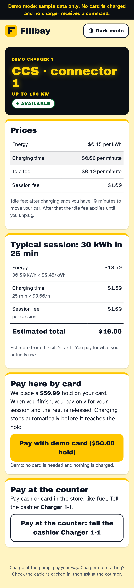
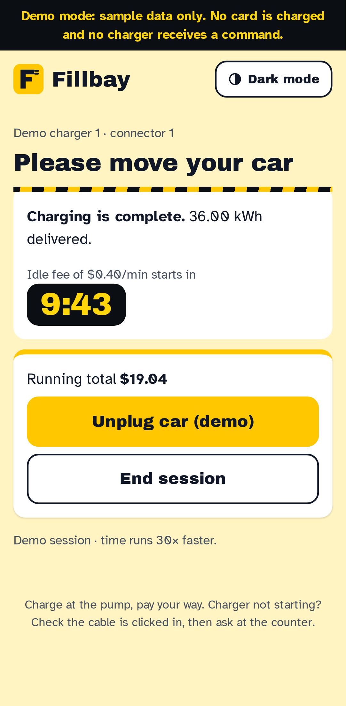
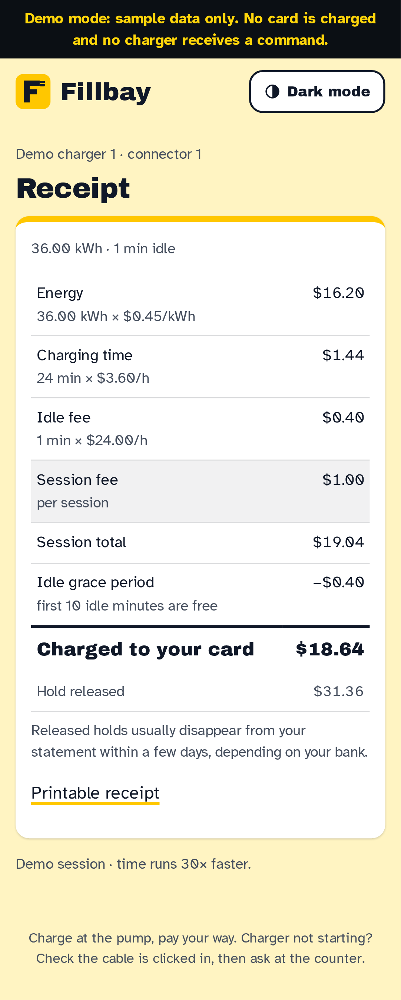
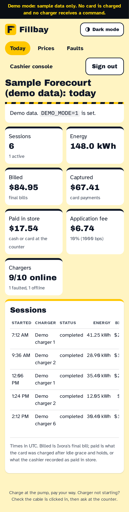
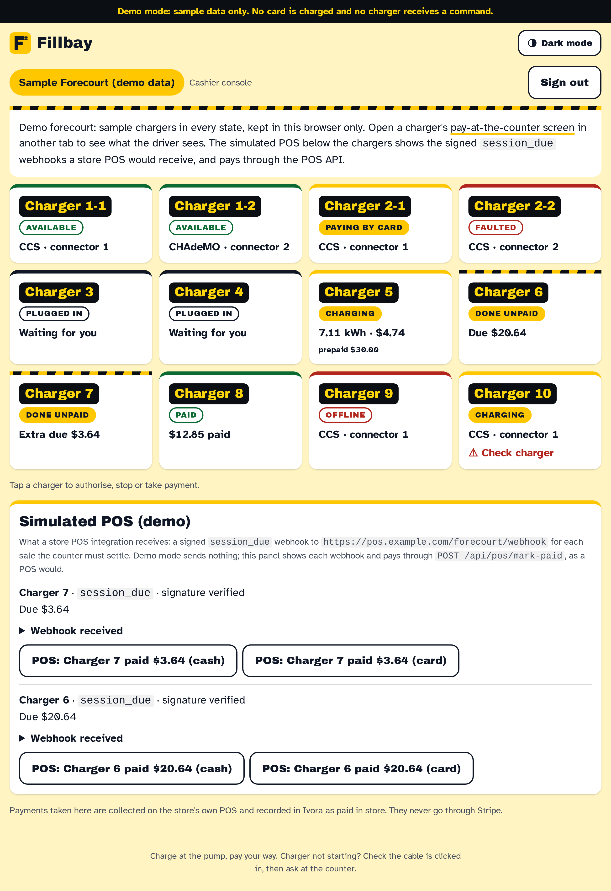
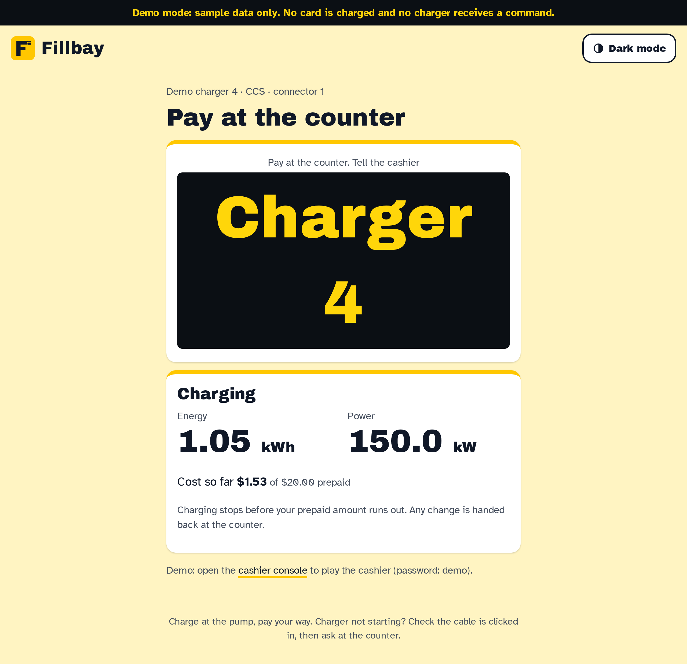
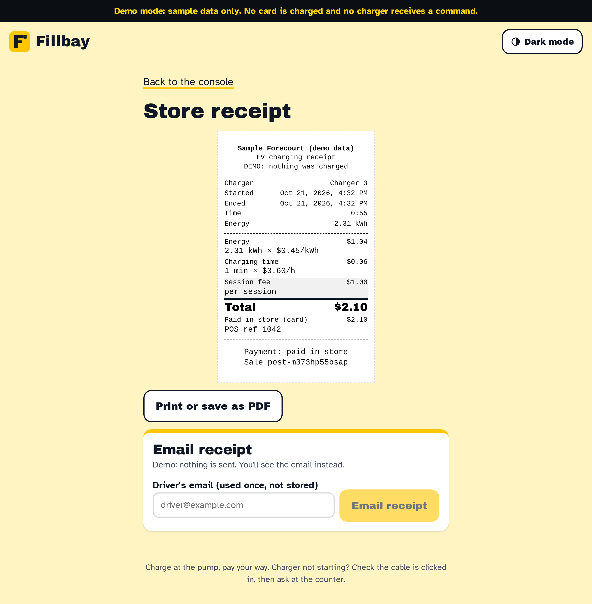
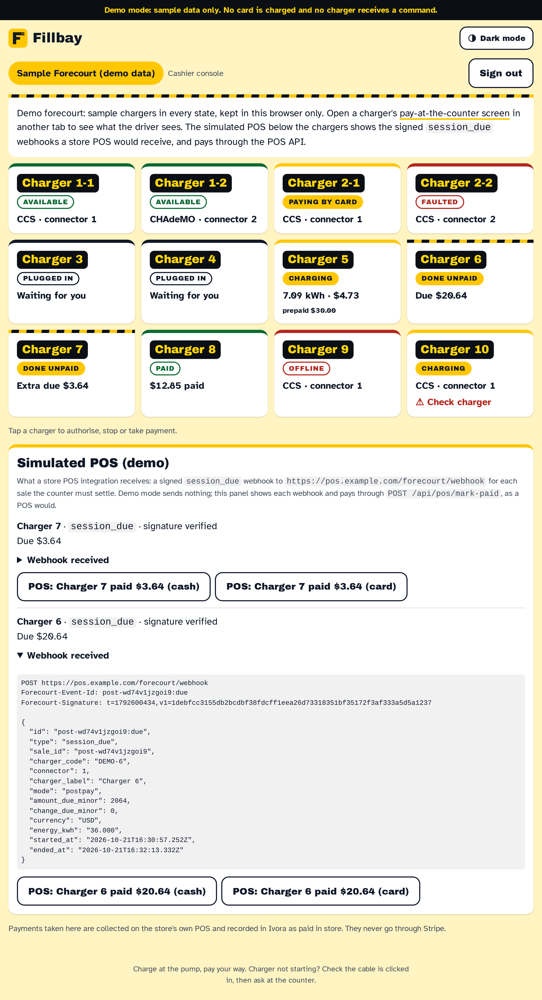

# Forecourt checkout

Ships as **Fillbay**, an original demo brand you can replace in a few minutes (see [Make it yours in 5 minutes](#make-it-yours-in-5-minutes)).

Checkout for fuel stations, convenience stores and retail sites with DC fast chargers, with two ways to pay:

- **Pay at the charger.** A driver scans the QR code on the charger with their phone, sees the price, pays with a card, Apple Pay or Google Pay, watches the session live and gets a receipt. No app, no account. When the car is full, the page asks the driver to move it and counts down to the idle fee.
- **Pay in store, like fuel.** The driver picks "Pay at the counter" on the same QR page and tells the cashier "Charger 3". On a tablet-first cashier console, the cashier either takes a prepayment on the store's own POS and starts the charger, or authorises a plugged-in car and takes payment when it's done. The console shows change to hand back, any amount still due, and prints an 80 mm receipt. The driver's phone shows the session live.

A convenience-store POS can join in: the app sends it a signed `session_due` webhook when a sale needs the counter, and the POS marks it paid through a small REST API. The console can also email the store receipt.

Site staff get password-protected pages for prices per charger, today's sessions and revenue (card and paid in store), and recent faults. Cashiers get their own password that can authorise, stop and take payment, but cannot change prices or settings.

It is built on the [Ivora API](https://ivoracharge.com/developers/guides) and Stripe, and it follows the shared [template conventions](../docs/conventions.md).

## Demo

| Charger page                                               | Move your car                                           | Receipt                                                       |
| ---------------------------------------------------------- | ------------------------------------------------------- | ------------------------------------------------------------- |
|  |  |  |



| Cashier console                                                   | Pay at the counter (driver)                                            | Store receipt (80 mm)                                             |
| ----------------------------------------------------------------- | ---------------------------------------------------------------------- | ----------------------------------------------------------------- |
|  |  |  |



All screenshots are demo mode: sample data, nothing charged, no charger contacted, no webhook or email sent.

Light and dark, desktop (1440 px) and phone (390 px): [charger](docs/screens/charger-phone-light.png) ([dark](docs/screens/charger-phone-dark.png)), [cashier console](docs/screens/cashier-desktop-light.png) ([dark](docs/screens/cashier-desktop-dark.png)), [operator](docs/screens/operator-desktop-light.png) ([dark](docs/screens/operator-desktop-dark.png)) and [home](docs/screens/home-phone-light.png) ([dark](docs/screens/home-phone-dark.png)); every capture is in [docs/screens](docs/screens), including the cashier console on a tablet in landscape and portrait. Regenerate them all from the demo with `npm run screenshots` (Playwright, light and dark, 1440 px and 390 px).

Accessibility: `tests/e2e/a11y.spec.ts` runs axe (WCAG 2 A/AA) over the landing, charger, counter, operator and cashier screens in light and dark, and checks that nothing scrolls sideways at 390 px.

## Make it yours in 5 minutes

Everything brand-specific lives in [`brand/`](brand). Components use only its tokens.

1. **Name and copy:** `brand/brand.ts` (`name`, `tagline`, `support`). Renaming is one line.
2. **Colours, type scale, radius and spacing:** `brand/tokens.css`. Each colour is `light-dark(<light>, <dark>)`; `npm test` checks every text pair against WCAG AA in both modes (`tests/contrast.test.ts`).
3. **Logo:** `brand/logo.svg`, and the same mark inline in `brand/Logo.tsx` so it follows the theme.
4. **Fonts:** put `.woff2` files in `brand/fonts/` and point `brand/fonts.ts` at them (self-hosted through `next/font`, nothing loads from a font CDN).
5. **Theme:** the page follows the system light/dark setting until the header toggle is used; the choice is kept in `localStorage` (key in `src/lib/theme.ts`).

The design brief and mocks are in `brand/BRIEF.md` and `docs/brief/`.

### Fonts and icons

- [Archivo Black](https://fonts.google.com/specimen/Archivo+Black) and [Atkinson Hyperlegible](https://fonts.google.com/specimen/Atkinson+Hyperlegible), both under the SIL Open Font License 1.1 (`brand/fonts/OFL-*.txt`).
- The Fillbay mark and the few icons (theme toggle) are original SVGs, released with this template under Apache-2.0.
- Fillbay is a made-up demo name, not a real product.

## Run locally

Demo mode needs no credentials and works offline. Use Node.js 22.

```sh
cd forecourt-checkout
npm ci
npm run dev
```

Open http://localhost:3000 and pick a demo charger, as if you had scanned its QR code. The demo runs a whole session from scan to receipt: the hold, charging with live kWh, power and running cost, the "move your car" countdown, and the receipt. Demo time runs 30 times faster, so the simulated car is full after about 50 seconds. The operator pages are at `/operator`; the demo password is `demo`.

The cashier console is at `/cashier` (demo password `demo`). It opens with sample chargers in every state: available, plugged in, charging on a prepayment, done unpaid, a prepayment that ran over, paid, paying by card, offline, faulted, and one charging without a console sale (flagged). Try pay-after on Charger 3 (authorise, stop, mark paid, print) and a $20 prepay on Charger 4, which stops itself before the money runs out and shows the change. Open `/c/DEMO-4/1` in another tab and choose "Pay at the counter" to see the driver's side. Below the chargers, a **simulated POS** shows the signed `session_due` webhooks a store POS would receive (Charger 6 and 7 are due), and its buttons pay through `POST /api/pos/mark-paid` with the demo token `demo-pos-secret`, exactly as a POS would. On a receipt, "Email receipt" shows the email instead of sending it. Demo in-store sales live in a cookie in your own browser (`src/lib/demo-store.ts`), so every visitor gets their own forecourt and nothing is stored on the server.

Demo mode is on whenever a required live variable is missing, or when `DEMO_MODE=1`. It never sends payment requests, charger commands, POS webhooks or emails: demo sessions are answered by `src/lib/demo.ts`, which has no network code, and a unit test fails if demo mode calls `fetch`.

Checks, as CI runs them:

```sh
npm run format:check
npm run typecheck
npm test            # unit tests, no network or credentials
npm run build
npm run test:e2e    # Playwright, demo end to end: card flow on a phone; in-store flows and the simulated POS on desktop and tablet
```

## Connect real services

1. Create an Ivora project for this deployment (one project per deployment; a separate test project for previews) and an API key with the permissions listed under [What it uses from the Ivora API](#what-it-uses-from-the-ivora-api). The new `settlement:write` scope needs explicit opt-in.
2. For each charger, set the station's `external_reference` to your own short code, such as `PUMP-3`. QR codes encode `https://<your domain>/c/<code>/<connector number>`, so you can move hosting or replace a charger without reprinting stickers.
3. Give every connector a tariff in Ivora. The tariff's `authorization_minor` is the card hold for that charger. Prices can then be changed on the operator Prices page.
4. In Stripe, enable Apple Pay and Google Pay under payment methods. Stripe-hosted Checkout shows them to drivers whose phone supports them; no domain verification is needed for hosted Checkout.
5. To take payment in the store, set `CASHIER_PASSWORD` and read [Pay in store](#pay-in-store) first: **every charger must require authorisation** (no free vend, no auto-start on plug-in).
6. Set the environment variables below. Add webhooks: an Ivora webhook to `https://<your domain>/api/webhooks/ivora` for `charging_session.status_changed` and `bill.finalized` (with pay in store, also `meter.sampled` with `"meter": {"sample_interval_seconds": 30}`; see [Stopping at the prepaid limit](#stopping-at-the-prepaid-limit)), and a Stripe webhook to `https://<your domain>/api/webhooks/stripe` for `checkout.session.completed` and `checkout.session.expired` (a Connect webhook if you use a connected account).

| Variable                      | Required | What it is                                                                                                                           |
| ----------------------------- | -------- | ------------------------------------------------------------------------------------------------------------------------------------ |
| `IVORA_API_KEY`               | Live     | Ivora API key for this deployment's project. Server-side only.                                                                       |
| `IVORA_TENANT_ID`             | Live     | Ivora tenant (project) ID, numeric.                                                                                                  |
| `STRIPE_SECRET_KEY`           | Live     | Stripe secret key. Use test mode outside production.                                                                                 |
| `SESSION_SECRET`              | Live     | Signs operator and driver cookies. `openssl rand -hex 32`.                                                                           |
| `OPERATOR_PASSWORD`           | Live     | Password for `/operator`.                                                                                                            |
| `CASHIER_PASSWORD`            | No       | Password for the cashier console at `/cashier`. Setting it turns on pay in store. Cashiers can't change prices or settings.          |
| `POS_API_SECRET`              | No       | Bearer token for `/api/pos/mark-paid` and `/api/pos/sessions`. Unset, they answer 404. `openssl rand -hex 32`.                       |
| `POS_WEBHOOK_URL`             | No       | HTTPS endpoint of your POS for the `session_due` webhook. Unset, no webhook is sent.                                                 |
| `POS_WEBHOOK_SECRET`          | No       | Signs the `session_due` webhook (`Forecourt-Signature`). Required with `POS_WEBHOOK_URL`. `openssl rand -hex 32`.                    |
| `RESEND_API_KEY`              | No       | Turns on emailed receipts, with `RECEIPT_EMAIL_FROM`. Resend is the example provider; see [Emailed receipts](#emailed-receipts).     |
| `RECEIPT_EMAIL_FROM`          | No       | Sender of emailed receipts, on a domain verified with the provider, e.g. `Forecourt <receipts@example.com>`.                         |
| `PUBLIC_BASE_URL`             | Live     | Your own HTTPS origin, used in Stripe return URLs and QR codes.                                                                      |
| `IVORA_WEBHOOK_SECRET`        | Advised  | Verifies the `Ivora-Signature` header on `/api/webhooks/ivora`.                                                                      |
| `STRIPE_WEBHOOK_SECRET`       | Advised  | Verifies Stripe's signature on `/api/webhooks/stripe`.                                                                               |
| `CRON_SECRET`                 | Advised  | Protects `/api/cron/reconcile`, the safety sweep that settles sessions nobody is watching.                                           |
| `STRIPE_CONNECTED_ACCOUNT_ID` | No       | The site operator's Stripe account. With it, payments are direct charges on that account and the deployer takes the application fee. |
| `APPLICATION_FEE_BPS`         | No       | Deployer's application fee in basis points. Default `1000` (10%). `0` to `10000`.                                                    |
| `DEFAULT_HOLD_CENTS`          | No       | Hold when a tariff has no authorization amount. Default `5000` ($50). `50` to `50000`.                                               |
| `IDLE_GRACE_MINUTES`          | No       | Free idle minutes after charging ends. Default `10`.                                                                                 |
| `SITE_NAME`                   | No       | Shown on the operator pages.                                                                                                         |
| `SITE_TIME_ZONE`              | No       | IANA zone for "today" and for tariff time rules. Default `UTC`.                                                                      |
| `TYPICAL_SESSION_KWH`         | No       | The typical session quoted on the charger page. Default `30`.                                                                        |
| `TYPICAL_SESSION_MINUTES`     | No       | Default `25`.                                                                                                                        |
| `IVORA_API_URL`               | No       | Default `https://api.ivoracharge.com`.                                                                                               |
| `DEMO_MODE`                   | No       | `1` forces demo mode.                                                                                                                |
| `TRUSTED_PROXY_HEADER`        | No       | Off Vercel: the header your proxy sets to the client address, for every rate limit. See [Security](#security).                       |

`.env.example` lists them all. Never commit a real `.env` file.

## Deploy

[](https://vercel.com/new/clone?repository-url=https%3A%2F%2Fgithub.com%2FIvora-Charge%2Fivora-examples&root-directory=forecourt-checkout&project-name=forecourt-checkout&env=IVORA_API_KEY,IVORA_TENANT_ID,STRIPE_SECRET_KEY,SESSION_SECRET,OPERATOR_PASSWORD,PUBLIC_BASE_URL)

The deploy runs in demo mode until every live variable is set. Point your own domain at it before printing QR codes; the Prices page refuses to show QR codes for a non-HTTPS or `*.vercel.app` URL. `vercel.json` runs the safety sweep once a day, which works on every Vercel plan; on a paid plan, run it every few minutes.

## How a payment works

This template uses Ivora's **externally funded charging sessions** (application-managed payments), the same path as Squid.

The settlement guides on the developer portal describe two ways to take a driver's money. The ticket asked to prefer **Ivora bills with a payment service** (Ivora-managed payments, `/payment/{service}/...`), so this template would show the path Squid does not use, unless that path cannot carry the site operator's own fee. It cannot today:

- The managed path's documented limits list application fees and marketplace payouts as unsupported, and Ivora takes no application fee on those direct charges.
- The payment request takes only a bill ID and return options, and capture "captures exactly the immutable bill amount" with no amount or fee field. There is nowhere to put the deployer's basis-point fee.
- The hold comes from the tariff with a $0.50 to $100 range, and there is no payment webhook.

With externally funded sessions the app owns the processor integration, so it can place the hold through Stripe Checkout, capture with `application_fee_amount`, and still use Ivora's immutable bill for the amount. If the managed path gains application fees, switching is mostly a matter of replacing `src/lib/server/stripe.ts` and the capture step.

The flow, in `src/lib/server/sessions.ts`:

1. **Pay.** The app reads the station and tariff, then creates a Stripe Checkout Session with manual capture for the hold. Nothing is sent to the charger yet. The Checkout Session ID becomes the app's session ID.
2. **Start.** Once the hold is authorized, the app creates an Ivora externally funded session (`application_reference` = `forecourt:<session id>`, `payment_reference` = the PaymentIntent), starts it with `funding_confirmed: true`, and records an optional `authorization` settlement report.
3. **Charge.** The driver's page polls; each poll reconciles. The app shows Ivora's live `energy_wh`, `power_w` and `estimated_minor`, and stops the session when the running cost reaches 85% of the hold.
4. **Finished.** When the connector reports `SuspendedEV`, `SuspendedEVSE` or `Finishing`, or power falls below 100 W, the page shows "Please move your car" with the idle-fee countdown.
5. **Receipt.** When the transaction ends, the app finalizes the bill, applies the idle grace credit, and captures the amount with the application fee, or releases the hold. It records a `capture` or `release` settlement report.

Every write uses an idempotency key derived from the session ID and the action (`forecourt:<id>:start`, `:capture` and so on), for both Ivora and Stripe. Reconciling is therefore safe to repeat from a poll, a webhook or the cron sweep, on any server instance. No database is needed: the state lives in Stripe (the Checkout Session and PaymentIntent metadata) and in Ivora (the session and its bill).

### Money rules

All amounts are integer cents. Every rounding is half up, once, at a documented point. The code is in `src/lib/money.ts`, with tests in `tests/money.test.ts`.

- **Hold:** the tariff's `authorization_minor`, or `DEFAULT_HOLD_CENTS` when that is not between 50 and 50,000 cents.
- **Bill:** Ivora's final bill, `total_minor`, from the same calculation as the tariff quote.
- **Idle grace:** Ivora bills every idle minute (PARKING_TIME), and the API has no grace-period setting. The app waives the first `IDLE_GRACE_MINUTES` at the bill's lowest idle rate, capped at what the bill charged for idle time. If the car left inside the grace period, the whole idle charge is waived. The receipt shows the credit as its own line.
- **Capture:** `min(bill − grace credit, hold)`. If that is under 50 cents (Stripe's minimum), nothing is charged and the whole hold is released. If it is above the hold, only the hold is charged and the receipt shows the uncollected rest. Charging stops at 85% of the hold, so this should be rare.
- **Application fee:** `captured × APPLICATION_FEE_BPS / 10000`, rounded half up, sent as Stripe's `application_fee_amount` on direct charges to `STRIPE_CONNECTED_ACCOUNT_ID`. Without a connected account there is no fee. The driver's receipt never shows it.

### Units

OCPP 1.6 meter registers are Wh. The app does arithmetic on Ivora's integer `energy_wh` and converts to kWh only for display, in one helper (`src/lib/units.ts`). Power arrives in W and is shown in kW.

## Pay in store

For fuel stations and convenience stores: the driver pays at the counter, and the store takes the money on its own POS (cash or card). That money never touches Stripe or this app. The app only drives the charger and records what happened in Ivora as **settlement reports**, which never move money, so the operator's figures show "paid in store" next to card payments. The flow is in `src/lib/server/store.ts`, the pure rules in `src/lib/store.ts`.

### The cashier console

`/cashier` shows every connector as a large tile, numbered from the station's `external_reference` like a fuel pump (`PUMP-3` is "Charger 3"; stations with several connectors are "Charger 3-1", "Charger 3-2"). Tile states: Available, Plugged in (waiting for the cashier), Starting, Charging (live kWh and cost), Done unpaid, Paid, Paying by card, Offline and Faulted. A tile shows "⚠ Check charger" when the charger is charging without a console sale or card session, or Ivora has a session the app didn't create.

The console polls every 4 seconds. Ivora webhooks move in-store sales forward on the server even when no console or driver screen is open: `meter.sampled` runs the prepaid stop check while charging, and `charging_session.status_changed` and `bill.finalized` finalize the bill and record the prepaid capture. The cron sweep is a backstop. The next poll shows the result. Pushing updates to the tablet would need shared state between server instances, which this template avoids.

### Prepay

1. The store takes cash or card on its POS. The cashier enters the prepaid amount (quick buttons for $10 to $50), or a kWh amount that the console prices with the tariff quote, and confirms.
2. The console creates an Ivora externally funded session (processor `in-store`, `payment_reference` = the sale ID, `application_reference` = `forecourt:store:<sale ID>`), records an `authorization` settlement report for the prepaid amount, then starts it with `funding_confirmed: true`. If the report can't be recorded, the charger is not started.
3. **Ivora does not stop at an external amount, so the app does** (see [Stopping at the prepaid limit](#stopping-at-the-prepaid-limit)). A dollar sale stops when the running cost reaches the prepaid amount less a headroom: the cost of the next minute at the recent power (energy at the session's tariff snapshot per-kWh price, plus the higher of its time and idle rates), but at least 50 cents or 5% of the prepaid amount. A kWh sale stops on energy, half a minute of energy at the recent power (at least 1% of the limit) before it; its prepaid amount (the quote for that energy) is only a safety cap, keeping back just the next minute's cost. Either way the unused amount is handed back as change.
4. When the transaction ends the app finalizes the bill and records a `capture` report for the part the prepaid amount covered, `min(cost, prepaid)`, under its own operation reference `<sale>:capture`.
5. The console shows the change to hand back (prepaid − cost). "Change given" records a `release` report for the unused amount (amount 0, as Ivora's release reports require).
6. **Overrun.** If the session cost more than the prepaid amount (a charger slow to stop, or idle fees after it stopped), the console shows "Used $x more than prepaid" and "Extra due $x". It is never charged or recorded as collected automatically. The cashier decides whether to collect it; "Mark extra paid" records a separate `capture` report.

### Postpay

1. The driver plugs in; the tile shows Plugged in. The cashier taps "Authorise: pay after charging" and the console creates and starts an externally funded session. Pay-after needs the car plugged in, so a charger never waits authorised with nobody there.
2. When the transaction ends, the console shows the amount due from the final bill, idle fees included.
3. "Mark paid" (cash or card on the POS, with an optional POS reference) records a `capture` report for exactly the amount due. **A POS reference must hold no card or customer data**: use the POS's own receipt or transaction number. It is stored in Ivora as part of the operation reference and printed on the receipt.

### Stopping at the prepaid limit

The stop check runs whenever the app reads a prepaid sale: on every `meter.sampled` webhook, every console or driver-screen poll, and the sweep. The webhook is what makes it work with no screen open, so subscribe to `meter.sampled` with a 30-second interval (`"meter": {"sample_interval_seconds": 30}` when you register the endpoint; the default is 60 and the range 10 to 3600). Ivora always delivers a transaction's first and last samples. You can limit the endpoint to your forecourt's stations with `stations`. The headroom looks a minute ahead for money and half a minute for energy, which covers a 30-second sample interval plus the charger's reaction time; a longer interval makes overruns more likely.

**Also set each charger's OCPP `MeterValueSampleInterval` to 30 seconds or less** (a ChangeConfiguration on the charger, or in its own settings). The webhook interval only limits how often Ivora delivers samples; the charger's own interval decides how fresh the energy and running cost are. A charger that reports every 60 or 300 seconds (common defaults) makes the cost estimate lag by that much, and the prepaid stop comes late however often the webhook fires.

The daily sweep (`/api/cron/reconcile`, `vercel.json`) is the backstop for missed webhooks. To tighten it, run it every minute on a paid Vercel plan (`"schedule": "* * * * *"`), or call it from an external scheduler with `Authorization: Bearer $CRON_SECRET`.

If the charger rejects a stop, the app retries it with a new idempotency key (`:stop-2`, then `:stop-3`). If Ivora can't tell whether a stop reached the charger (`unknown`), it is never resent under a new key. In both cases, and when all three attempts fail or Ivora refuses another, the console shows "Stop failed: stop it at the charger" (or "Stop not confirmed") on the tile, and the driver's screen asks the driver to see the cashier.

### The driver's screen

The QR page offers "Pay here by card" (unchanged) and "Pay at the counter: tell the cashier Charger 3". The counter page shows the number large, then live status once the cashier starts the charger: energy, power, cost against the prepaid amount, "please move your car", and finally the amount due or the change to collect.

The counter page's API (`GET /api/counter/<code>/<connector>`) is public, so it answers only what the driver needs (status, energy, time, the amount due or change; no sale ID, payments or POS references), reuses one answer per charger for 5 seconds on each server instance, and allows 60 reads a minute per client. The client address comes from the same trusted source as the logins (see [Security](#security)); without one, there is no per-client limit, since every driver at a busy site would share it, only a site-wide cap of 6,000 reads a minute per server instance that normal polling (one read every 2 seconds or more per driver) can't reach.

### Receipts

"Print receipt" opens `/cashier/receipt/<sale ID>`, laid out for 80 mm thermal paper (named `@page` of 80 mm width): energy, time, rates, idle fee and grace, total, prepaid, change, and the payment as "paid in store" with the method and POS reference.

### Emailed receipts

Optional. With `RESEND_API_KEY` and `RECEIPT_EMAIL_FROM` set, the receipt page has an "Email receipt" form. The cashier types the driver's address; it is sent once to the provider with the receipt and is **never stored**: not in Ivora, a cookie, a URL or the logs (logs show only the sale ID and the provider's message ID). Each tap carries its own idempotency key, so a retry after a timeout doesn't send twice. The form is rate-limited to 20 a minute per signed-in console (its login alone, not the client address, which could be forged), per server instance, so one busy till doesn't hold back the others.

Any provider fits behind the `ReceiptMailer` interface in `src/lib/server/mailer.ts` (one `send()` method); `ResendMailer` is the example. To use another provider, implement the interface and return it from `receiptMailer()` in `src/lib/server/services.ts`. Demo mode has no mailer at all and shows the email that would be sent instead; a unit test checks that demo mode never sends.

### Money rules in store

- Integer cents throughout. The amount owed is Ivora's final bill less the same idle grace credit as card payments. There is no 50-cent minimum: that is a card rule.
- Reports per sale, each with its own operation reference and an idempotency key `forecourt:store:<sale ID>:report:<step>`: `authorization` (prepaid amount, reference `<sale>`), `capture` (prepaid part, `<sale>:capture`, a distinct operation from the authorization), `capture` (postpay `<sale>:paid:<method>[:<POS ref>]` or overrun `<sale>:extra:...`) and `release` (change, `<sale>:change`). Captures never exceed the final bill. Mark-paid only accepts exactly the outstanding amount; repeating it is a no-op, and a different amount after payment is refused.
- In-store sales carry no application fee, because they never pass through Stripe.

### Safety

- **Chargers must require authorisation.** Turn off free vend and auto-start on plug-in, or a car can charge without a sale. The console flags any connector charging without a console sale or card session.
- A charger is only started by the cashier's "Authorise" or "Confirm … paid and start", which require the cashier (or operator) cookie. Reading a sale never starts it: a session that was created but not started (for example after a lost response) is canceled after 2 minutes, and the cashier taps again.
- Starts, stops, cancels, finalizes and reports use idempotency keys from the sale ID and action (`forecourt:store:<sale ID>:start`, `:stop` and so on). The same tap reuses the same sale ID, so a retry after a timeout never starts twice. A stop the cashier presses and the automatic prepay stop share one key per attempt.
- Idle fees apply in both flows with `IDLE_GRACE_MINUTES`.
- The cashier password is separate from the operator one. A cashier can authorise, stop and mark paid; the operator pages (prices, settings) stay closed to it. An operator can also use the console. Both logins are rate-limited per client, separately (10 attempts per 15 minutes per server instance). The client address comes only from a trusted source: on Vercel, Vercel's own `x-vercel-forwarded-for`; elsewhere, set `TRUSTED_PROXY_HEADER` to the header your proxy or CDN sets (for example `cf-connecting-ip`, or `x-forwarded-for` from a proxy that appends to it; the last entry is used). A plain `x-forwarded-for` from the client is never trusted, since it could be rotated for unlimited guesses. The same source keys the POS and driver-screen limits (`src/lib/server/client.ts`). Without a trusted source, every caller shares one bucket per role, so guessing stays limited, but a single shared bucket can lock out real cashiers while the login is under attack. Changing `CASHIER_PASSWORD` signs every cashier out; logging out only accepts same-origin requests.

### What is stored

Nothing new. A sale's terms (mode, prepaid amount, kWh limit) are encoded in its sale ID, which is Ivora's `payment_reference`, for example `pre-2000-0-3fa9c01b77de` or `post-3fa9c01b77de`; only this server creates those sessions, with its API key. Payments, change and overruns are read back from Ivora's settlement reports.

Ivora's session list is ordered by opaque session ID, not time, so finding the open sales means reading every page. Each server instance keeps an **index of open and last-day sessions** (`src/lib/server/session-index.ts`) and rebuilds it at most once a minute; console polls, the driver's screen, meter samples and the POS list read the index, not the whole history. Wherever the sale is known, the app looks it up directly by `application_reference` instead: cashier actions, receipts, POS mark-paid, and the console, which names the sales it has shown on each poll so an instance that hasn't indexed a sale yet (it was authorised through another instance) finds it at once. A charger that is busy with no session the index knows, a meter sample for an unknown transaction, or any meter sample without a transaction ID (even at a station where the index already knows a sale on another connector) triggers an early rebuild, at most every 15 seconds. So a prepaid sale authorised through another instance is checked within about 15 seconds, not at the next one-minute rebuild. Unpaid sales older than 24 hours drop off the "Unpaid sales" list; they stay in Ivora's records.

### Point-of-sale integration

The integration point for convenience-store POS systems, with no specific vendor. The POS learns when a sale needs the counter from a signed webhook, and tells the app it took the money through a REST call. Both are optional and independent.

**Outbound: `session_due` webhook.** With `POS_WEBHOOK_URL` and `POS_WEBHOOK_SECRET` set, the app POSTs JSON to your POS when an in-store sale finishes and the counter has something to do: a pay-after sale with its amount due, a prepaid sale that ran over (the extra due), or a prepaid sale with change to hand back (`amount_due_minor` 0). Settled sales send nothing.

```http
POST /your/pos/endpoint
Content-Type: application/json
Forecourt-Event-Id: post-3fa9c01b77de:due
Forecourt-Signature: t=1792561776,v1=6dc9ddd4…

{"id":"post-3fa9c01b77de:due","type":"session_due","sale_id":"post-3fa9c01b77de",
 "charger_code":"PUMP-3","connector":1,"charger_label":"Charger 3","mode":"postpay",
 "amount_due_minor":1940,"change_due_minor":0,"currency":"USD","energy_kwh":"36.042",
 "started_at":"2026-10-20T15:00:00.000Z","ended_at":"2026-10-20T15:30:00.000Z"}
```

- Money is integer minor units; `energy_kwh` is a decimal string from the charger's Wh; times are ISO 8601 UTC. There is no card data and no personal data.
- The signature is the same scheme as Ivora's `Ivora-Signature`: `v1` is the hex HMAC-SHA256 of `<t>.<raw body>` with `POS_WEBHOOK_SECRET`. Verify it over the raw bytes, in constant time, and reject timestamps more than five minutes old.
- Answer `2xx` quickly. Failures (network, timeout, `408`, `429`, `5xx`) are retried three times a few seconds apart, then again after 1 minute, 5 minutes, 30 minutes and 2 hours, on the next read of the sale or the next sweep (`/api/cron/reconcile`), whichever comes first. A delivery cut off by the route's time limit is retried the same way once it has been in flight for 60 seconds. Other `4xx` answers are not retried. Retries carry the same event ID and body with a fresh `t`.
- Delivery state is kept in memory per server instance, so a restart can lose a pending retry. **Poll `GET /api/pos/sessions?status=due` as a backstop** (every minute or so while the store is open) and treat a sale listed there like a `session_due` event with the same `sale_id`.
- **De-duplicate by event ID.** It is stable per sale, and a delivery can arrive more than once (a retry, or another server instance).

Verifying in Node.js:

```js
import { createHmac, timingSafeEqual } from "node:crypto";

function verify(rawBody, header, secret) {
  const parts = Object.fromEntries(header.split(",").map((p) => p.split("=")));
  if (!/^\d+$/.test(parts.t ?? "") || !/^[a-f0-9]{64}$/.test(parts.v1 ?? ""))
    return false;
  if (Math.abs(Date.now() / 1000 - Number(parts.t)) > 300) return false;
  const expected = createHmac("sha256", secret)
    .update(`${parts.t}.${rawBody}`)
    .digest("hex");
  return timingSafeEqual(Buffer.from(expected), Buffer.from(parts.v1));
}
```

**Inbound REST.** With `POS_API_SECRET` set (and pay in store on), the POS calls the app with `Authorization: Bearer <POS_API_SECRET>`, compared in constant time. Both endpoints are rate-limited per client (30 and 60 a minute per server instance), and the logs show only sale IDs, never the token. The client address comes from the same trusted source as the logins (see [Security](#security)). Without one, every caller shares one bucket per endpoint, so token guessing stays limited, but a flood of guesses can then hold back the real POS too; set `TRUSTED_PROXY_HEADER` off Vercel to avoid that.

`POST /api/pos/mark-paid` records that the POS took the money, through the same `markSalePaid()` as the console's "Mark paid", so Ivora gets exactly the same settlement report. `amount_minor` must be what the final bill leaves to collect (the `amount_due_minor` from the webhook, or from the sessions list).

```sh
curl -X POST https://charge.example.com/api/pos/mark-paid \
  -H "Authorization: Bearer $POS_API_SECRET" \
  -H "Content-Type: application/json" \
  -d '{"sale_id":"post-3fa9c01b77de","amount_minor":1940,"method":"card","pos_reference":"R-1042"}'
# 200 {"sale_id":"post-3fa9c01b77de","status":"paid","amount_minor":1940,"method":"card","pos_reference":"R-1042","currency":"USD"}
```

| Answer              | When                                                                                                                                                                                                             |
| ------------------- | ---------------------------------------------------------------------------------------------------------------------------------------------------------------------------------------------------------------- |
| `200`               | Recorded, or a repeat with the same amount, method and POS reference (the original result, nothing recorded twice)                                                                                               |
| `409`               | `idempotency_conflict`: the sale is already paid with different values; `session_not_finished`: no final bill yet; `nothing_due`: nothing to collect (for example, a prepaid sale with only change to hand back) |
| `422`               | `amount_mismatch`: the amount isn't what the final bill leaves to collect                                                                                                                                        |
| `400`               | Malformed body; `pos_reference` may only use letters, digits, `.`, `-` and `_` (never card or customer data)                                                                                                     |
| `401`, `404`, `429` | Wrong token; endpoints off or unknown sale; rate limited                                                                                                                                                         |

`GET /api/pos/sessions?status=due|charging|paid[&limit=1-50]` lists recent in-store sales (last 24 hours, newest first) for a POS screen. It never marks a sale paid, but like every read it moves a sale forward the way a console poll does: it may stop a prepaid sale at its limit, finalize the bill when charging ends, and record the prepaid capture in Ivora.

```sh
curl "https://charge.example.com/api/pos/sessions?status=due" \
  -H "Authorization: Bearer $POS_API_SECRET"
# {"status":"due","data":[{"sale_id":"post-3fa9c01b77de","status":"due","charger_code":"PUMP-3","connector":1,
#   "charger_label":"Charger 3","mode":"postpay","prepaid_minor":null,"amount_due_minor":1940,"change_due_minor":0,
#   "change_given":false,"cost_minor":1940,"currency":"USD","energy_kwh":"36.000","started_at":"…","ended_at":"…","payments":[]}]}
```

The in-process seam is still there for integrations inside the app: `saleEvents` in `src/lib/server/sale-events.ts` emits `sale.due` with the same stable event ID.

## What it uses from the Ivora API

| Endpoint                                                                             | Used for                                        |
| ------------------------------------------------------------------------------------ | ----------------------------------------------- |
| `GET /v1/tenants/{tenant_id}/stations?external_reference=`                           | Resolve a QR code to a station and connector    |
| `GET /v1/tenants/{tenant_id}/stations`, `GET .../stations/{station_id}`              | Connector status, idle detection, operator list |
| `GET /v1/tenants/{tenant_id}/tariffs/{tariff_id}`, `PATCH` the same                  | Price breakdown; operator price changes         |
| `POST /v1/tenants/{tenant_id}/tariffs/{tariff_id}/quote`                             | Typical-session estimate on the charger page    |
| `POST /v1/tenants/{tenant_id}/charging-sessions`, `GET` with `application_reference` | Create and recover externally funded sessions   |
| `POST .../charging-sessions/{id}/start`, `/stop`, `/cancel`, `/finalize`             | Start, stop, cancel and bill a session          |
| `POST .../charging-sessions/{id}/settlement-reports`                                 | Card audit trail; the in-store money record     |
| `GET .../charging-sessions/{id}/settlement-reports`                                  | What was paid in store, change given            |
| `GET /v1/tenants/{tenant_id}/stats`                                                  | Today's sessions, energy and billed revenue     |
| `GET /v1/tenants/{tenant_id}/stations/{station_id}/faults`                           | Recent faults                                   |
| Webhooks: `charging_session.status_changed`, `bill.finalized`                        | Settle a session as soon as it changes          |
| Webhook: `meter.sampled` (pay in store)                                              | Stop a prepaid sale at its limit                |

API key permissions documented on the portal: `stations:read`, `stations:control` (start and stop), `billing:read` (sessions, quotes, revenue), `billing:write` (create, finalize and cancel sessions) and `settlement:write` (create sessions and reports). Pay in store needs no extra permission: it uses the same session, command and settlement report endpoints, and reads reports back; check the portal for the scope that reads settlement reports. Editing prices also writes tariffs; check the portal for the permission your key needs. The app sends `Ivora-Version: 2026-10-15` so tariff elements and bill breakdowns are present.

Errors show the API's code and request ID with a link to [Errors and statuses](https://ivoracharge.com/developers/guides/reference/errors). On `429` the client waits once for a short `Retry-After` and otherwise reports `rate_limited`. `request_in_progress` and `outcome_unknown` are retried on the next poll with the same key.

## Card terminals (planned)

Payment terminals are out of scope for now. `src/lib/terminal.ts` defines the `CardTerminalAdapter` interface a terminal integration would implement (present a hold, capture, release, show a receipt), so a card tap can drive the same session flow as the phone. The included `PlannedTerminalAdapter` refuses every call, so a half-wired terminal can never take money.

## Limits and next steps

- **USD only**, like Ivora bills today.
- **No database.** Session state lives in Stripe and Ivora; in-store sales live in Ivora only (see [What is stored](#what-is-stored)). The webhook de-duplicates per server instance (reconciling is idempotent, so a duplicate on another instance is harmless).
- **10,000-session ceiling.** A full read of the session list stops at 100 pages of 100 sessions. The session index, the operator "today" view and the daily sweep use full reads, so in a project with more sessions an open sale can be missed by them: the console shows a red banner when that happens, and the cron response says `"truncated": true`. Sales the app looks up by reference (console sales it has shown, cashier and POS actions, receipts) are unaffected. Use one Ivora project per deployment as the conventions ask, and start a new project before you reach the ceiling.
- **Webhooks to the POS are per instance.** Each server instance remembers which `session_due` events it delivered, in memory, so a cold start or another instance may send one again, and a restart can drop a pending retry. POS systems must de-duplicate by event ID and poll `GET /api/pos/sessions?status=due` as a backstop.
- **Idle after the transaction ends is not billed.** Ivora prices idle time inside the charging transaction. If the driver presses "End session" while still parked, the idle fee stops too.
- **Idle detection while charging is approximate.** The countdown starts when the app first sees the connector idle; the final idle fee comes from Ivora's bill, which uses the charger's own reports.
- **Holds expire.** Card authorizations last about 7 days with most issuers. The daily sweep settles abandoned sessions well before that; run it more often on a paid plan.
- **Conditional prices** (time of day, power or energy bands) are priced correctly by Ivora but can't be edited on the Prices page; edit them through the API.
- **Refunds** are not in the UI; issue them in the Stripe Dashboard.
- **Prepaid overrun.** The headroom stop makes it rare, but a charger that is slow to stop, a missed meter sample, a rejected stop, or idle time after a stop can cost more than was prepaid. The console shows it and the cashier decides; it is never collected automatically.
- **Pay in store needs chargers that require authorisation.** With free vend or auto-start, cars can charge without a sale; the console can only warn.
- **The console polls.** Webhooks keep sales moving on the server; the tablet sees changes within a few seconds.
- **Next steps:** card terminal adapter, partial refunds, a database for longer history, per-site multi-tenant operator accounts, and switching to Ivora-managed payments once that path supports application fees.

## License

[Apache-2.0](../LICENSE)
