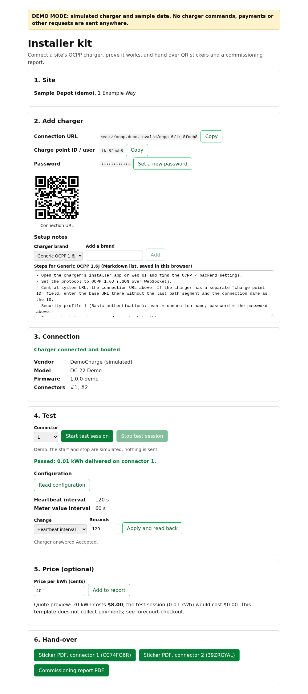

# Installer kit

For installers and hardware sellers: connect a site's OCPP 1.6J charger to Ivora, prove it works, and hand the site QR stickers and a one-page commissioning report, in minutes and with no new hardware.

1. **Site:** pick an existing Ivora location or create one (name and address).
2. **Add charger:** registers the station, sets its connection password, and shows the connection URL, charge point ID and password with copy buttons and QR codes to scan from your phone. The password is shown **once**: afterwards the app only has a mask, and you can set a new password but never see the old one. Setup notes are an editable Markdown list per brand, starting with generic OCPP 1.6J steps (saved in your browser).
3. **Wait for connection:** live status from webhooks (`station.connected`, `station.booted`, `station.disconnected`) and polling every 2 seconds. Shows vendor, model, firmware and connectors once the charger boots, with troubleshooting hints for a wrong URL, a wrong password or no network.
4. **Test:** remote start and stop of a short session on a chosen connector, with energy delivered (kWh). Reads the heartbeat and meter value intervals back from the charger, and can change either and read it back again.
5. **Price (optional):** a per-kWh price in integer cents with a quote preview, recorded on the report.
6. **Hand-over:** a printable QR sticker PDF per connector and a commissioning report PDF (charger details, test result, configuration, date).

This template collects no payments. For paid charging, see [forecourt-checkout](../forecourt-checkout) and [Squid](https://github.com/Ivora-Charge/squid).



## Run locally

```bash
npm ci
npm run dev
```

Open http://localhost:3000. With no credentials the app runs in **demo mode**: it works offline, a simulated charger connects about two seconds after "Add charger", boots two seconds later and passes the test. Demo never sends charger commands, payments or any other request; everything is answered by `src/lib/server/demo-backend.ts`, and a unit test fails if demo mode calls `fetch`. Demo stickers use the current address and are marked "DEMO - NOT FOR PRINTING".

Checks (the same as CI):

```bash
npm run format:check && npm run typecheck && npm test && npm run build
npm run test:e2e   # drives the demo in Chromium; run after build
```

## Connect real services

Copy `.env.example` to `.env.local` and fill it in. Use a separate Ivora project (and API key) for each deployment, and a test project for previews and local work.

| Variable               | Required for live | Purpose                                                                                                                     |
| ---------------------- | ----------------- | --------------------------------------------------------------------------------------------------------------------------- |
| `IVORA_API_KEY`        | Yes               | API key of this deployment's project. Server-side only; empty means demo mode.                                              |
| `IVORA_TENANT_ID`      | Yes               | Your numeric tenant ID. Server-side only.                                                                                   |
| `OPERATOR_PASSWORD`    | Yes               | At least 12 characters. Live mode refuses to run without it.                                                                |
| `QR_BASE_URL`          | For stickers      | Your own stable HTTPS origin, for example `https://charge.example.com`. Live mode prints no stickers until it is set.       |
| `IVORA_WEBHOOK_SECRET` | Recommended       | Signing secret of the webhook endpoint `https://<your domain>/api/webhooks/ivora`. Without it the wizard relies on polling. |
| `IVORA_API_URL`        | No                | Defaults to `https://api.ivoracharge.com`.                                                                                  |
| `DEMO_MODE`            | No                | `1` forces demo mode.                                                                                                       |

### Operator access

Live mode can register stations, set charger passwords and start and stop charging, so the whole app sits behind an operator password:

- `OPERATOR_PASSWORD` is compared in constant time; sign-in sets a signed, httpOnly, `SameSite=Strict` cookie valid for 12 hours. Changing the password signs everyone out.
- Every write must come from the app's own origin (the `Origin` header is checked), so other sites cannot drive it with an operator's cookie.
- Sign-in failures are limited to five a minute per instance.
- If live credentials are set but `OPERATOR_PASSWORD` is missing or shorter than 12 characters, the app shows a setup message and every API route answers `503 operator_password_missing`.

This is one shared password for a small team. For named accounts, put the app behind your own sign-in (for example your identity provider) and keep the operator password as a second gate.

### Webhooks

Register `https://<your domain>/api/webhooks/ivora` in your Ivora project for `station.connected`, `station.booted` and `station.disconnected`, and set `IVORA_WEBHOOK_SECRET` to the signing secret. The route verifies `Ivora-Signature: t=<unix>,v1=<hex>` (HMAC-SHA256 of `<t>.<raw body>`) in constant time, rejects timestamps more than five minutes away, checks the tenant, and processes each event ID once. Events only nudge the status sooner; the wizard still reads the station from the API.

## Deploy

[](https://vercel.com/new/clone?repository-url=https%3A%2F%2Fgithub.com%2FIvora-Charge%2Fivora-examples&root-directory=installer-kit&env=OPERATOR_PASSWORD,QR_BASE_URL,IVORA_API_KEY,IVORA_TENANT_ID,IVORA_WEBHOOK_SECRET)

Then point your own domain at the deployment and set `QR_BASE_URL` to it. Do not use the `*.vercel.app` address for stickers: it changes if you rename or move the project, and the app refuses it.

## Why QR codes use your own domain

Stickers point to `QR_BASE_URL/s/<code>`, where `<code>` is a random eight-character code this app assigns per connector. It is not a station ID or any Ivora ID. A sticker stays on a wall for years. Because the URL is on your domain and the code is yours, you decide where it leads: you can change hosting, move the site to another charging platform or re-map a replaced charger without reprinting anything. The app therefore refuses to print codes on:

- Ivora domains (`ivoracharge.com`, `ivoracharge.co` and any subdomain),
- hosting providers' default domains such as `*.vercel.app`, and link shorteners,
- `http://`, localhost and IP addresses.

`/s/<code>` is a placeholder landing page; connect it to your charging or payment flow.

## What it uses from the Ivora API

All calls go from the server to `https://api.ivoracharge.com` ([OpenAPI](https://api.ivoracharge.com/openapi.json), [guides](https://ivoracharge.com/developers/guides)), under `/v1/tenants/{tenant_id}/`:

| Step        | Endpoint                                                                                                                        | Scope                              |
| ----------- | ------------------------------------------------------------------------------------------------------------------------------- | ---------------------------------- |
| Site        | `GET locations`, `POST locations`                                                                                               | `stations:read/write`              |
| Add charger | `POST stations`, `PUT stations/{id}/credentials` (while the new station is offline)                                             | `stations:write`                   |
| Connection  | `GET stations/{id}`, webhooks                                                                                                   | `stations:read`                    |
| Test        | `POST stations/{id}/commands` (`start`, `stop`), `GET transactions?station_id=`, `GET transactions/{id}`, `GET operations/{id}` | `stations:control`, `billing:read` |
| Config      | `POST stations/{id}/configuration/refresh`, `GET stations/{id}/configuration?key=`, `POST stations/{id}/configuration`          | `stations:control`                 |

- Every write sends an `Idempotency-Key` derived from this app's record and action (for example `<charger>:test:2:start`). Retries after `429`, `5xx`, a lost response, `request_in_progress` or `outcome_unknown` reuse the same key; other `4xx` errors are not retried. `429` waits for `Retry-After` when it is 10 seconds or less, otherwise the error goes back to the operator.
- Locations and stations carry an `external_reference`, so an uncertain create is adopted instead of duplicated.
- Errors show the API's code, message and request ID with a link to [Errors and statuses](https://ivoracharge.com/developers/guides/reference/errors).
- The test session starts with the operator ID tag `INSTALLER-TEST`. A start is an operator command and authorizes no payment. Energy is 0 kWh if no vehicle is plugged in; the test passes when the charger accepts the remote start and stop and reports the transaction.
- Units: OCPP 1.6 meter registers are Wh, session energy is shown in kWh (`src/lib/units.ts`), and money is integer cents.

## Limits and next steps

- **State is in memory** (sites, chargers, sticker codes, webhook event IDs), so it is lost on restart and not shared between serverless instances. Before printing real stickers, move `src/lib/server/store.ts` to a database: the code-to-connector map must outlive the deployment.
- **Firmware** comes from the `station.booted` webhook; the station record does not include it, so without webhooks it shows "reported at boot".
- **Password changes on a connected charger** need `stations:admin`; this app sets the password while the new station is offline and suggests setting a new one before the charger connects.
- Setup notes are stored in the browser only.
- The price is a preview recorded on the report; it does not create an Ivora tariff.
- Live mode is covered by unit tests against a mocked API, not by runs against a real project.
- The sticker PDF code was written for this template (Squid's sticker code was not reused).
